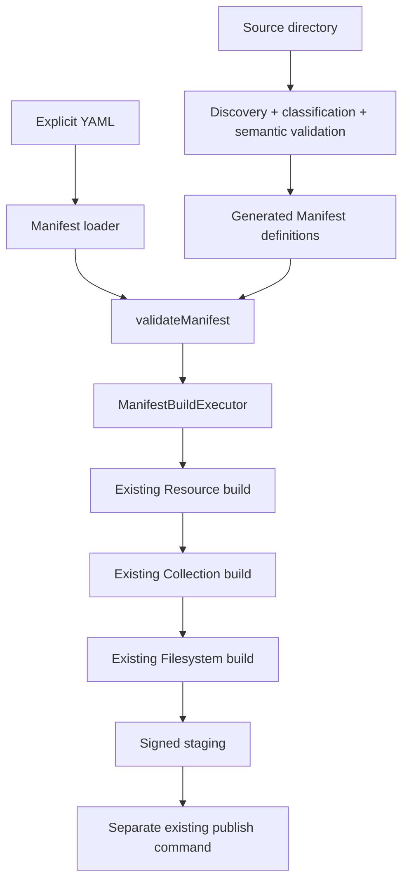

# Filesystem Recursive Import and Automatic Resource Discovery

## Status and scope

**Active architectural specification.** The CLI implements a first vertical slice for recursively importing **Normalized Document** (`.nd.json`) files. Automatic mixed-type discovery, generic media, and integration with explicit Resource definitions remain **deferred**. Sections describing those capabilities are normative design direction, **not claims of existing implementation**.

This specification preserves both the implemented contracts and the broader design rationale. It extends the existing manifest-driven Resource build system; it does **not** introduce a second Resource build, staging, storage, Filesystem, or publication pipeline.

The existence of automated staging/publication integration tests is not evidence of a successful publication against live Blossom and Nostr services. Check actual CLI test/build results separately.

### Implemented Normalized Document entrypoint

```bash
kjvonly import normalized-documents ./content \
  --manifest ./publication.yaml \
  --root library \
  --output-manifest ./publication.generated.json
```

The import command **builds and stages**, but does not publish. Publication remains a separate operation using the **generated** Manifest:

```bash
kjvonly publish ./publication.generated.json
```

The input YAML must be a **configuration-only Manifest**, with no Resources, Collections, or Filesystems. The command does not rewrite that input. The generated JSON Manifest retains the Resource definitions required by the ordinary publisher, including Blossom-backed Resources.

For the current command, only `.nd.json` files are selected; hidden paths, symlinks, and unrelated files are skipped. Empty selections and invalid selected documents fail the batch. The source files can live in a different directory from the YAML and output Manifest. Publication uses the signed staging generation identified by the generated Manifest.

Related current documentation:

- [`../README.md`](../README.md) — CLI commands and publication workflow
- [`normalized-content-parsing.md`](normalized-content-parsing.md) — Normalized Content parsing
- [`../../../docs/03_implementation/tooling/001-resource-publishing-cli.md`](../../../docs/03_implementation/tooling/001-resource-publishing-cli.md) — Resource publishing pipeline
- [`../../../docs/03_implementation/tooling/002-filesystem-overlays.md`](../../../docs/03_implementation/tooling/002-filesystem-overlays.md) — Filesystem Resource contract

---

# 1. Purpose

The CLI currently builds Resources, Collections, and Filesystems from explicit semantic YAML manifests.

The first directory workflow imports Normalized Documents; the broader goal is to support a directory containing multiple recognized semantic families and ordinary media, preserving its hierarchy through the standard publishing lifecycle.

Conceptually:

```text
source directory
    ↓
recursive walk
    ↓
automatic classification
    ↓
ordinary Resource definitions
    ↓
ordinary Filesystem placements
    ↓
existing Resource build
    ↓
existing Collection build
    ↓
existing Filesystem build
    ↓
existing staging/publication
```

The desired user model is similar to a cloud-drive client:

```text
local directory tree
    ↕ mirrors
application Filesystem tree
    ↕ stable Resource identities
published replaceable Resources
```

The import system should preserve the user's directory organization rather than requiring every file to be enumerated manually in YAML.

---

# 2. Primary Goals

The end-state design should provide (not all items are implemented in the first slice):

```text
recursive directory discovery
one discovered file → one logical Resource
automatic semantic type recognition
automatic semantic version validation
generic media classification
stable Resource identity derived from visible path
Filesystem placement that mirrors the source tree
large-file-safe processing
inline-versus-external storage policy
reuse of existing manifest validation
reuse of existing Resource builders
reuse of existing Filesystem builder
reuse of existing staging and publication
```

The importer should support both strongly semantic application data:

```text
Bible Chapters
Strong's definitions
Bible paragraphs
pericopes
Normalized Documents
other registered KJVOnly semantic contracts
```

and ordinary media/files such as:

```text
PDF
MP3
audio
MP4/video
images
other supported generic file types
```

---

# 3. Non-Goals

Recursive import must not create parallel implementations of:

```text
Resource signing
Resource event construction
Resource staging
Collection construction
Filesystem content construction
Filesystem event construction
Blossom publication
Nostr publication
Resource publication ordering
```

Discovery determines what ordinary manifest/build inputs should exist.

The existing build system remains responsible for turning those inputs into published Resources.

---

# 4. Core Architectural Rule: Discovery Compiles Into Manifest

The current CLI already has a normalized application model for build intent:

```text
Manifest
```

The YAML file is only one way to create that model.

Recursive discovery is another way to create it for the implemented Normalized Document slice; the same convergence rule applies to later content types.

The desired convergence point is:



There should not be a durable parallel model such as:

```text
DiscoveredImportPlan
    ↓
special discovered Resource builder
    ↓
special discovered publisher
```

Internal discovery objects are acceptable while a directory is being inspected, but the durable build handoff is the existing `Manifest` model.

---

# 5. BuildManifest Responsibility Split

The shared build execution has been extracted into `ManifestBuildExecutor`.
`BuildManifestUseCase` now loads a YAML Manifest and delegates execution to it.
The Normalized Document import use case also calls that executor with an
in-memory, validated Manifest.

The two entrypoints are:

```text
Manifest file entrypoint
    ↓
ManifestLoader
    ↓
Manifest build executor

Directory import entrypoint
    ↓
Recursive discovery
    ↓
Manifest compiler
    ↓
Manifest build executor
```

The shared executor receives:

```ts
interface ManifestBuildInput {
    readonly directory: string;
    readonly manifest: Manifest;
    readonly origin: string;
}
```

The important requirement is ownership:

```text
input acquisition / discovery
    ≠
Manifest execution
```

Both entrypoints must terminate at the same Manifest execution capability.

---

# 6. Existing SourceExpander Remains Narrow

`SourceExpander` currently expands one already-semantic `ResourceDefinition` into concrete source files.

That responsibility should remain unchanged.

It should not become a recursive semantic classifier.

A recursive source tree may contain:

```text
Bible Chapter JSON
Normalized Document JSON
MP3
MP4
PDF
image
Strong's data
```

Those files require different Resource definitions.

Therefore recursive classification must happen **before** `SourceExpander`.

The established direction is:

```text
recursive discovery
    ↓
one generated ResourceDefinition per discovered file
    ↓
existing SourceExpander
    ↓
existing Resource builder
```

---

# 7. One File Produces One Logical Resource

The initial contract is explicit:

> One discovered file produces one logical Resource.

Do not begin by grouping files of the same semantic type into one Resource definition.

Given:

```text
library/
├── books/
│   ├── one.nd.json
│   └── two.nd.json
└── audio/
    └── sermon.mp3
```

the eventual mixed-file importer produces three logical Resources. The current Normalized Document-only command selects just the two `.nd.json` files.

This keeps:

```text
source identity
semantic classification
Resource identity
storage decision
Filesystem placement
```

one-to-one and deterministic.

Grouping may be considered later as an optimization if a concrete use case requires it.

---

# 8. Three Ingestion Levels

There are three ways build intent can be determined.

## 8.1 Explicit

The existing semantic YAML manifest remains the explicit workflow.

The user defines the Resource and Filesystem semantics directly.

Conceptually:

```text
semantic YAML
    ↓
explicit Resource definitions
    ↓
Manifest
```

This remains the most controlled authoring path and is not replaced by discovery.

## 8.2 Recognized Semantic Content

Recursive discovery identifies recognized semantic candidates. **Currently, only Normalized Documents are registered for directory import**; the other types below are deferred examples of the same contract.

Examples include:

```text
kjvonly.bible.chapter
Strong's definition data
Bible paragraphs
Normalized Document
```

Recognition identifies the likely semantic family.

Registered version validators determine the exact supported semantic version.

## 8.3 Generic Media/File Content (deferred)

Future mixed-file import may map files that are not application-structured semantic documents to existing generic Resource/data types.

Current application examples include:

```text
kjvonly.audio
kjvonly.video
kjvonly.image
```

with physical media types such as:

```text
audio/mpeg
video/mp4
image/jpeg
```

The current development mock uses `mock/audio`, `mock/video`, and `mock/image` Resource types. Those `mock/*` names are fixture details and must not become the production semantic contract merely because they appear in FileManager development data.

PDF and opaque generic-binary handling should use the appropriate registered generic Resource/data type once that production contract is established. Discovery should not invent ad-hoc per-file data types.

---

# 9. Recursive Directory Input

A recursive import requires at minimum:

```text
source directory
Filesystem root label
```

Example:

```text
source = ./content
root   = library
```

Given:

```text
./content/
├── books/
│   └── pilgrim.nd.json
├── sermons/
│   └── romans-8.mp3
└── video/
    └── sunday.mp4
```

the relative paths are:

```text
books/pilgrim.nd.json
sermons/romans-8.mp3
video/sunday.mp4
```

and the application-visible Filesystem paths become:

```text
library/books/pilgrim.nd.json
library/sermons/romans-8.mp3
library/video/sunday.mp4
```

This is the desired hierarchy for mixed-type import. With the current `.nd.json`-only command, only `library/books/pilgrim.nd.json` is emitted from this example.

---

# 10. Filesystem Path and Resource Identity Mirror Each Other

Filesystem location and Resource identity remain different concepts, but recursive import intentionally makes their path portions mirror each other.

For a discovered file:

```text
root         = library
relativePath = books/pilgrim.nd.json
```

the mirrored logical path is:

```text
library/books/pilgrim.nd.json
```

The Filesystem entry uses that complete path:

```text
FilesystemEntry.path
    = library/books/pilgrim.nd.json
```

The Resource `d`/resourceId uses the same path as the location portion of its identity:

```text
<resource-identity-prefix>/library/books/pilgrim.nd.json
                           └──────────────────────────┘
                              mirrored path portion
```

The exact prefix remains owned by the Resource identity contract for that resource type.

The important rule is:

> `<root>/<relative-path>` is preserved identically in both the Filesystem location and the path portion of the replaceable Resource identity.

This gives the user a cloud-drive-style relationship between:

```text
local source path
Filesystem browser path
replaceable Resource identity
```

while preserving the architectural distinction between Filesystem location and Resource identity.

---

# 11. Replaceable Event Stability

Using the mirrored path in `d` gives deterministic replaceable Resource identity.

If the contents of:

```text
library/books/pilgrim.nd.json
```

change while the logical path remains the same, the rebuilt Resource retains the same addressable identity and produces a newer revision of that Resource.

If the user moves the file to:

```text
library/archive/pilgrim.nd.json
```

that is a new logical path and therefore a new Resource identity.

This mirrors normal drive semantics:

```text
same path + changed bytes
    → same logical item, new revision

changed path
    → different logical location / identity
```

Remote cleanup of the previously published identity remains a separate destructive/prune concern and must not be silently added to normal sync behavior.

---

# 12. Directory Nodes Remain Synthetic

Recursive walking does not change the accepted Filesystem persistence contract.

Filesystem Resources continue to persist file mappings:

```text
path
    ↓
ResourceDescriptor
```

Directories such as:

```text
library
library/books
```

remain synthetic tree nodes projected by FileManager unless a future explicit directory-state contract is introduced.

Recursive import therefore generates Resources for files, not directory Domain Objects.

---

# 13. Automatic Type Detection

The central classifier is conceptually:

```text
FilesystemImportClassifier
    ↓
registered recognizers

BibleChapterRecognizer
StrongsRecognizer
ParagraphsRecognizer
NormalizedDocumentRecognizer
AudioRecognizer
VideoRecognizer
ImageRecognizer
GenericBinaryRecognizer
```

The concrete CLI classifier currently gathers plausible `dataType` candidates
from registered recognizers, deduplicates and sorts them, and defers semantic
validation. Only `NormalizedDocumentRecognizer` is registered for this first
slice; the other recognizer names above express future extension points.

For `.nd.json`, the recognizer claims a candidate from the suffix. For
ordinary `.json`, it can inspect up to 64 KiB for a `"blocks": [` structural
hint. This broader `.json` hint is **not used by the current directory command**,
which selects only `.nd.json`. See Sections 14–20 for the recognition,
validation, version-precedence, and ambiguity contracts, and Sections 27–30
for Manifest compilation and storage handling.

The architecture must make adding a recognizer a registration/composition change rather than a rewrite of the directory walker.

---

# 14. Recognizer Responsibility

A recognizer answers:

> Which semantic family does this file appear to belong to?

A recognizer is not the final validator.

For structured semantic data:

```text
BibleChapterRecognizer
    ↓
candidate dataType = kjvonly.bible.chapter
```

The recognizer should be inexpensive and permissive: candidate collection
may admit false positives, with semantic validity established later.

It may use:

```text
filename hints
extension hints
bounded prefix reads
JSON shape probes
magic bytes
media probing
other cheap structural evidence
```

It should not duplicate every version-specific semantic validation rule.

---

# 15. Recognition Hints Are Not Semantic Truth

Complex semantic filename extensions are intentionally rejected.

Do not require names such as:

```text
foo.kjvonly.v1.bible.chapter
```

Simple human-friendly suffixes remain useful hints.

For example:

```text
sermon.nd.json
chapter.json
song.mp3
movie.mp4
cover.jpg
```

A suffix such as:

```text
.nd.json
```

is a direct recognition hint for `NormalizedDocumentRecognizer`. All registered recognizers still have an opportunity to claim the file; the classifier does not stop at the first claim.

It does not make the file a valid Normalized Document.

Validation still decides semantic correctness.

---

# 16. Semantic Version Selection

Recognition first collects possible `dataType` values. After reading and decoding
the complete file once, each candidate family is validated independently.

For each candidate the Semantic Type Registry validates known versions from
newest to oldest.

Example:

```text
recognized dataType:
kjvonly.bible.chapter

registered versions:
3
2
1

validate v3 → fail
validate v2 → fail
validate v1 → pass

classification:
dataType    = kjvonly.bible.chapter
dataVersion = 1
```

The rule is:

> The first successful validator, evaluated newest supported version to oldest supported version, wins.

The registry owns the supported versions and their validators.

Recognizer registration order must not become semantic version policy.

---

# 17. Failed Semantic Validation

There is an important distinction between no recognition hints and hints
that later fail semantic validation. An **explicit semantic filename** (such as
`.nd.json`) with invalid content must produce a path-specific import error,
not silently become a generic file.

A weak structural hint in ordinary `.json` may instead be a false positive.
Whether a file with **only heuristic candidates** and no successful validator
falls back to generic content or fails remains a decision for the later import
workflow; this classifier does not decide it. No candidate, even an explicit
hint, is an accepted semantic type until validation succeeds.

---

# 18. Recognition Ambiguity

A file should not silently become whichever semantic recognizer happens to run
first. Multiple recognition hints are not yet a semantic conflict.

Desired behavior:

```text
zero semantic candidates
    → generic media/file classification in the future mixed-type importer
      (not implemented by the current .nd.json-only command)

one or more semantic candidates
    → decode complete content once
    → validate each candidate (newest valid version per family)
    → exactly one family validates: choose it
    → multiple families validate: ambiguity error
```

The policy for zero validated families, particularly when only a weak heuristic
matched, remains open for the future mixed-type importer. Explicit semantic filename
hints should not silently turn malformed content into generic Resources.
Recognizer ordering must not hide candidates or become semantic policy.

---

# 19. Semantic Type Registry

Semantic metadata must be centralized rather than recreated by every importer.

The registry is conceptually similar to the CLI's existing registries such as:

```text
EncodingRegistry
DescriptorStrategyRegistry
HTML processor registries
```

It is instantiated in the CLI composition root under **Manifest / Build / Publish / Sync**.
Currently, only `createNormalizedDocumentSemanticType(normalizedDocumentValidator)`
is registered. Bible, Strong's, Paragraphs, and media definitions remain future
registrations; do not describe them as existing CLI contracts.

---

# 20. Semantic Registry Responsibility

A semantic registry entry owns the relationship between:

```text
dataType
dataVersion
validator
resourceType
objectType
other required semantic Resource metadata
```

The implemented contract is:

```ts
interface SemanticTypeDefinition {
    readonly dataType: string;
    readonly dataVersion: number;
    readonly resourceType: string;
    readonly objectType: string;
    validate(value: unknown): void | Promise<void>;
}
```

`validate` receives decoded content, not a filesystem path; rejection is
expressed by throwing. The registry tries versions newest first and returns
the first accepted definition.

The critical rule is that the directory importer should not contain duplicated logic such as:

```text
if Bible Chapter:
    construct Bible tags

if Strong's:
    construct Strong's tags

if Normalized Document:
    construct document tags
```

Instead:

```text
recognizer
    ↓
dataType candidate
    ↓
SemanticTypeRegistry
    ↓
newest-to-oldest validation
    ↓
semantic Resource metadata
```

---

# 21. Generic Media Uses Registered Data Types

Generic media classification should reuse the application's existing standard media data types rather than inventing a unique semantic contract for every MIME type.

Current application examples include:

```text
kjvonly.audio
kjvonly.video
kjvonly.image
```

Physical media remains separate:

```text
kjvonly.audio + audio/mpeg
kjvonly.video + video/mp4
kjvonly.image + image/jpeg
```

This preserves the distinction:

```text
dataType
    = application semantic family

mediaType
    = physical representation
```

The semantic registry supplies the correct production Resource/object metadata for these data types.

The development-only `mock/audio`, `mock/video`, and `mock/image` Resource types are not authoritative production mappings.

---

# 22. Import Sources Carry Paths, Not Whole Files

Discovery must not model a source file as an eager `Uint8Array`.

A file may be several gigabytes.

The discovery boundary should carry filesystem information conceptually similar to:

```ts
interface ImportSourceFile {
    readonly sourcePath: string;
    readonly relativePath: string;
    readonly size: number;
}
```

Downstream owners can then choose to:

```text
read a bounded prefix
parse a small semantic JSON file
open a stream
gzip/hash a file
stage an object artifact
upload to Blossom
```

without requiring discovery to materialize all bytes.

---

# 23. File Probe Capability

Recognizers need bounded inspection, not uncontrolled file loading.

The implemented recognition capability is deliberately narrow:

```ts
interface ImportFileProbe {
    readPrefix(maxBytes: number): Promise<Uint8Array>;
}
```

`ImportSourceFile` separately carries source path, relative path, and size.
The Node reader also supports reading the complete candidate JSON for semantic
validation; there is no `openStream()` method on `ImportFileProbe`. Large
artifact storage follows the existing source-path/object-upload pipeline.

The invariant is:

```text
classification
    = bounded probing where possible

large file transfer
    = streaming/path-based
```

---

# 24. Storage Policy Is Separate From Classification

The classifier answers:

```text
What is this file?
```

The storage policy answers:

```text
Should its content be inline or externally stored?
```

These concerns must remain separate.

Current Normalized Document policy (future types may require their own configured defaults):

```text
source size <= inline threshold
    → inline Resource content

source size > inline threshold
    → external object storage
```

Default threshold:

```text
1 MiB (1,048,576 source bytes; equality remains inline)
```

`BuildNormalizedDocumentImport` accepts an optional `inlineLimitBytes` input;
the documented CLI command does not currently expose a separate threshold flag.
The threshold should not be duplicated across semantic type handlers.

---

# 25. Inline Encoding Policy

For inline content, the current desired encoding is:

```text
source content
    ↓
gzip
    ↓
hex
    ↓
Nostr event content
```

The generated Resource definition should therefore use the existing encoding pipeline:

```yaml
encoding:
  - gzip
  - hex
```

Discovery must not implement gzip or hexadecimal encoding itself.

The existing `EncodingRegistry` and `InlineEventBuilder` remain responsible for encoding/building the event.

Because inline content is bounded by the configured threshold, the existing small-file in-memory path remains acceptable for this first design.

---

# 26. External Storage Policy

For externally stored files:

```text
source file path
    ↓
existing object artifact staging
    ↓
stream/hash/stage
    ↓
existing descriptor-backed Resource build
    ↓
existing Blossom publication
```

For the current Normalized Document contract, the original JSON file is staged
for external upload without applying inline gzip+hex encoding to its object bytes.
The descriptor-backed Resource event remains an ordinary Resource.

The recursive importer must not read a multi-gigabyte file into memory merely to pass it to the object-upload path.

The current object artifact staging/publication design already provides a path/stream-oriented seam for unencoded object uploads, so discovery should generate ordinary `object-upload` Resource definitions that use it.

---

# 27. Generated Manifest Definitions

Each discovered file generates ordinary in-memory Manifest definitions.

At minimum:

```text
one ResourceDefinition
one Filesystem Resource placement
```

No temporary YAML file is required.

The generated object is validated through the same `validateManifest(...)` function used for YAML input before build execution begins.

This ensures discovered definitions are subject to the existing rules for:

```text
Resource event envelopes
semantic tags
staging-safe logical names
Filesystem paths
Filesystem placement names
Resource references
Collection references
Filesystem event contracts
```

Discovery constructs build intent.

Manifest validation remains authoritative for Manifest correctness.

---

# 28. Generated Resource Logical Names

The Manifest requires a staging-safe logical Resource name for each generated Resource definition.

That logical name is an internal CLI coordination identifier.

It is not the user-visible Filesystem path and is not the published `d` identity.

The generated name must be:

```text
deterministic
staging-safe
collision-resistant
stable for the same discovered logical path
```

The Normalized Document compiler currently uses a SHA-256 digest of the full
mirrored logical path, prefixed with `normalized-document-`. Filesystem staging
names likewise hash the root. These are staging-only identifiers; published
`d` and Filesystem paths retain the readable path. Other future compilers may
share a common naming helper without changing public identities.

---

# 29. Generated Resource Definition

For a discovered file, classification plus the semantic registry supplies the semantic event metadata.

Walk context supplies the mirrored path.

Storage policy determines inline versus object-upload construction.

Conceptually:

```text
source path
    ↓
classification
    ↓
dataType + dataVersion
    ↓
SemanticTypeRegistry
    ↓
resourceType + objectType + semantic metadata
    ↓
root + relative path
    ↓
stable d/resourceId path
    ↓
StoragePolicy
    ↓
ordinary ResourceDefinition
```

The generated definition then enters the exact same Resource builder used by explicit YAML definitions.

---

# 30. Generated Filesystem Placement

Every discovered Resource is also placed at its mirrored Filesystem path.

Example:

```text
source root:
./content

user root:
library

source file:
./content/books/pilgrim.nd.json

relative path:
books/pilgrim.nd.json

Filesystem path:
library/books/pilgrim.nd.json
```

The Manifest compiler generates the equivalent of an ordinary Filesystem Resource placement that points at the generated Resource logical name.

The existing `FilesystemContentBuilder` remains responsible for resolving the staged Resource event into a `ResourceDescriptor` and producing the Filesystem Resource payload.

Discovery must not construct Filesystem payload JSON directly.

---

# 31. Explicit YAML and Discovery Can Coexist

The long-term Manifest compilation model is:

```text
explicit semantic Manifest definitions
+
recursive discovery definitions
    ↓
combined in-memory Manifest candidate
    ↓
validateManifest
    ↓
Manifest
    ↓
shared build executor
```

The current implementation exposes Normalized Document directory discovery
through a separate CLI command/use case. **Combining explicit Resource,
Collection, or Filesystem definitions with that command is not supported**;
its input YAML must contain only publication configuration.

A future YAML syntax may declare recursive import roots directly.

Either way, recursive discovery remains a compiler into the same Manifest model.

---

# 32. Conflict Policy

Explicit and discovered definitions must never silently overwrite each other.

Conflicts that must be detected include:

```text
duplicate generated Resource logical name
duplicate published Resource identity
duplicate Filesystem path
file/directory Filesystem path collision
explicit-vs-generated Filesystem path collision
explicit-vs-generated Resource identity collision
```

Where possible, existing Manifest and Filesystem validation should detect these after compilation.

Identity conflicts not represented by current Manifest validation should be checked by the compiler before build execution.

---

# 33. Canonical Application Data Versus Arbitrary Placement

Some semantic types participate in canonical application layouts.

Examples include:

```text
Bible Chapters
Strong's
paragraphs
other tightly structured datasets
```

Other content can live naturally anywhere in the Filesystem:

```text
Normalized Documents
sermons
books
audio
video
images
PDF
```

Automatic recognition determines what the Resource **is**.

The directory tree determines where it is **published/browsed**.

A recognized Bible Chapter stored at a noncanonical path can still carry:

```text
dataType = kjvonly.bible.chapter
```

and can still be opened by a capable application Resource resolver.

However, features that depend on canonical application placement/identity conventions may not infer navigation relationships from an arbitrary directory layout.

The importer should not silently move recognized files into canonical locations.

---

# 34. Determinism

Unchanged directory input must compile into unchanged Manifest intent. Here
"unchanged" means unchanged inputs as detected by the implementation's
metadata-based incremental policy; it is not a guarantee of content-byte
identity when a separate tool restores source timestamps and sizes.

The following must be deterministic (for the current importer and its future extensions):

```text
walk ordering
relative path normalization
mirrored Filesystem path
Resource d path portion
Resource logical-name derivation
recognizer selection
version validation order
semantic registry lookup
storage decision for a fixed threshold
```

This allows the existing incremental chain to work as designed:

```text
unchanged source
    ↓
unchanged Resource input
    ↓
Resource event reuse
    ↓
Collection event reuse
    ↓
Filesystem event reuse
```

Recursive discovery should not introduce timestamps, random IDs, or filesystem enumeration order into semantic build identity.

---

# 35. Incremental Change Behavior

When a file's source metadata changes without moving its path, the current
CLI preserves its logical Resource identity while rebuilding only the necessary
revision state. The default reuse policy compares modification time, source
size and definition revision; it does **not** SHA-256 every unchanged source.
A byte edit that preserves both size and mtime is intentionally not guaranteed
to trigger a rebuild. For that exceptional case, `touch` the affected source
file(s) and run import followed by publish, rather than deleting the staging
generation referenced by the generated Manifest.

Conceptually:

```text
same root + relative path
source metadata detects change (or file was touched)
    ↓
same d/resourceId
new Resource revision
    ↓
dependent Collection revisions change only if applicable
    ↓
dependent Filesystem revision changes because target event changed
```

Moving or renaming the source file changes the mirrored path and therefore changes the generated Resource identity and Filesystem path.

Removal of the previously published path/identity remains non-destructive under normal build/sync semantics. Remote destructive cleanup remains the separate prune/deletion design concern.

---

# 36. Generic Media Examples

## Audio

Source:

```text
./content/sermons/romans-8.mp3
```

Root:

```text
library
```

Classification:

```text
dataType  = kjvonly.audio
mediaType = audio/mpeg
```

Mirrored path:

```text
library/sermons/romans-8.mp3
```

If larger than the inline threshold:

```text
source path
    ↓
existing object-upload Resource definition
    ↓
external artifact staging
    ↓
Blossom descriptor-backed Resource
    ↓
Filesystem placement
```

## Video

```text
dataType  = kjvonly.video
mediaType = video/mp4
```

## Image

```text
dataType  = kjvonly.image
mediaType = image/jpeg
```

The semantic registry supplies the production Resource/object metadata for these data types.

---

# 37. Normalized Document Example

Source:

```text
./content/books/pilgrim.nd.json
```

Root:

```text
library
```

Flow:

```text
walk
    ↓
relative path = books/pilgrim.nd.json
    ↓
NormalizedDocumentRecognizer
    ↓
Normalized Document dataType candidate
    ↓
newest-to-oldest semantic validators
    ↓
exact dataVersion
    ↓
SemanticTypeRegistry metadata
    ↓
mirrored path = library/books/pilgrim.nd.json
    ↓
ordinary ResourceDefinition
    ↓
existing Resource builder
    ↓
ordinary Filesystem placement
```

A filename suffix such as `.nd.json` may prioritize the recognizer but is never sufficient validation by itself.

---

# 38. Structured Semantic Example

A Bible Chapter discovered at:

```text
./content/archive/genesis/1.json
```

may compile to a mirrored location path:

```text
library/archive/genesis/1.json
```

while still being classified as:

```text
dataType = kjvonly.bible.chapter
```

Its `d` identity uses the appropriate Bible Resource identity prefix plus the same mirrored location path portion.

The application can still understand the Resource's semantic type.

The arbitrary path does not promise canonical Bible navigation relationships.

---

# 39. Large File Safety

The recursive importer must scale to very large media files.

The directory walker currently collects metadata and should keep that
responsibility for future media types:

```text
path
relative path
size
possibly stat information
```

Recognition should use bounded reads or media probes where possible.

The build/storage path should stream or use the source path when handling large objects.

The architecture must never require a 4 GB file to become a 4 GB `Uint8Array`
simply to move from discovery into publication. **Current exception/limit:**
complete candidate Normalized Document JSON is read into memory for parsing and
validation. This must not become the generic-media discovery/storage contract.

---

# 40. Source Root Safety

Walked files must remain canonical descendants of the configured source directory.

Discovery must reject or safely handle traversal outside the import root.

The current `NodeImportDirectoryWalker` excludes symlinks, including a
symlinked source root. The generalized import's symlink policy remains deferred;
any future policy must enforce root containment and avoid traversing outside
the source tree.

The user-visible Filesystem path must also pass the existing canonical Filesystem path rules after `<root>/<relative-path>` is constructed.

---

# 41. Hidden and Ignored Files

The current `SourceExpander` ignores dot-prefixed direct source entries.

Recursive import should define its own explicit discovery policy rather than accidentally inheriting host filesystem noise.

The initial Normalized Document walker skips hidden files and directories,
including `.git`, and skips symlinks. Other non-regular filesystem entries
are also excluded. Custom ignore globs are deferred.

This is an implementation policy, not a reason to change the Resource build architecture.

---

# 42. Failure Model

Automatic discovery should fail with precise path-specific diagnostics when a file cannot be safely classified or validated.

Examples:

```text
explicitly claimed semantic file but no supported version validates
multiple distinct semantic families pass validation
unsupported generic media contract
invalid generated Filesystem path
Resource identity collision
Filesystem placement collision
```

The current `.nd.json` import fails the batch rather than silently skipping an
invalid selected document. Generalized failure policies are deferred.

A future best-effort import mode can be designed separately if needed.

---

# 43. Composition Root

Registries and concrete recognizers belong in the CLI composition root.

The composition pattern follows existing registries such as:

```text
EncodingRegistry
DescriptorStrategyRegistry
HtmlBlockProcessorRegistry
HtmlInlineProcessorRegistry
```

The implemented first-slice composition is:

```text
createCliComposition
    ├── SemanticTypeRegistry (Normalized Document v1)
    ├── FilesystemImportClassifier (NormalizedDocumentRecognizer)
    ├── NodeImportDirectoryWalker
    ├── FilesystemSemanticImportResolver
    ├── NormalizedDocumentManifestCompiler
    ├── BuildNormalizedDocumentDirectory
    └── ManifestBuildExecutor
```

Additional recognizers and a mixed-type import compiler will be composed at
this same boundary when those features are implemented.

Lower-level recognizers should receive their dependencies through composition rather than importing a global registry.

---

# 44. Major Responsibilities

The current concrete components and the generalized extension points have
different statuses. Do not treat a future generalized compiler as an existing
production class.

## `NodeImportDirectoryWalker` (implemented; generalized discovery is deferred)

Owns recursive enumeration, deterministic root-relative paths, source metadata,
root safety, and skipping hidden entries/symlinks. It does not own semantic
tags or publication.

## FilesystemImportClassifier

Owns:

```text
registered recognizer coordination
stable unique semantic candidate collection
no premature ambiguity rejection
```

Does not own Resource building.

## SemanticTypeRegistry

Owns:

```text
registered semantic contracts
newest-to-oldest version validation
semantic dataType/version metadata mapping
```

## `NormalizedDocumentManifestCompiler` (implemented)

Owns one validated document → one ordinary `ResourceDefinition`, mirrored
Resource identity and Filesystem placement, storage selection, collision checks,
and `validateManifest`. It does not sign or stage events. A generalized
mixed-type Manifest compiler and explicit/generated merging remain deferred.

## `ManifestBuildExecutor` (implemented)

Owns the build execution extracted from `BuildManifestUseCase`:

```text
Resource build
Collection build
Filesystem build
staging coordination
```

It is shared by YAML and the implemented Normalized Document directory entrypoint.

## `BuildNormalizedDocumentDirectory` (implemented)

Connects the recursive walker, configuration Manifest loading, staging-generation
workspace, batch semantic import, and atomic generated publication Manifest.
The command does not itself publish events.

---

# 45. Testing Strategy

## Recursive discovery

Test:

```text
nested traversal
stable ordering
relative path calculation
root containment
hidden-entry policy
large file metadata without eager loading
```

## Recognizers

For each recognizer:

```text
positive claim
negative claim
bounded inspection
extension hint does not bypass validation
```

## Semantic registry

Test:

```text
duplicate registration fails
newest supported version validates first
newest fails / older passes
all versions fail
correct resourceType/objectType metadata returned
```

## Manifest compilation

Test:

```text
one file → one ResourceDefinition
one file → one Filesystem placement
mirrored root + relative path
stable Resource logical names
stable d/resourceId
inline definition generation
object-upload definition generation
explicit/discovered collision detection
validateManifest accepts generated result
```

## Storage

Test:

```text
below threshold → gzip + hex inline Resource definition
at threshold → documented boundary behavior
above threshold → object-upload definition
object upload preserves original file bytes
large external file is path/stream based
```

## Integration

For the **implemented** Normalized Document slice, signed-staging and
publication integration specs cover inline/external Resource events,
Filesystem descriptor mapping, incremental reuse, and the generated Manifest.
These specs use substituted network endpoints; live publication must be
verified separately. Run official CLI tests and build to confirm results.

For a **future mixed-type importer**, given a directory containing:

```text
Normalized Document
Bible Chapter
MP3
MP4
image
```

verify:

```text
classification
version selection
Resource definitions
mirrored Resource identities
Filesystem placements
ordinary staging
ordinary publication
second unchanged build reuses events
```

---

# 46. Implementation Status and Remaining Sequence

The original incremental implementation plan is retained here as a status map,
not as instructions to repeat completed work:

```text
Implemented for Normalized Documents:
  ✓ ManifestBuildExecutor extracted from BuildManifestUseCase
  ✓ SemanticTypeRegistry with Normalized Document v1 registration
  ✓ FilesystemImportClassifier and NormalizedDocumentRecognizer
  ✓ newest-valid semantic version selection and candidate ambiguity handling
  ✓ NodeImportDirectoryWalker with metadata and stable relative paths
  ✓ NormalizedDocumentManifestCompiler (one file → one Resource)
  ✓ mirrored Resource identity and Filesystem placement
  ✓ 1 MiB inline threshold and existing external object-upload strategy
  ✓ CLI import normalized-documents entrypoint
  ✓ generated publication Manifest and isolated staging generations
  ✓ focused signed-staging, event-reuse, and publication integration specs

Pending verification:
  • Full CLI Vitest suite and build after the latest fixture changes
  • Live relay/Blossom publication smoke test where applicable
  • Confirm the generated Manifest remains usable after failed semantic validation

Deferred (future separate slices):
  • Generalized semantic recognizers backed by shared domain validators
  • Registered generic media/file types and their production contracts
  • Mixed-type directory import and explicit/generated Manifest merging
  • Generalized best-effort/ignore policy and safe cleanup policy
```

Do not introduce discovery-specific builders or a second publisher during
subsequent work.

---

## Current Normalized Document staging-generation consistency

The directory-import command uses an isolated staging generation rather than
mutating the generation pointed to by its current publication Manifest.
The Node staging adapter seeds each new generation with the previous signed
artifacts to preserve existing Resource/Collection/Filesystem reuse logic.
The shared Manifest executor still performs all Resource, Collection and
Filesystem builds. Only after it succeeds does the generated publication
Manifest atomically switch to the newly staged generation.

On an error, the uncommitted generation is discarded; the prior generated
Manifest still points to its staged events. A crash may leave an unreferenced
generation directory, but does not switch the pointer. Previous committed
generations remain on disk; automatic garbage collection has not been designed.

The local pointer does **not** record whether remote publication happened. The
publish command selects signed events and artifacts from that generated Manifest
and reconciles them separately with Blossom/Nostr. It scopes publication to
Manifest logical names so removed or renamed sources left in prior staging do
not get republished under their old names. Ordinary publication does not issue
remote deletion events for obsolete Resources.

Source-backed identity artifacts may be symlinks to mutable source files. The
old Manifest still exists after an import failure, but an older Blossom artifact
is only republishable while its source is available and matches staged source
metadata. This is not an immutable historical archive, a multi-process lock,
or atomicity of external Blossom/Nostr publication.

---

# 47. Decisions Locked by This Specification

These invariants apply to the implemented slice and constrain deferred work.
A locked architectural rule does not mean every generalized feature is already implemented:

```text
✓ recursive directory import is a Manifest authoring mechanism

✓ no parallel Resource build or publication pipeline

✓ explicit YAML and discovery converge on the existing Manifest model

✓ generated Manifest candidates are validated with validateManifest

✓ SourceExpander remains a narrow post-semantics source expander

✓ one discovered file produces one logical Resource

✓ user supplies the Filesystem root label

✓ Filesystem path = <root>/<walk-relative-path>

✓ the same <root>/<walk-relative-path> is mirrored in the d/resourceId path

✓ stable path means stable replaceable Resource identity

✓ recognizers identify semantic families

✓ semantic versions validate newest-to-oldest

✓ first passing registered version wins

✓ semantic metadata is centralized in a composition-root registry

✓ generic media reuses standard dataTypes such as
  kjvonly.audio / kjvonly.video / kjvonly.image

✓ dataType and mediaType remain distinct concepts

✓ filenames may hint classification but do not establish semantic truth

✓ discovery carries paths/metadata, not giant Uint8Array values

✓ inline content uses the existing gzip + hex pipeline

✓ large/external content uses the existing object-upload/staging/publication path

✓ initial inline threshold target is approximately 1 MiB

✓ recursive import generates ordinary Filesystem placements

✓ FilesystemContentBuilder remains the owner of Filesystem descriptor payload construction

✓ directories remain FileManager projection unless an explicit future directory-state contract is designed

✓ normal sync/build remains non-destructive
```

---

# 48. Open Decisions for Future Generalized Import

The current Normalized Document command has resolved its own contracts. The
following questions apply to *future* generalized or mixed-type imports:

```text
whether import roots may also be declared within YAML

how explicit and generated definitions are safely combined

production resourceType/objectType mappings for generic media

PDF and opaque-binary standard dataType contracts where not already defined

generalized recognizer registrations backed by shared semantic validators

symlink policy for generalized import (current walker skips symlinks)

custom ignore/glob support

user-facing threshold configuration (current API accepts inlineLimitBytes)

whether future storage policy considers encoded size as well as source size

best-effort versus fail-whole-build for future mixed-type imports

safe retention/garbage collection of unreferenced staging generations

multi-process coordination for imports targeting one generated Manifest
```

Resolved in the current slice: the command uses arguments (not YAML import
directives); `.nd.json` stays visible in the published Filesystem path;
`SemanticTypeRegistry` and `ImportFileProbe` have concrete interfaces; and
stable staging names derive from SHA-256 hashes. Do not reopen these by
mistaking an old proposal for an unresolved implementation question.

---

# 49. End-State Mental Model

The **future mixed-type** user experience should be approximately:

```text
"Publish this directory as root library."
```

The CLI then performs:

```text
recursive source discovery
    ↓
automatic type recognition
    ↓
semantic version validation
    ↓
generic media classification where appropriate
    ↓
one file → one ordinary ResourceDefinition
    ↓
mirrored root + relative path identity
    ↓
inline/external storage decision
    ↓
ordinary Manifest validation
    ↓
existing Resource build
    ↓
existing Collection build
    ↓
existing Filesystem build
    ↓
existing staging and publication
```

The central architectural rule is:

> Recursive discovery is automatic authoring of the existing Manifest/Resource system, not a second Resource system.
