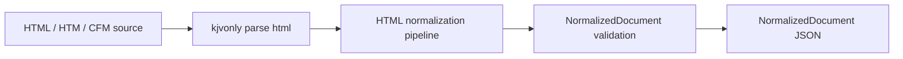
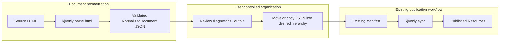
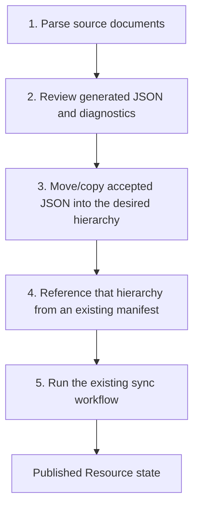
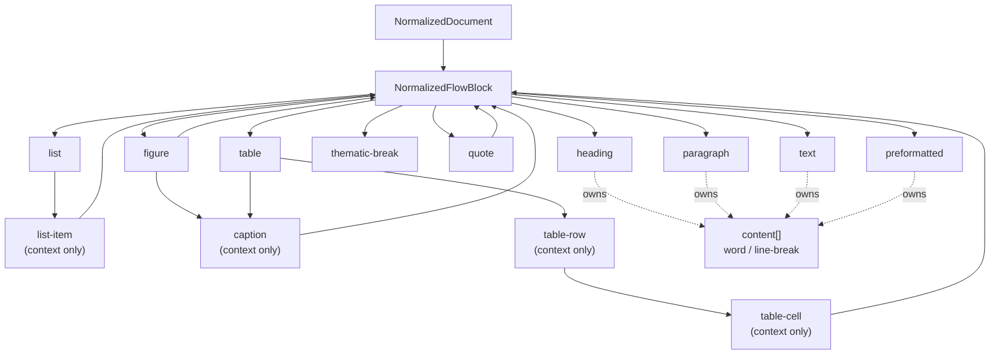
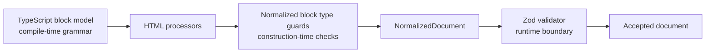
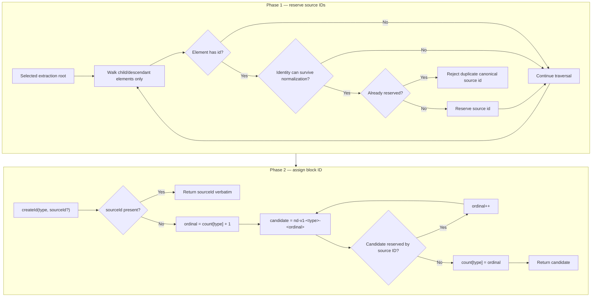
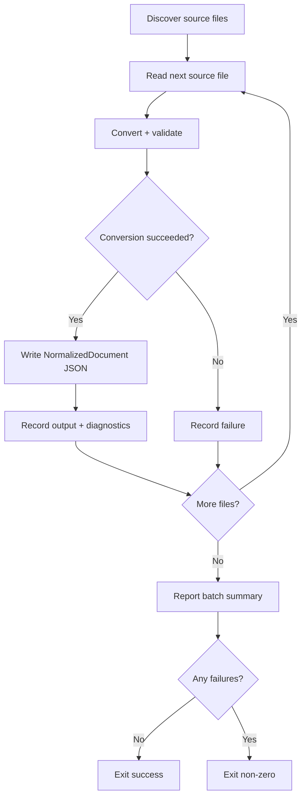
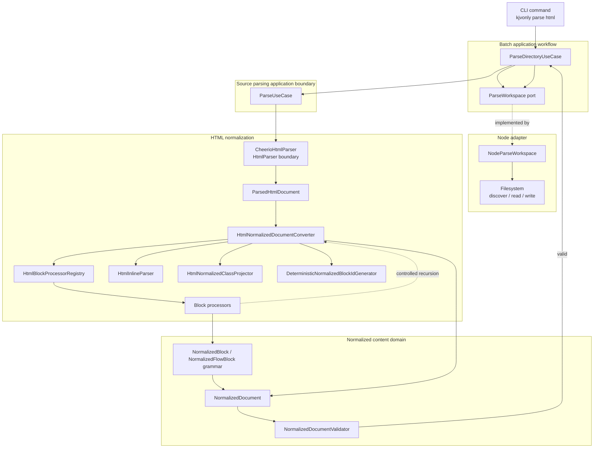
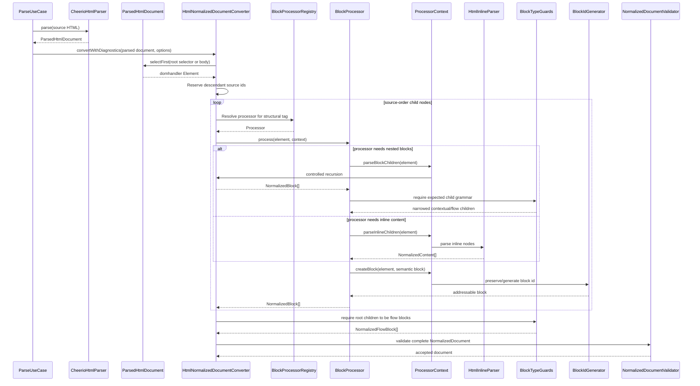
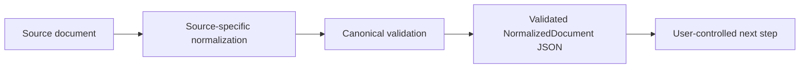

# Normalized Content Parsing

## Purpose

The CLI can convert document-oriented HTML sources into the application's canonical `NormalizedDocument` JSON representation.

The first iteration deliberately stops at file conversion:



Parsing does not publish Resources and does not require a publication manifest. After conversion, the generated JSON files are ordinary filesystem artifacts. A user can review them, move them into the directory hierarchy they want to publish, reference that hierarchy from an existing CLI manifest, and use the normal `build`, `publish`, or `sync` workflow.

Conceptually, parsing and publication remain two independently useful stages:



This boundary keeps source conversion independent from Resource publication.

---

## Command

Parse a directory recursively with:

```bash
kjvonly parse html <directory>
```

Optionally select the content root inside every source document:

```bash
kjvonly parse html <directory> --root-selector '<css-selector>'
```

Existing normalized JSON is protected by default. Explicitly allow replacement with:

```bash
kjvonly parse html <directory> --overwrite
```

Options may be combined:

```bash
kjvonly parse html ./sermons --root-selector '#content' --overwrite
```

The root selector is a CSS selector interpreted against each HTML document. The first matching element is an **extraction boundary**: normalization converts its children, not the selected element itself. The boundary's own tag semantics, ID, classes, and other metadata are therefore outside the canonical document.

If no selector is supplied, the document `<body>` is the extraction boundary. Choose a container element as an explicit root; if the outer element itself carries semantics that must be normalized, select its parent instead.

If a configured root selector is not present in a source file, that file fails conversion and the rest of the batch continues.

---

## Source Discovery

The HTML batch parser recursively discovers these source extensions:

```text
.cfm
.htm
.html
```

Each source file is processed independently.

A failure in one file does not prevent the remaining files from being attempted.

The CLI exits unsuccessfully when one or more files fail, while still reporting and retaining successful conversions from the same batch.

---

## Output Files

Normalized JSON is written beside each source file using the same basename and a `.json` extension.

Example:

```text
sermons/
├── 001.html
├── 001.json
├── nested/
│   ├── 002.cfm
│   └── 002.json
```

The JSON is pretty-printed for inspection and ends with a newline.

The document's optional `source` field records the source path relative to the parse root rather than an absolute machine path.

Example:

```json
{
  "source": "nested/002.cfm",
  "blocks": []
}
```

Absolute paths such as `/Users/...` or `/home/...` are filesystem implementation details and are not persisted as document provenance.

Before parsing begins, the batch computes the complete source-to-output plan. If multiple source files map to the same `.json` path, every source participating in that collision fails preflight and that output is not written. Non-colliding sources in the same batch may still be converted.

Existing output paths are also checked during preflight. By default, an existing `.json` file protects that source from conversion and is reported as a failure. Use `--overwrite` only when replacing existing normalized output is intentional. Source-to-source output collisions remain errors even with `--overwrite`; overwrite permission never chooses one ambiguous source over another.

The filesystem write enforces the same policy after preflight: normal writes use exclusive creation, while `--overwrite` explicitly permits replacement. This protects against a file appearing between the preflight check and the write.

---

## Publication Workflow

Parsing and publishing are separate workflows.

The parser does not decide:

```text
Resource category
Resource id
publication directory hierarchy
manifest membership
Nostr event tags
Blossom strategy
Collection membership
```

Those remain publication concerns controlled by the user's filesystem organization and manifest.

A typical workflow is:



For example:

```bash
kjvonly parse html ./incoming-sermons --root-selector '#content'

# organize generated JSON as desired

kjvonly sync ./manifest.yaml
```

The existing Resource build/publish pipeline consumes files. It does not need to understand HTML or reconstruct the source conversion process.

---

## Canonical Document Model

The parser emits the shared structured-text model.

The canonical model now distinguishes between:

- `NormalizedFlowBlock`: blocks that may participate in ordinary document flow, including the document root.
- `NormalizedBlock`: every legal node type that may appear anywhere in the normalized tree, including context-only structural nodes.

Conceptually:

```ts
interface NormalizedDocument {
    source?: string;
    blocks: NormalizedFlowBlock[];
}

type NormalizedFlowBlock =
    | NormalizedHeadingBlock
    | NormalizedParagraphBlock
    | NormalizedTextBlock
    | NormalizedPreformattedBlock
    | NormalizedThematicBreakBlock
    | NormalizedQuoteBlock
    | NormalizedListBlock
    | NormalizedFigureBlock
    | NormalizedTableBlock;

type NormalizedBlock =
    | NormalizedFlowBlock
    | NormalizedListItemBlock
    | NormalizedCaptionBlock
    | NormalizedTableRowBlock
    | NormalizedTableCellBlock;
```

This distinction makes the document grammar explicit in TypeScript instead of representing every block as one object with many optional fields.

For example:

- a heading always has `level` and `content`;
- a list always has `ordered` and `list-item` children;
- a table cell always has `header` and ordinary-flow children;
- a contextual block such as `table-row` cannot appear directly at the document root.

Inline visible text is represented by `content[]`, not by a second duplicate block-level `text` field.

`NormalizedDocumentValidator` validates only the current canonical shape. It does not repair or remove retired fields. During development, old normalized shapes are updated with the schema rather than carried through a compatibility layer, so a block-level `text` field is invalid canonical data.

### Block grammar

The legal recursive relationships are:



Context-only blocks exist because they have meaning only under a specific owner:

| Contextual block | Legal owner | Child grammar |
| --- | --- | --- |
| `list-item` | `list` | `NormalizedFlowBlock[]` |
| `caption` | `figure` or `table` | `NormalizedFlowBlock[]` |
| `table-row` | `table` | `NormalizedTableCellBlock[]` |
| `table-cell` | `table-row` | `NormalizedFlowBlock[]` |

The same grammar is enforced at two levels:



Processor guards are important because recursive traversal returns the broad `NormalizedBlock` union. Before a parent constructs a specialized structure, it narrows those children to the legal type for that parent. The document root does the same thing explicitly: root traversal is narrowed through `requireNormalizedFlowBlocks(...)` before a `NormalizedDocument` candidate is constructed. Context-only nodes therefore cannot rely on the final validator as the first place their illegal root position is discovered.

The final validator independently enforces the same grammar for unknown runtime data and remains the canonical runtime boundary.

---

## Supported Block Semantics

The HTML converter maps source structure into source-independent normalized blocks.

| HTML | Normalized block | Structural role | Notes |
| --- | --- | --- | --- |
| `h1`–`h6` | `heading` | Flow | Preserves a required heading level from `1` through `6`. |
| `p` | `paragraph` | Flow | Owns inline `content[]`. |
| inline text between structural blocks | `text` | Flow | Preserves source-order inline runs using `content[]`. |
| `blockquote` | `quote` | Flow | Recursively owns ordinary-flow child blocks. |
| `ol`, `ul` | `list` | Flow | Requires `ordered`; owns only `list-item` children. |
| `li` | `list-item` | Context only | Exists only beneath a `list`; recursively owns ordinary-flow blocks. |
| `pre` | `preformatted` | Flow | Preserves source newlines as explicit line breaks. |
| `hr` | `thematic-break` | Flow | Represents a semantic section break. |
| `figure` | `figure` | Flow | Owns ordinary-flow content and optional contextual captions. |
| `figcaption`, table `caption` | `caption` | Context only | Exists beneath a `figure` or `table`; recursively owns ordinary-flow blocks. |
| `table` | `table` | Flow | Owns only captions and table rows. |
| `tr` | `table-row` | Context only | Exists only beneath a table; owns only table cells. |
| `td` | `table-cell` | Context only | `header: false`; recursively owns ordinary-flow blocks. |
| `th` | `table-cell` | Context only | `header: true`; recursively owns ordinary-flow blocks. |

HTML table sections:

```text
thead
tbody
tfoot
```

are structural source containers and are flattened into their rows when doing so is semantically safe.

The parser does not permit contextual blocks to leak into ordinary document flow. A malformed processor result such as a `caption` inside a `quote`, a `table-cell` directly under a table, or a `list-item` at the document root is rejected rather than normalized into an ambiguous tree.

### Unsupported semantic attributes

Supporting an HTML element does not imply that every attribute on that element is represented by NormalizedDocument v1. Attribute handling follows an allowlist contract rather than a growing blacklist:

```text
id / class / style
    → owned by existing identity / presentation normalization

data-*
    → treated as source/application metadata and ignored

explicitly consumed element attributes
    → normalized
    → currently a[href]

any other attribute on a supported element
    → preserve the supported element/content
    → emit html-attribute-unsupported
```

The warning includes the attribute name and the full opening tag so the original value remains visible during import review. For example:

```html
<ol type="I" start="4">
```

continues to normalize as an ordered list, while diagnostics report both `type` and `start` because v1 cannot preserve Roman-numeral presentation or the starting ordinal. The same rule automatically covers inline cases such as:

```html
<del datetime="2026-10-04">old KJV note</del>
<a href="/kjv/1_1_1" target="_blank">Genesis 1:1</a>
```

This keeps conversion useful as the parser improves while making semantic loss auditable. Adding support for an attribute means teaching the appropriate normalization strategy to consume it; once consumed, the warning disappears.

Unsupported elements are handled separately below. Their diagnostic already contains the complete opening tag and attributes, so they do not also produce per-attribute warnings.

### Unsupported element policy

An HTML element is never treated as semantically neutral merely because no processor is registered for it. At the same time, one unsupported edge case should not make an otherwise useful document impossible to import. The converter therefore separates **content preservation** from **semantic support**:

```text
registered block/inline processor
    → normalize supported semantics

registered transparent structural processor
    → recurse after its semantic-loss guards pass

explicitly neutral inline wrapper
    → recurse with no warning

script/style/noscript/template
    → intentionally ignore + existing ignored-element diagnostic

unsupported/unregistered element
    → preserve representable descendants
    → emit an unsupported-element warning
```

The current generic neutral inline wrapper set is deliberately small: `span` is known to be transparent because its useful normalized classes are projected onto descendant words before recursion. Other unregistered elements are **not** declared neutral. Instead, elements such as `abbr`, `time`, `q`, `details`, `summary`, `img`, `data`, or custom elements are tolerated as unsupported boundaries. Their descendant text/blocks are preserved wherever the current canonical model can represent them, and diagnostics tell the user that the wrapper semantics were not normalized.

Unsupported-element diagnostics include the source opening tag and its attributes, for example:

```text
Unsupported source HTML element <time datetime="2026-10-04">; descendant content was preserved where representable, but this element's semantics were not normalized.
```

This makes conversion forward-compatible: future processors can add explicit support for edge cases without forcing incomplete documents today. Leaf elements with no descendant content, such as an unsupported `img`, may still contribute no canonical content; their full source tag/attributes remain visible in diagnostics so the loss is auditable.

Element support and semantic-attribute support remain separate concerns. Unsupported attributes on a **supported** element keep the normalized element/content and produce `html-attribute-unsupported` diagnostics instead of aborting the document.

### Empty semantic elements

Some supported semantic block processors omit elements that contain no meaningful normalized content. For those block types, an otherwise-empty element is preserved when dropping it would discard canonical metadata that v1 can represent. Structural table rows and cells are already preserved when empty because their position is itself meaningful.

The preservation rule is:

```text
source id present
    → preserve the empty canonical block

supported normalized presentation present
    → preserve the empty canonical block

neither present
    → omit the empty source element
```

For example:

```html
<p id="anchor"></p>
<p class="text-center"></p>
```

remain addressable/presentational normalized paragraph blocks with empty `content[]`, while:

```html
<p></p>
<p class="publisher-only"></p>
```

are omitted. Arbitrary publisher classes or unsupported style metadata do not make an otherwise-empty source element canonical.

This rule applies only to supported semantic block types that have a canonical normalized representation. Transparent structural containers still cannot carry their own canonical block, so an addressable ID or supported normalized presentation on such a wrapper is rejected rather than preserved.

---

## Transparent Structural Containers

Several HTML elements are treated as structural wrappers rather than canonical normalized block types, including source structures such as:

```text
address
article
aside
div
footer
header
main
nav
section
```

A neutral wrapper can be flattened by recursively parsing its children.

Flattening is rejected when it would discard canonical information. In particular, an addressable source container with an `id` is not silently removed, and supported normalized presentation is not silently discarded from a transparent container.

This prevents source boundaries that may matter for durable document locations from disappearing accidentally.

The selected extraction root is the deliberate exception. Because that element defines the boundary around imported content rather than content itself, its own ID/presentation is intentionally not normalized or diagnosed. The same container nested *inside* the extraction boundary still follows the semantic-loss guards above.

---

## Inline Semantics

Visible inline text is normalized into ordered content entries.

Words use:

```ts
interface NormalizedWord {
    type: 'word';
    text: string;
    joinPrevious?: true;
    class?: NormalizedClassName[];
    href?: string[];
    emphasis?: true;
    strong?: true;
    marks?: NormalizedMark[];
}
```

Whitespace, not DOM node boundaries, defines ordinary word separation. Adjacent text fragments with the same normalized inline semantics are merged into one addressable word token even when HTML wrappers split the source text.

When an inline semantic boundary must split one visible lexical token, `joinPrevious: true` records that there was no source whitespace before the new fragment. For example:

```html
pre<strong>fix</strong> word<sup>1</sup>!
```

normalizes conceptually to:

```json
[
  { "type": "word", "text": "pre" },
  { "type": "word", "text": "fix", "strong": true, "joinPrevious": true },
  { "type": "word", "text": "word" },
  { "type": "word", "text": "1", "marks": ["superscript"], "joinPrevious": true },
  { "type": "word", "text": "!", "joinPrevious": true }
]
```

The renderer inserts its ordinary inter-word space before a word unless that word has `joinPrevious: true` or follows a line break. It must not infer punctuation or HTML-specific spacing rules.

Canonical word data is sparse. `text` is one non-empty token and cannot itself contain whitespace; whitespace relationships are represented by token boundaries plus `joinPrevious`. Optional semantics are omitted when absent rather than encoded as `false`, `null`, or empty arrays. Therefore canonical words reject shapes such as:

```json
{ "type": "word", "text": "KJV Bible" }
{ "type": "word", "text": "KJV", "strong": false }
{ "type": "word", "text": "KJV", "href": null }
{ "type": "word", "text": "KJV", "href": [] }
```

`joinPrevious: true` also requires a preceding visible word in the same horizontal run. Zero-width anchors may sit between those words, but a line break ends the relationship.

Explicit line breaks use:

```ts
{
    type: 'line-break'
}
```

Supported inline semantics include:

| HTML | Normalized meaning |
| --- | --- |
| `a[href]` | `href` on emitted words |
| `em`, `i` | `emphasis: true` |
| `b`, `strong` | `strong: true` |
| `sup` | `marks: ['superscript']` |
| `sub` | `marks: ['subscript']` |
| `u` | `marks: ['underline']` |
| `del`, `s`, `strike` | `marks: ['strikethrough']` |
| `small` | `marks: ['small']` |
| `code` | `marks: ['code']` |
| `mark` | `marks: ['highlight']` |
| `br` | `line-break` |

### Link target safety and local integrity

Normalized link targets remain opaque navigation data. The Normalized Content Domain does not interpret Bible/application routes, relative Resource paths, document fragments, or ordinary external URLs; the renderer/host continues to own destination behavior.

The canonical contract does, however, reject browser-executable URI schemes that should never become persisted link behavior:

```text
javascript:
vbscript:
data:
```

During HTML conversion an unsafe `a[href]` does **not** abort otherwise useful document import. Its descendant text/structure is preserved, the unsafe `href` is omitted from normalized words, and conversion emits `html-link-target-unsafe`. The strict Domain validator also rejects those schemes so another source adapter cannot inject them directly into a canonical `NormalizedDocument`.

Document-local targets are different. A source link such as `href="#fn1"` is preserved even if no canonical ID named `fn1` exists inside the selected extraction boundary. That can happen when a deliberately selected subtree omits the target. Conversion therefore emits the recoverable `html-local-link-target-missing` warning rather than rejecting the document.

A local target resolves when its ID belongs to either a canonical block or a zero-width inline anchor. Empty `href=""` and `href="#"` retain their existing source meaning and are not treated as missing named identities.

A source `id` on a supported or deliberately neutral inline element is preserved as a zero-width canonical anchor at that element's opening position:

```ts
{
    type: 'anchor',
    id: 'fn1'
}
```

Anchors carry no visible text or presentation. They exist so document-local links such as `href="#fn1"` can target an exact inline position without inventing a fake word or moving the identity onto a surrounding block. A renderer should expose the anchor ID in the DOM at that content position while producing no visible characters.

Because anchors are zero-width, they do not create whitespace. For example:

```html
K<span id="kjv-anchor"></span>JV
```

normalizes conceptually to:

```json
[
  { "type": "word", "text": "K" },
  { "type": "anchor", "id": "kjv-anchor" },
  { "type": "word", "text": "JV", "joinPrevious": true }
]
```

The anchor keeps its own `contentIndex`; `joinPrevious` preserves the fact that no source whitespace existed across that zero-width boundary.

Nested inline semantics compose. For example, linked strong/emphasized text retains all of those meanings on the normalized words.

Inline semantic wrappers may also contain structural descendants in the parsed HTML tree. When that happens, structural traversal remains block-owned, but it carries an inherited inline-semantic state produced by `HtmlInlineParser`. This keeps supported wrapper meaning on every descendant inline run without teaching block processors about anchors, marks, emphasis, or strong semantics.

For example:

```html
<a href="/kjv/1_1_1">
    Before
    <p>KJV <strong>Bible</strong></p>
    After
</a>
```

normalizes as three flow blocks in source order. The synthetic text block containing `Before`, the paragraph words, and the synthetic text block containing `After` all retain the anchor `href`; `Bible` additionally retains `strong: true`. Nested recursive blocks inherit the same state.

The block processor registry does not interpret these inline wrappers. `HtmlInlineParser` remains the sole owner of turning the wrapper boundary into descendant inline state; block traversal only propagates that state while it recurses. If the wrapper also has a source `id`, its zero-width anchor is emitted at the wrapper's opening boundary before descendant block content.

The current normalized mark vocabulary is therefore:

```text
superscript
subscript
underline
strikethrough
small
code
highlight
```

That vocabulary is domain-owned and closed for the current data version. Canonical validation rejects unknown, empty, null, or duplicate mark collections. New HTML edge cases should add an explicit semantic mapping before they can expand the canonical mark vocabulary.

Non-breaking spaces are normalized as whitespace during tokenization. Runs of ordinary whitespace collapse to one logical separator and are not stored as separate content entries.

---

## Preformatted Text

Normal HTML text collapses source whitespace into deterministic word boundaries.

`<pre>` is different: source newline structure is meaningful.

For preformatted content, source newlines are projected into explicit normalized line breaks:

```text
Alpha
Bravo
```

becomes conceptually:

```json
[
  { "type": "word", "text": "Alpha" },
  { "type": "line-break" },
  { "type": "word", "text": "Bravo" }
]
```

The parser still uses the same canonical inline content model; `<pre>` does not introduce a second raw-text representation.

V1 preserves **line structure**, not exact preformatted whitespace. Within each line, whitespace is tokenized into canonical word boundaries. Repeated spaces, tabs, and indentation are therefore not retained. Only line breaks synthesized from leading/trailing source newline characters in preformatted text are trimmed when they do not separate visible content. Explicit `<br>` elements always remain canonical line breaks, including at a content boundary.

For example, source shaped like:

```text
    Alpha   Bravo
	Charlie
```

normalizes conceptually to:

```json
[
  { "type": "word", "text": "Alpha" },
  { "type": "word", "text": "Bravo" },
  { "type": "line-break" },
  { "type": "word", "text": "Charlie" }
]
```

If exact spaces, tabs, indentation, or boundary newlines become a product requirement, the normalized preformatted contract must be expanded rather than assuming the current representation is lossless.

---

## Normalized Presentation Classes

The converter does not copy arbitrary source CSS classes into application content.

Only the controlled normalized class vocabulary is preserved/projected:

```text
text-center
indent
nowrap
list-roman
list-arabic
```

For example, a supported source hint such as `style="text-align:center"` may project to:

```text
text-center
```

Publisher/site-specific classes are ignored rather than becoming part of the canonical document contract.

The vocabulary is domain-owned and closed for the current data version. Canonical validation rejects unknown, empty, null, or duplicate class collections instead of allowing parser-specific values to expand the shared document contract accidentally.

This keeps the normalized representation independent from historical source stylesheets.

---

## Stable Normalized Identity

Every canonical block requires an ID at both the TypeScript model and runtime-validation boundaries. Supported/neutral inline elements may additionally contribute zero-width `anchor` content with a source-authored ID. Blocks and inline anchors share one document-local identity namespace because both eventually become linkable DOM targets.

Source-authored IDs on representable elements *inside* the extraction boundary are authoritative. A supported block preserves its ID on the block; a supported or neutral inline element preserves its ID as an inline anchor. The extraction boundary's own ID is selector metadata and is not reserved because the boundary itself is not normalized content. IDs on unsupported or intentionally ignored elements are not canonical identities and therefore do not reserve generated addresses.

Structural processors make this identity behavior explicit. Processors whose element boundary materializes as a canonical block preserve source identity by default. Flattening processors—such as transparent containers, table section wrappers, and unsupported block fallbacks—declare that their own boundary does not become canonical identity. This lets reservation follow processor semantics instead of maintaining a second tag list.

Blocks without source IDs receive a deterministic **document-local ordinal ID**. Inline anchors are never generated; they exist only when the source provides an inline identity. Generated block IDs are intentionally simple and are not content fingerprints. They identify a block within one normalized document snapshot; they are not expected to remain attached to the same logical content after the source is reparsed.

Generated IDs are versioned and scoped by block type:

```text
nd-v1-heading-1
nd-v1-paragraph-1
nd-v1-paragraph-2
nd-v1-list-1
nd-v1-list-item-1
nd-v1-table-cell-1
```

Each block type has its own counter. This keeps generated addresses readable and prevents an inserted block of one type from renumbering every block of every other type.

### Generated-ID algorithm

The generator has two responsibilities: reserve source-authored IDs that can survive normalization, then assign per-type ordinals to blocks that do not already have an ID.



The generator does **not** inspect block text, inline markup, classes, links, child identity, heading level, list orderedness, or table-cell role. There is no recursive fingerprint and no hash involved in generated block identity.

For example, the first generated paragraph is always:

```text
nd-v1-paragraph-1
```

regardless of whether its text is `Alpha`, `Bravo`, or anything else. The next generated paragraph is `nd-v1-paragraph-2`.

Canonical descendant source IDs do not consume generated ordinals themselves. If one happens to equal a generated candidate such as `nd-v1-paragraph-1`, the generator skips that reserved value and advances to the next available ordinal. This includes inline anchor IDs, because a block and anchor cannot safely render with the same document-local ID. An ID on the extraction boundary, an unsupported wrapper, or intentionally ignored content does not cause a skip because that identity cannot appear in normalized output.

### Reparse behavior

Generated ordinal IDs are deterministic only for the same traversal shape. Inserting, removing, or reordering blocks of a given type can renumber later generated IDs of that type.

That is intentional. Normalization is not responsible for matching logical blocks across document revisions.

A downstream note, annotation, or reference that was created against an older document revision should be preserved even when the source later changes. Whether that reference still applies belongs to document/revision validation—for example, comparing the revision or content hash associated with the referenced document—not to block-ID generation. A mismatch can be surfaced to the user as stale or requiring review rather than deleting the dependent data.

This keeps two responsibilities separate:

```text
block ID
    document-local address inside one normalized snapshot

document/revision identity
    tells consumers whether an older reference still applies to the current snapshot
```

Duplicate source IDs that would both survive normalization are rejected because they would make normalized document locations ambiguous. IDs that exist only on unsupported/ignored source boundaries are diagnostic source metadata rather than canonical identity and do not reserve or collide with generated output. The extraction boundary itself is also outside the canonical identity set.

Canonical validation applies the same invariant to the finished `NormalizedDocument`: every ordinary and contextual block must have a non-blank ID, every inline anchor must have a non-blank ID, and block/anchor IDs must be unique across the entire recursive document. This protects documents entering through paths other than the HTML converter as well.

The canonical TypeScript model matches that runtime rule: `NormalizedBlockBase.id` is a required `string`. HTML processors therefore do not construct a partially valid `NormalizedBlock`; they submit a `NormalizedBlockCreationInput` that omits converter-owned `id`/`class` metadata, and `createBlock()` returns the canonical identified block. Nested child blocks are already canonical before they are attached to a parent.

Generated IDs are owned by normalization/import. Renderers must not invent or reinterpret persistent identity later.

---

## Diagnostics

Conversion diagnostics are reported separately from the persisted `NormalizedDocument` JSON.

The parser reports aggregate metrics such as:

```text
blocks produced
words produced
source block/inline-anchor ids preserved
generated block ids
linked words produced
```

It also emits warnings for auditable source information that was intentionally not carried into the normalized document, including:

```text
ignored source HTML classes
ignored script elements
ignored style elements
ignored noscript elements
ignored template elements
unsafe executable link targets whose behavior was stripped
unresolved document-local link targets inside the selected extraction boundary
```

Example summary:

```text
Parsed 12/12 file(s); 0 failed.
Produced 420 block(s), 6821 word(s); preserved 34 source id(s), generated 386 id(s), linked 52 word(s).
```

Warnings and metrics are import-tooling information. They do not become fields in `NormalizedDocument`. Diagnostics inspect the imported descendants only; metadata on the extraction boundary is intentionally outside both normalized output and ignored-source warnings.

---

## Failure Behavior

The converter never silently discards semantic loss. Recoverable source semantics are reported as diagnostics; failures are reserved for conditions where continuing would violate canonical identity or structure.

Examples of conditions that can fail a source document include:

```text
configured root selector is missing
duplicate canonical-preservable source ids within the imported descendants
flattening a structural wrapper would discard an addressable id
flattening a structural wrapper would discard supported normalized presentation
invalid final NormalizedDocument structure
```

A batch records the failure and continues with the remaining source files. Successful JSON outputs from the same batch remain usable.



---

## Architecture

Parsing follows the same responsibility-oriented CLI architecture used elsewhere in the package.



The HTML path is intentionally split between syntax parsing and semantic conversion so parser-library concerns do not leak into normalized-content semantics:



Responsibilities are intentionally separated.

### CLI command

Owns command-line arguments and reporting.

### `ParseDirectoryUseCase`

Owns batch orchestration:

```text
discover files
read source
invoke parsing
write JSON
collect failures/diagnostics
```

It does not interpret HTML.

### `ParseWorkspace`

Defines filesystem capabilities used by the batch workflow.

The Node adapter owns actual filesystem traversal/read/write mechanics.

### `ParseUseCase`

Is the application boundary for source-document normalization.

It selects the source-format parser and converter without exposing their internals to callers. Raw HTML is parsed before the converter receives the source tree.

### `HtmlParser` / `CheerioHtmlParser`

Owns HTML syntax parsing and parser-library behavior only.

`CheerioHtmlParser` is the production implementation. It keeps Cheerio private and exposes a narrow `ParsedHtmlDocument` capability for selecting elements from the parsed tree. It does not choose the semantic conversion root or create normalized content.

### `HtmlNormalizedDocumentConverter`

Owns HTML semantic interpretation, conversion-root policy, and structural traversal over the parsed tree.

If no explicit root selector is supplied, it selects `body`. The selected element is always an extraction boundary: conversion starts at its children, and boundary metadata is intentionally excluded from normalized identity and diagnostics. It does not parse raw HTML syntax and does not own directory traversal, publication, Resource identity, or rendering.

Structural recursion carries the current inherited inline-semantic state. When an inline wrapper spans structural descendants, the converter asks `HtmlInlineParser` to derive the descendant state from that wrapper, then continues ordinary block traversal with that state.

### Block processor registry

Owns HTML block tag → semantic processor dispatch.

Individual processors own one structural semantic family rather than accumulating one large converter switch statement.

### Inline parser

Owns inline recursion, tokenization, links, marks, emphasis, strong semantics, and line-break production. Registered processors handle supported inline meaning; unregistered elements recurse to preserve representable descendants and are reported by conversion diagnostics unless explicitly classified as neutral.

It also owns creation of inherited descendant state when a supported inline wrapper crosses a structural boundary. Block processors receive only the resulting state through converter-owned traversal; they never interpret inline HTML tags themselves.

### Block grammar and type guards

The Domain model owns the legal recursive block grammar.

HTML processors use explicit type guards after recursive traversal to narrow broad `NormalizedBlock[]` results into the child type required by the parent being constructed. This prevents contextual structures such as list items, captions, rows, or cells from escaping their owning structure.

### Validator

Owns the accepted canonical `NormalizedDocument` semantic boundary and enforces the same flow/context grammar for runtime input.

---

## Security and Source Isolation

Source HTML is input data. It is never treated as trusted runtime markup.

The HTML normalization pipeline does not preserve or execute arbitrary source behavior such as:

```text
scripts
stylesheets
event handlers
raw HTML fragments
arbitrary non-semantic attributes
arbitrary CSS classes
```

Unsupported attributes on otherwise-supported elements are not executed or persisted as arbitrary metadata. Their normalized content is preserved and the lost source attribute is reported through import diagnostics.

The resulting JSON contains only normalized semantic structures accepted by the application contract.

Downstream renderers should render those structures rather than injecting the original HTML.

---

## Non-Goals for the First Iteration

The HTML parser intentionally does not own:

```text
Resource publication
manifest generation
publication directory layout
Nostr or Blossom behavior
Filesystem Resource discovery
Domain installation/persistence
application navigation
Notes persistence
markup/highlight persistence
Markdown conversion
PDF conversion
```

For the first iteration, this boundary is sufficient:



The user remains in control of what happens to that artifact next.
