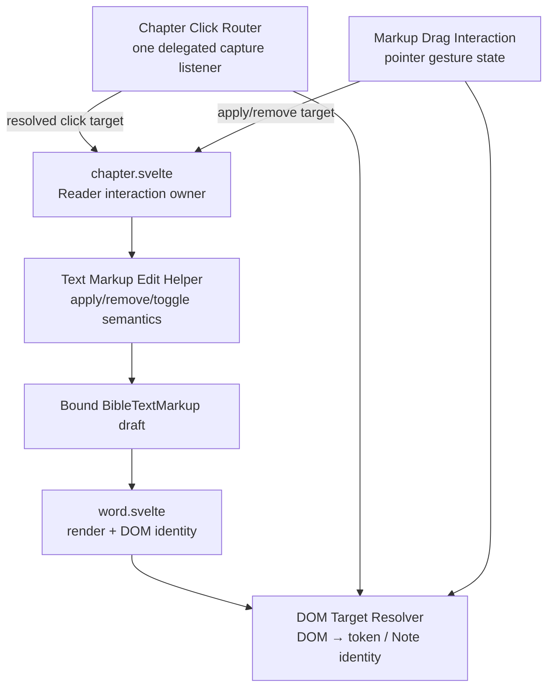
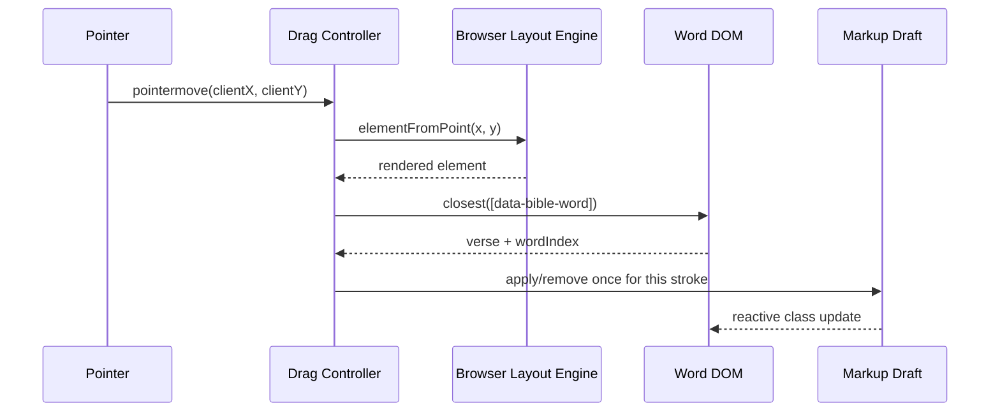
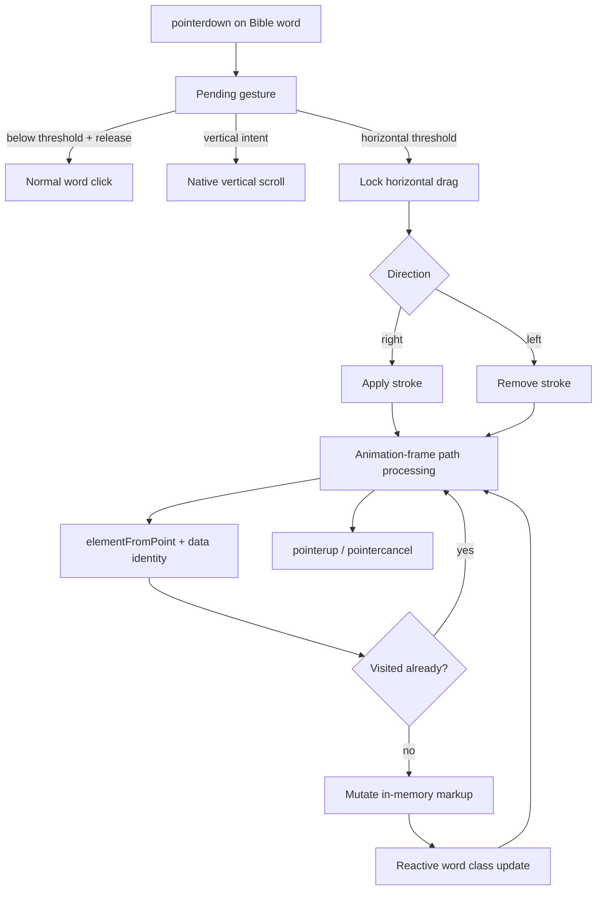

# Bible Text Markup Drag Editing

## Status

Implemented.

This document defines the accepted interaction and implementation direction for horizontal drag editing of Bible Text Markup in the Bible Reader.

It extends the current Text Markup editing behavior described in:

```text
docs/03_implementation/domains/bible/001-text-markup.md
```

It does not change the Bible Text Markup Domain Object, Resource contract, persistence model, or publication lifecycle.

---

# 1. Purpose

Bible Text Markup currently supports precise word-level editing through clicks.

That interaction is useful for single-word corrections, but it is inefficient when the user wants to apply the same markup across several adjacent words.

The Reader should therefore support a second edit interaction:

```text
click
    = precise toggle of one word

left-to-right horizontal drag
    = apply the currently selected markup

right-to-left horizontal drag
    = remove the currently selected markup
```

The drag interaction is a fast paint/erase tool over the existing mutable Text Markup draft.

The user must see each crossed word update immediately while the pointer moves across the text.

---

# 2. Goals

The feature should provide:

1. fast multi-word Text Markup editing,
2. immediate visual feedback while dragging,
3. unchanged precise click behavior,
4. unchanged vertical Reader scrolling,
5. deterministic apply/remove semantics,
6. no continuous CPU work while idle,
7. no persistence or publication work per crossed word,
8. minimal interaction-specific code inside `word.svelte`,
9. shared markup mutation semantics between click and drag,
10. preservation of existing reading-mode reference/Strong's activation behavior.

---

# 3. Non-Goals

This feature does not introduce:

```text
native browser text selection as the markup model
range-based Domain identity
a new Bible Text Markup schema
a new annotation system
a new persistence path
a new Resource type
a new save model
continuous autosave while dragging
arbitrary free-form drawing
vertical drag painting
```

The existing chapter-scoped, word-indexed Text Markup model remains authoritative.

---

# 4. Existing Editing Contract

Bible Text Markup is stored by verse and word index:

```text
textMarkup.markings[verseNumber][wordIndex]
```

A marking contains presentation classes such as:

```text
bg-highlight*
text-highlight*
decoration-highlight*
underline
decoration-solid
```

The Reader owns a mutable UI copy of the active chapter's Text Markup.

Edits mutate that in-memory copy immediately. Persistence remains controlled by the existing save flow through `BibleTextMarkupService.put()`.

This feature must preserve that lifecycle.

---

# 5. Interaction Contract

## 5.1 Click

A click in edit mode remains the precise operation.

```text
click word
    ↓
set mode.bibleLocationRef to that exact word
    ↓
toggle the currently selected markup family on that word
```

This behavior is intentionally retained because it provides pinpoint editing and establishes the Reader's current exact selection. Add Note does not consume that selection; it uses its own explicit Note-location selection result.

A click below the drag threshold must remain indistinguishable from the current click interaction.

## 5.2 Left-to-right drag

A horizontal stroke whose locked direction is left-to-right means:

```text
ensure selected markup is applied
```

For every eligible word crossed by the stroke:

```text
selected markup already present
    → no change

selected markup absent
    → apply selected markup
```

This is not toggle behavior.

## 5.3 Right-to-left drag

A horizontal stroke whose locked direction is right-to-left means:

```text
ensure selected markup is removed
```

For every eligible word crossed by the stroke:

```text
selected markup present
    → remove selected markup family

selected markup absent
    → no change
```

Removal must affect only the currently selected markup family.

For example:

```text
existing classes
    bg-highlighta
    text-highlightc
    underline
    decoration-highlightb
    decoration-solid

current mode
    background highlight

right-to-left drag result
    text-highlightc
    underline
    decoration-highlightb
    decoration-solid
```

Other independent markup families must remain intact.

## 5.4 Direction locking

The operation is determined once per stroke after the horizontal gesture threshold is crossed.

```text
first accepted horizontal direction
    right → apply
    left  → remove
```

The operation remains fixed until pointer release/cancellation.

Reversing direction during the same stroke does not turn an apply stroke into an erase stroke or vice versa.

This prevents oscillating behavior when the user's finger moves slightly backward while painting.

## 5.5 Verse numbers

Word index `0` retains its current whole-verse click semantics, but it also participates in drag painting as the verse-number token itself.

```text
wordIndex = 0
    click → existing whole-verse toggle behavior
    drag  → apply/remove markup on word index 0 only
```

This distinction is intentional. Swiping over a verse number should provide the same continuous paint experience as swiping over words, but it must not invoke the click-only whole-verse operation.

---

# 6. Scroll and Gesture Intent

The Bible Reader is primarily a vertically scrolling surface.

Drag editing must therefore claim only clear horizontal intent.

The gesture begins in a pending state:

```text
pointerdown
    ↓
record start X/Y
    ↓
movement remains below threshold
    → still a possible click
```

Once movement becomes meaningful:

```text
horizontal movement dominates
    → lock markup drag

vertical movement dominates
    → abandon markup drag
    → allow normal Reader scrolling
```

The exact threshold is an implementation constant and should be small enough to feel responsive while large enough to protect ordinary taps. A value in approximately the `8–12px` range is expected to be appropriate, but the final value should be validated in browser interaction testing.

Edit-mode drag surfaces should use browser touch semantics equivalent to:

```css
touch-action: pan-y;
```

This communicates that vertical panning remains native while horizontal movement may be handled by the markup interaction.

Normal read mode must not change its scrolling or touch behavior.

---

# 7. Ownership and Component Boundaries

Gesture semantics do not belong in each `word.svelte` instance.

The current ownership is:



The responsibilities are intentionally separated.

## 7.1 `word.svelte`

`word.svelte` remains responsible for:

```text
rendering one Bible token
rendering its current markup classes
exposing stable DOM identity
existing inline Note affordance
```

Reading-mode reference/Strong's activation, edit-mode markup clicks, Note-location selection, and inline Note activation are delegated from the chapter surface rather than installed independently on every rendered Word component.

It does not own:

```text
pointerdown/pointermove/pointerup state
swipe thresholds
gesture direction locking
pointer capture
visited-word tracking
requestAnimationFrame throttling
coordinate hit testing
click suppression after a drag
reading-mode reference/Strong's activation
edit-mode markup click mutation
inline Note click navigation
```

## 7.2 Markup drag interaction

A dedicated Reader-local interaction layer owns the pointer gesture state machine.

The implementation is Reader-local:

```text
src/lib/domains/bible/modules/reader/chapter/interactions/
    bible-text-markup-drag.ts
    bible-text-markup-drag-gesture.ts
```

The Svelte action owns browser event/hit-testing integration. The gesture controller owns the DOM-independent state machine. Both remain Reader-local interaction utilities rather than Domain services.

This layer knows:

```text
pointer coordinates
gesture thresholds
horizontal direction
pointer capture
which DOM word is under the pointer
which words were already processed during the stroke
```

It does not know how CSS markup families are mutated.

## 7.3 Chapter click router

One Reader-local Svelte action owns chapter click delegation:

```text
src/lib/domains/bible/modules/reader/chapter/interactions/
    bible-chapter-click.ts
```

It installs one capture listener on the chapter interaction root and resolves semantic DOM identity with `closest(...)`:

```text
[data-bible-word]
    → verseNumber + wordIndex

[data-bible-note]
    → verseNumber + wordIndex
```

`chapter.svelte` supplies the current interaction intent and owns all semantics:

```text
reading
    → only xref / FOOTNO / vno activate references / Strong's
    → ordinary Bible words remain unhandled

text-markup
    → toggle the selected token / verse

note-location
    → consume chapter clicks exclusively
    → complete only selected Bible-token locations

inline Note affordance
    → open exact-location Notes outside note-location selection
```

The router does not mutate Text Markup, construct Bible references, or navigate by itself. The drag action remains separate because pointer gesture recognition and drag-click suppression have different lifecycle requirements. The drag action is registered before the click router so a completed drag suppresses its resulting click before the router can process it.

## 7.4 Text Markup edit helper

Markup mutation logic is shared through:

```text
src/lib/domains/bible/modules/reader/chapter/
    text-markup-edit.ts
```

Click and drag therefore use the same rules. The helper exposes operations such as:

```text
toggle word markup
apply word markup
remove word markup
toggle whole-verse markup
```

The helper understands:

```text
BibleTextMarkup.markings
mode.type
mode.colorMarkup
decoration companion classes
markup-family replacement/removal semantics
```

It does not understand pointer coordinates or gestures.

This prevents two independent implementations of Text Markup editing rules.

---

# 8. DOM Word Identity

Reader interactions must map browser event/hit-test targets back to Bible word identity without searching or measuring every word.

Each eligible rendered word exposes semantic DOM metadata:

```html
<span
    data-bible-word
    data-verse="3"
    data-word-index="17"
>
```

These attributes do not describe geometry.

They form the bridge between browser hit testing and Bible token identity.

```text
browser geometry
    ↓
element under x/y
    ↓
DOM data attributes
    ↓
Bible verse / word index
```

The attributes are presentation metadata only. They do not change Bible location identity or Text Markup persistence.

---

# 9. Coordinate Hit Testing

Pointer Events provide current viewport coordinates:

```text
clientX
clientY
```

The drag interaction asks the browser which rendered element is physically under that point:

```ts
document.elementFromPoint(clientX, clientY)
```

The resulting node is normalized to the nearest Bible word:

```ts
element?.closest('[data-bible-word]')
```

Then:

```text
data-verse
    +
data-word-index
    ↓
Text Markup target
```

Conceptually:



No loop over all rendered words is required for ordinary hit testing.

---

# 10. Pointer Capture

Once a pending gesture becomes an accepted horizontal markup stroke, the Reader may capture the pointer so movement continues to be delivered reliably even after the pointer leaves the original word element.

Because pointer capture keeps event ownership associated with the capturing element, `event.target` must not be used to infer the current Bible word during an active stroke.

Current physical location is always resolved from coordinates through browser hit testing.

Pointer capture must be released or allowed to end on:

```text
pointerup
pointercancel
component teardown
edit-mode exit while a stroke is active
```

---

# 11. Processing Words During a Stroke

Each stroke owns a temporary set of visited Bible word identities.

Example:

```text
3:17
3:18
3:19
```

A word is mutated at most once per stroke.

```text
first encounter
    → apply/remove operation
    → add identity to visited set

later pointer sample over same word
    → no-op
```

This prevents repeated Svelte mutations while a finger remains over one word.

The visited set exists only for the active gesture and is discarded when the gesture ends.

---

# 12. Fast Pointer Movement

Pointer movement events are not guaranteed to occur at every physical pixel crossed by a fast swipe.

The implementation must therefore avoid assuming that one `pointermove` event will occur over every short word.

The drag controller should process the path between the previous accepted pointer position and the newest position.

A practical implementation may use bounded spatial interpolation:

```text
previous pointer point
    ↓
sample intermediate points when movement distance is large
    ↓
elementFromPoint() for those samples
    ↓
deduplicate by visited word identity
```

Sampling should be sparse and bounded. Its purpose is only to prevent short words from being skipped during fast movement; it must not become a dense per-pixel scan.

Where supported, coalesced Pointer Events may also be consumed as additional path samples, but the interaction must not depend on them for correctness.

---

# 13. Animation-Frame Scheduling

Raw `pointermove` frequency may exceed the rate at which the UI can visibly update.

The controller should therefore batch movement processing with `requestAnimationFrame`.

Conceptually:

```text
pointermove
pointermove
pointermove
    ↓
latest/coalesced path samples
    ↓
one animation-frame processing pass
```

This bounds gesture work to visible frame cadence while retaining real-time feedback.

There must be:

```text
no polling
no MutationObserver
no idle scanning
no recurring timer
```

for this feature.

---

# 14. Real-Time Visual Feedback

A crossed word must visibly change during the gesture, not after pointer release.

The interaction achieves this by mutating the existing in-memory `BibleTextMarkup` draft immediately.

```text
pointer crosses word
    ↓
apply/remove draft markup
    ↓
Svelte reactivity updates wordMarkup
    ↓
word CSS classes update
    ↓
user sees highlight/font/underline change immediately
```

No separate preview model is required.

The visual state shown during the gesture is the same draft state that will be saved if the user accepts the edit.

This also means cancel/close behavior remains unchanged: the existing edit cancellation path can discard the unsaved draft and reread accepted Text Markup.

---

# 15. Persistence and Publication Boundary

Drag editing must not write persistence on every crossed word.

During a stroke:

```text
DOM hit testing
    +
in-memory BibleTextMarkup mutation
    +
reactive rendering
```

Only the existing save action crosses the durable write boundary:

```text
BibleTextMarkupService.put()
    ↓
Domain persistence
    ↓
ResourceInstallation revision state
    ↓
Outbox intent
    ↓
publication lifecycle
```

Therefore a stroke across many words does not create corresponding IndexedDB writes, Outbox writes, Nostr events, or network operations.

---

# 16. Selected Bible Location

Edit-mode clicks establish the precise Bible token reference represented by the current edit selection.

That behavior remains explicit after click delegation:

```text
click word in edit mode
    ↓
mode.bibleLocationRef = clicked word
    ↓
toggle markup
```

A drag stroke must not continuously change `mode.bibleLocationRef` as it crosses words.

The concepts remain separate:

```text
click
    = select precise word reference + precise markup toggle

drag
    = bulk Text Markup operation only
```

Therefore clicking a word and then dragging elsewhere does not silently move the selected Reader location to the last word crossed by the drag.

The selected Reader location continues to reflect the last explicit edit-mode click; drag remains a bulk Text Markup operation only.

---

# 17. Click Suppression After Drag

Browsers may emit a click after a completed pointer gesture.

Once the movement threshold has promoted a gesture to markup drag, the drag interaction must suppress the click associated with that stroke.

Otherwise pointer release could cause the final word to run its normal toggle behavior and undo the just-applied drag result.

The rule is:

```text
movement never became a drag
    → normal click proceeds

movement became a drag
    → resulting click is consumed
```

Click suppression belongs to the shared gesture layer, not to individual words.

---

# 18. Edit-Mode Boundary

Drag painting is active only while:

```text
mode.value === BIBLE_MODES.EDIT
```

Outside edit mode:

```text
no markup pointer capture
no drag hit testing
no markup mutation
no drag-specific click suppression
```

Normal Bible reading interactions remain unchanged.

If edit mode exits during an active stroke, the controller must cancel and clear transient gesture state immediately.

---

# 19. Pointer Types

The interaction should be built with Pointer Events rather than separate mouse and touch gesture implementations.

The same state machine can support:

```text
touch
mouse primary button
pen/stylus primary contact
```

Non-primary mouse buttons and non-primary concurrent pointers should be ignored.

Only one markup stroke is active at a time.

---

# 20. Performance Contract

The feature is designed to have effectively zero ongoing CPU cost when no drag is active.

Idle/edit-mode state must not perform:

```text
word scans
layout measurement loops
timers
polling
DOM observation
background hit testing
```

During an active stroke, work is bounded by:

```text
animation-frame cadence
small browser-native elementFromPoint() hit tests
bounded path interpolation
one markup mutation per unique crossed word
```

The implementation must not enumerate all rendered words or call `getBoundingClientRect()` for the full chapter on every pointer move.

This keeps the cost proportional to the user's active gesture rather than to chapter size.

---

# 21. Styling and Browser Behavior

While edit drag is enabled, the Reader should prevent browser behaviors that conflict specifically with horizontal markup painting.

Expected behavior includes:

```text
vertical touch pan
    preserved

horizontal markup stroke
    owned by Reader edit interaction

native text selection during markup stroke
    suppressed
```

Any `user-select` or `touch-action` treatment should be scoped to the edit interaction surface and must not disable normal reading/copy behavior outside edit mode.

---

# 22. Markup Mutation Semantics

The shared edit helper must preserve the current family-based rules.

For a word target:

```text
toggle
    existing current family → remove
    absent current family   → apply

apply
    existing current family → normalize/retain selected value
    absent current family   → apply selected value

remove
    existing current family → remove
    absent current family   → no-op
```

When applying a color within a family, the helper should not permit multiple conflicting members of the same family to accumulate.

Decoration behavior must continue to maintain its companion classes consistently:

```text
selected decoration color
    + underline
    + decoration-solid
```

Removing the decoration family removes the associated decoration companion classes without removing independent background/text markup.

Whole-verse toggle semantics remain available only through the existing word-index-`0` click path.

---

# 23. Proposed Runtime Flow



---

# 24. Failure and Cancellation Rules

An active stroke must terminate safely on:

```text
pointerup
pointercancel
lost pointer capture
edit-mode exit
component teardown
```

Cancellation clears only transient interaction state:

```text
active pointer ID
gesture phase
direction
last pointer position
visited words
scheduled animation frame
click-suppression state associated with the stroke
```

Markup already applied to the in-memory draft before cancellation remains part of the edit draft, just as markup applied by clicks does. The user can still cancel the overall edit session through the existing Reader edit controls.

---

# 25. Testing Strategy

## 25.1 Pure markup helper tests

Unit tests should verify:

```text
toggle adds absent family
toggle removes existing family
apply is idempotent
remove is idempotent
apply replaces conflicting value in same family
remove preserves other markup families
decoration companion classes are added correctly
decoration companion classes are removed correctly
whole-verse click semantics remain unchanged
```

## 25.2 Gesture-state tests

Focused tests should verify:

```text
small movement remains a click
horizontal right locks apply
horizontal left locks remove
vertical intent cancels drag recognition
direction remains fixed for the stroke
a word is processed once per stroke
pointercancel clears transient state
non-primary input is ignored
```

## 25.3 Browser tests

Browser-level coverage is required for behavior that depends on DOM geometry and hit testing.

It should verify:

```text
right drag visibly applies markup before pointerup
left drag visibly removes markup before pointerup
fast drag does not skip short words in the tested path
vertical swipe continues to scroll without markup edits
verse number participates as a single drag target without invoking whole-verse editing
completed drag does not trigger a final click toggle
normal click still toggles one word
clicked word still becomes the selected Reader location
drag does not overwrite the selected Reader location
other markup families survive erase strokes
edit-mode exit disables drag behavior
```

Real-time visual feedback should be asserted before releasing the pointer where practical.

---

# 26. Current Source Ownership

The implemented interaction remains a small Reader-local slice.

Current ownership is:

```text
src/lib/domains/bible/modules/reader/chapter/word.svelte
    render Bible tokens + markup + inline Note affordance
    expose DOM word identity

src/lib/domains/bible/modules/reader/chapter/chapter.svelte
    own/wire chapter click routing + drag semantics

src/lib/domains/bible/modules/reader/chapter/interactions/
    one delegated chapter click router
    pointer gesture state + coordinate hit testing
    shared DOM token / Note target resolution

src/lib/domains/bible/modules/reader/chapter/
    shared Text Markup edit helper
```

The ownership boundaries are the important constraint.

The interaction does not require changes to:

```text
BibleTextMarkup Domain Object
BibleTextMarkupService public API
Text Markup Resource contract
IndexedDB Text Markup schema
Outbox publication contract
```

---

# 27. Invariants

The implementation must preserve these invariants:

1. Drag editing exists only in Bible edit mode.
2. Normal word click remains the precise one-word toggle interaction; verse-number click retains whole-verse toggle semantics.
3. Explicit edit-mode click continues to establish `mode.bibleLocationRef` as the Reader's current exact selection.
4. Drag does not continuously rewrite that selected Reader location.
5. Left-to-right means apply; right-to-left means remove.
6. A stroke operation is idempotent per word and does not toggle crossed words.
7. Removal affects only the selected markup family.
8. Verse number / word index `0` participates in drag painting as one token; clicking it retains whole-verse editing.
9. Vertical scrolling remains native and must not paint words.
10. Crossed words update visually while the stroke is active.
11. Drag mutation remains in the existing in-memory edit draft.
12. Durable persistence/publication occurs only through the existing save flow.
13. Reading-mode click, edit-mode click, inline Note activation, and drag interaction semantics are owned outside `word.svelte`.
14. Click and drag share one markup mutation implementation.
15. Reading click, edit click, drag, Note-location selection, and inline Note activation resolve the same chapter DOM identity contract.
16. Coordinate lookup uses browser hit testing rather than chapter-wide geometry scans.
17. The feature performs no continuous background work when idle.
18. A completed drag must not fall through into a normal click toggle.

---

# 28. Final Mental Model

```text
Bible reading mode
    ↓
reference / footnote / verse-number click
    → delegated chapter click resolves DOM Bible token identity
    → preserve existing reference/Strong's navigation behavior

ordinary Bible word click
    → unhandled

Bible edit mode
    ↓

precise click
    → delegated chapter click resolves DOM Bible token identity
    → update the exact selected Bible location
    → toggle current markup

horizontal drag
    → gesture controller determines apply/remove
    → browser hit testing resolves crossed DOM words
    → shared markup helper mutates each unique word
    → bound Text Markup draft rerenders immediately
    → no persistence until normal Save

vertical movement
    → normal Reader scrolling
```

The feature is an interaction-layer improvement over the existing Bible Text Markup draft. It does not introduce a second markup model or a second persistence lifecycle.
