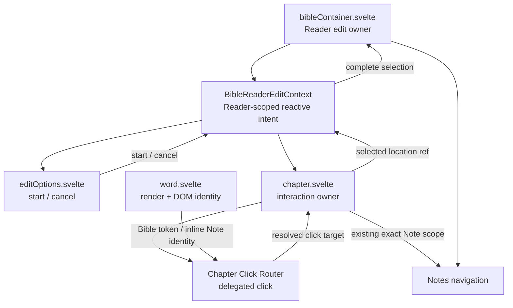
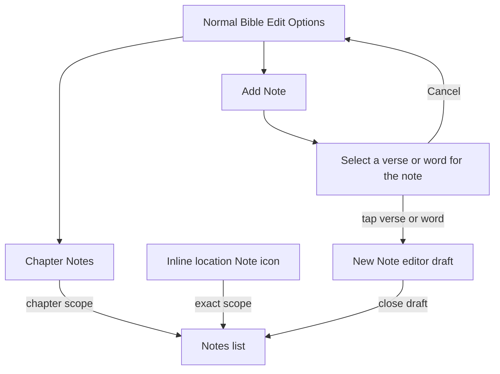

# Bible Note Location Selection

## Status

Implementation complete.

Completed:

```text
Notes navigation scope/create-intent contract
exact/chapter installed-Note filtering
chapter-level draft initialization
Bible edit-options Chapter Notes action
Bible Add Note location-selection interaction
direct Notes editor entry at selected verse or word
single delegated chapter click router for reading/edit/Note interactions
delegated inline exact-Note activation
reusable expandable action cluster
Bible color-picker migration to the shared cluster
```

Focused browser regression coverage is implemented. Runtime execution of the browser suite remains a worktree validation step.

This document defines the accepted Bible Reader interaction for viewing Notes associated with Scripture and creating a new Note at an explicit Bible verse or word location.

It complements:

```text
docs/03_implementation/domains/notes/001-notes.md
docs/03_implementation/domains/bible/003-text-markup-drag-editing.md
```

It does not change Note Domain ownership, Note persistence, the Notes Resource contract, or the Bible Text Markup Domain Object.

---

# 1. Purpose

Before this refactor, the Bible Reader used a selected Bible location as both:

```text
where Notes are shown
and
where a new Note is created
```

That made Note creation depend too heavily on implicit Reader selection state.

The current Reader makes those intents explicit.

There are three distinct interactions:

```text
inline Note icon at a Bible location
    = view Notes at exactly that location

Edit Options → Chapter Notes
    = view all Notes associated with the active chapter

Edit Options → Add Note
    = explicitly choose one Bible verse number or word
    = open Notes directly in a new draft at that location
```

The current interaction keeps these meanings visible to the user and distinct in navigation state.

---

# 2. Goals

The implemented feature provides:

1. unchanged exact-location Note access from inline Note icons,
2. a clear Chapter Notes action in Bible edit options,
3. an explicit Add Note flow that asks the user to choose a verse number or word,
4. direct navigation into the Notes editor after the location is chosen,
5. a chapter-level Note as the default when Add is used from the Chapter Notes list,
6. no accidental Text Markup mutation while choosing a Note location,
7. no dependence on a previously selected markup word for new Note placement,
8. a clear distinction between Notes list scope and new-Note location,
9. no Note-selection/navigation logic inside `word.svelte`; it renders affordances and DOM identity only,
10. a reusable compact/expandable action-group presentation for edit controls when appropriate.

---

# 3. Non-Goals

This feature does not introduce:

```text
a new Notes Domain Object
a new Bible location format
a new Notes persistence path
a new Notes Resource type
range-based Note anchors
multi-word Note anchors
a replacement for inline Note icons
markup gestures inside the Notes location-selection mode
```

The explicit Add Note selection targets either one Bible verse number or one Bible word. A verse number resolves to the existing verse-level location with `wordIndex = 0`.

---

# 4. Canonical Bible Locations

The active chapter uses the existing canonical chapter reference:

```text
bookID_chapter
```

Examples:

```text
1_3
43_1
```

A word Note uses the existing four-segment location:

```text
bookID_chapter_verse_wordIndex
```

Example:

```text
43_3_16_7
```

A chapter-level Note uses the chapter reference directly:

```text
43_3
```

Do not manufacture a synthetic chapter location such as:

```text
43_3_0_0
```

The existing `BibleLocationReferenceService.extractBookIDChapter()` contract already provides the canonical chapter key.

---

# 5. Three Note Interaction Meanings

## 5.1 Exact-location Note icon

The existing inline Note icon remains the affordance for Notes already associated with a specific Bible location.

Conceptually:

```text
inline Note icon beside a rendered verse-number or word token
    ↓
open Notes
    ↓
show Notes whose bibleLocationRef exactly equals that token location
```

This behavior remains location-specific.

It is not replaced by the new Chapter Notes or Add Note actions.

## 5.2 Chapter Notes action

The existing Notes/NoteStack action in Bible edit options changes meaning to:

```text
Chapter Notes
```

It opens Notes scoped to the active `bookID_chapter` and shows every installed Note whose Bible location belongs to that chapter.

That includes:

```text
chapter-level Notes
verse-level Notes when present
word-level Notes
```

The scope comparison must use parsed Bible location identity rather than a raw string prefix.

Conceptually:

```text
note.bibleLocationRef
    ↓
BibleLocationReferenceService.extractBookIDChapter(...)
    ↓
compare with active bookID_chapter
```

A Note with no Bible location is not part of the chapter-scoped list.

## 5.3 Add Note action

Bible edit options expose a separate Add Note action.

Selecting it does not immediately open Notes.

It first enters a temporary Reader interaction:

```text
Choose Note Location
```

The user then taps either the Bible verse number or word where the Note should be anchored.

Once a valid verse number or word is selected:

```text
chosen verse number or word
    ↓
bookID_chapter_verse_wordIndex
    ↓
open Notes module
    ↓
open directly in a new Note draft
```

The user should not need to press Add again after choosing the location.

---

# 6. Edit Options Interaction

## 6.1 Normal edit state

Normal Bible edit options continue to expose Text Markup controls.

The edit bar groups related actions without forcing every group into the same visual treatment.

The color picker uses the shared expandable action cluster because its opaque swatches remain visually distinct when overlapped.

The Notes actions remain adjacent independent buttons:

```text
Text Markup actions | Chapter Notes  Add Note
```

A subtle vertical divider separates the Text Markup controls from the Notes action group. The two Note actions remain semantically distinct and require accessible labels.

## 6.2 Choose Note Location state

After Add Note is selected, the normal edit controls are replaced by an explicit instruction state.

Preferred presentation:

```text
Select a verse or word for the note                Cancel
```

The instruction should live in the edit bar rather than only in a transient toast.

A toast may supplement the interaction, but it is not sufficient as the sole explanation because location selection is a real temporary interaction mode.

Cancel returns to the previous normal edit controls without changing Text Markup or opening Notes.

---

# 7. Reader Interaction Ownership

The Note-location selection gesture should not be implemented independently inside every rendered Bible token.

The current ownership is:



The Reader-scoped Svelte context prevents temporary edit intent from being
prop-drilled between sibling Reader components. It is not a global registry and
does not replace the persistent `BibleMode` or Text Markup models.

`word.svelte` remains focused on:

```text
rendering a Bible token
Text Markup presentation
exposing Bible-token DOM identity
rendering the exact-location Note affordance + DOM identity
```

Responsibility is split deliberately:

```text
Bible Reader edit context
    = current temporary edit intent
    = start / cancel / complete coordination

chapter interaction
    = route reading / markup / Note-location clicks through one listener
    = intercept a selected verse number or word during Note-location intent
    = prevent markup / inline-Note behavior during selection
    = construct the exact selected location reference
    = open existing inline Notes with exact scope

Bible Reader container
    = open Notes in create mode
```

---

# 8. Reusing DOM Bible Word Identity

The Text Markup drag feature already gives rendered Bible tokens stable DOM identity through attributes equivalent to:

```html
<span
    data-bible-word
    data-verse="3"
    data-word-index="17"
>
```

The Note-location selection flow reuses that identity rather than adding a second per-word addressing system. Inline existing-Note affordances expose the same verse/word coordinates through `data-bible-note`, allowing the same chapter click router to open exact-location Notes without a per-Word click handler.

The chapter already knows the active `bookID_chapter`.

A selected token therefore resolves to:

```text
bookID_chapter
+
data-verse
+
data-word-index
    ↓
bookID_chapter_verse_wordIndex
```

Both verse numbers and words are valid Add Note targets:

```text
wordIndex = 0
    = verse-level Note

wordIndex > 0
    = word-level Note
```

---

# 9. Interaction With Text Markup Editing

Choose Note Location is a temporary sub-mode of Bible edit interaction.

While it is active:

```text
Text Markup click toggle
    = disabled

Text Markup horizontal drag apply/remove
    = disabled

vertical Reader scrolling
    = remains available
```

This prevents the user from accidentally highlighting, recoloring, underlining, or clearing text while trying to place a Note.

The user's existing Text Markup selections are preserved.

Canceling location selection returns to the same markup configuration that was active before Add Note was selected.

The interaction does not create a second persisted Bible mode. A small Reader-local edit intent is sufficient:

```text
markup
note-location
```

This intent is UI interaction state, not Bible Domain state. It is exposed to
Reader descendants through `BibleReaderEditContext` rather than being added to
`BibleMode` or forwarded through sibling coordination props.

---

# 10. Selected Reader Location and Add Note Behavior

Normal markup editing retains its existing contract:

```text
click word in edit mode
    ↓
mode.bibleLocationRef = exact clicked word
    ↓
perform precise Text Markup toggle
```

That behavior remains useful for ordinary Reader selection and must not regress.

However, Add Note does not rely on whatever value happened to already exist in `mode.bibleLocationRef`.

The Add Note flow establishes its location from the user's explicit verse-number or word selection after entering Choose Note Location.

The Add Note selection path does not write the chosen location into `mode.bibleLocationRef`. `chapter.svelte` constructs the exact location from delegated DOM identity and reports it through `BibleReaderEditContext`; `bibleContainer.svelte` then exits edit mode and opens Notes with that explicit create location.

---

# 11. Notes Navigation Contract

Notes navigation now distinguishes explicitly between:

```text
which Notes the list should show
from
which Bible location a new draft should use
```

These are separate concepts.

The current contract is:

```ts
interface NotesBibleScope {
    kind: 'exact' | 'chapter';
    bibleLocationRef: string;
}

interface NotesNavigationIntent {
    noteID?: string;
    bibleScope?: NotesBibleScope;
    createBibleLocationRef?: string;
}
```

A bare root-level `bibleLocationRef` is not a supported compatibility form; `parseNotesNavigationIntent()` rejects it. Current callers must use `bibleScope` when they want Bible-scoped Notes.

## 11.1 Inline Note icon

Inline exact-location Note access uses:

```text
bibleScope.kind = exact
bibleScope.bibleLocationRef = exact verse or word location
```

No automatic draft is created.

## 11.2 Chapter Notes

Chapter Notes uses:

```text
bibleScope.kind = chapter
bibleScope.bibleLocationRef = bookID_chapter
```

No automatic draft is created.

## 11.3 Direct Add Note

Direct Add Note uses both concepts:

```text
bibleScope.kind = chapter
bibleScope.bibleLocationRef = current bookID_chapter

createBibleLocationRef = selected exact verse or word location
```

This allows Notes to open directly in the new draft while retaining the chapter list as the backing context.

If the new draft is closed, the Notes module naturally returns to Chapter Notes rather than the global Notes list.

---

# 12. Notes List Filtering

Exact scope preserves the existing equality behavior:

```text
note.bibleLocationRef === exact scope ref
```

Chapter scope uses Bible location parsing:

```text
note.bibleLocationRef exists
    ↓
extractBookIDChapter(note.bibleLocationRef)
    ↓
compare with chapter scope ref
```

The Notes list should not infer chapter scope merely because a two-segment `bibleLocationRef` was supplied.

Scope meaning must come from the explicit navigation contract.

This avoids giving the same string different meanings in different callers.

Location-scoped Notes remain installed-only under the current availability model because unresolved Note Resource descriptors do not expose Bible-location metadata.

---

# 13. Creating a Chapter-Level Note

When the user opens Chapter Notes and presses the normal Notes-list Add action, the default new Note location is the chapter scope itself:

```text
bookID_chapter
```

Example:

```text
43_3
```

The current Notes draft initializer assumes any supplied Bible reference includes a verse.

That initializer must be extended intentionally for chapter references.

A chapter-level draft should use chapter-level metadata such as:

```text
bibleLocationRef
    = 43_3

bibleReferenceText
    = John 3

title
    = John 3
```

It should not call the verse-loading path or manufacture a verse quotation when no verse was selected.

---

# 14. Creating a Verse- or Word-Level Note Directly

After the user chooses a verse number or word from the Bible Reader, the Notes module opens directly into a transient new Note draft at that exact location.

The existing Note draft lifecycle remains authoritative:

```text
new draft
    = editor-local state

Save
    → NotesService.put(...)

close without Save
    → no persisted Note
```

Direct creation changes how the draft is entered, not how Notes are persisted or published.

The existing verse/word draft metadata and verse quotation behavior may be reused. A verse-number target uses `wordIndex = 0`, so its title/reference remains verse-level without a word suffix.

---

# 15. Reusable Expandable Action Group

The Bible edit color picker already uses a compact collapsed stack that expands into multiple options.

The Notes action work prompted extracting that presentation into a reusable component. The final Notes UI does not use overlapping icons because transparent icon shapes do not preserve enough identity when stacked.

The reusable presentation component remains justified for action sets, such as color swatches, whose items remain visually distinct when overlapped.

Conceptually:

```text
KJVExpandableActionCluster
```

The shared component may own:

```text
expanded/collapsed state
collapsed overlap spacing
expanded spacing
stacking/z-index treatment
transition timing
aria-expanded behavior
collapse after selection when requested
```

The component must not own:

```text
Bible behavior
Notes behavior
Text Markup behavior
color semantics
navigation
```

The caller supplies the actual actions/content.

The shared `KJVExpandableActionCluster` is implemented under `src/lib/components/actions`. The Bible color picker uses it for the overlapping swatch presentation, where each item has a naturally distinct opaque surface.

The Notes actions remain separate adjacent buttons. Their transparent icon shapes did not preserve enough identity when overlapped, so `editOptions.svelte` uses a simple vertical divider to separate the Text Markup actions from the Notes action group instead of forcing the shared stack presentation.

---

# 16. Interaction Flow



For direct Add Note, the backing `NotesList` is chapter-scoped even though the editor initially opens directly.

---

# 17. Accessibility and Feedback

The interaction should expose clear accessible names:

```text
Chapter Notes
Add Note
Cancel note location selection
```

The temporary selection state must provide visible text, not icon-only instruction.

The instruction should remain present until:

```text
a valid verse number or word is selected
or
Cancel is activated
```

The implementation should not depend on hover because the Bible Reader is mobile-first.

---

# 18. Performance

This feature does not require polling, observers, or continuous geometry scanning.

Choose Note Location is active only after the user explicitly selects Add Note.

The implementation reuses the existing rendered token identity and the Reader's single delegated chapter click router rather than measuring every Bible word or installing per-Word click handlers.

Entering Note-location selection only changes the router's current intent. It does not add polling, observers, geometry scans, or another persistent chapter click listener.

---

# 19. Testing

## 19.1 Notes scope tests

Cover:

```text
exact scope includes only exact matching location
chapter scope includes chapter-level Note
chapter scope includes word-level Notes in chapter
chapter scope excludes another chapter
chapter scope excludes Notes without Bible location
```

## 19.2 Draft creation tests

Cover:

```text
no Bible scope → standalone Note
chapter scope Add → chapter-level Note
chapter-level Note does not load a verse
verse-level create → exact verse/0 bibleLocationRef
verse-level create omits a word suffix
word-level create → exact word bibleLocationRef
word-level create preserves existing verse-derived draft metadata
```

## 19.3 Reader interaction tests

Cover:

```text
Add Note enters location-selection mode
markup drag is disabled while selecting location
markup click toggle is disabled while selecting location
verse-number click resolves exact book/chapter/verse/0 location
word click resolves exact book/chapter/verse/word location
Cancel restores normal edit controls
selected verse number or word opens Notes directly in new draft
```

## 19.4 Navigation tests

Cover:

```text
inline Note icon → delegated chapter click → exact scope
Chapter Notes → chapter scope
Add Note → chapter scope + createBibleLocationRef
closing direct-create draft reveals Chapter Notes
```

## 19.5 Regression checks

Verify:

```text
normal Text Markup click behavior remains unchanged
horizontal Text Markup drag remains unchanged
existing inline Note icons still open exact-location Notes
ordinary global Notes opening remains unchanged
new Note drafts remain transient until Save
```

---

# 20. Completed Implementation Sequence

The feature was implemented in small slices in this order:

```text
1. Notes navigation scope/create intent contracts
2. Notes list chapter-scope filtering + chapter-level draft initialization
3. Bible Chapter Notes action
4. Bible Add Note location-selection interaction
5. direct Notes editor entry at selected verse or word
6. reusable expandable action cluster
7. behavior-preserving Bible color-picker migration to shared cluster
8. browser/touch regression coverage
```

Each slice should preserve the existing behavior not owned by that slice.

---

# 21. Accepted Mental Model

```text
inline location icon
    = Notes here

Chapter Notes
    = Notes anywhere in this chapter

Add Note
    = explicitly choose one verse number or word
    = create a Note there
```

And at the Notes boundary:

```text
scope
    = what Notes are visible

create location
    = where the new draft belongs
```

Those concepts must remain distinct.
