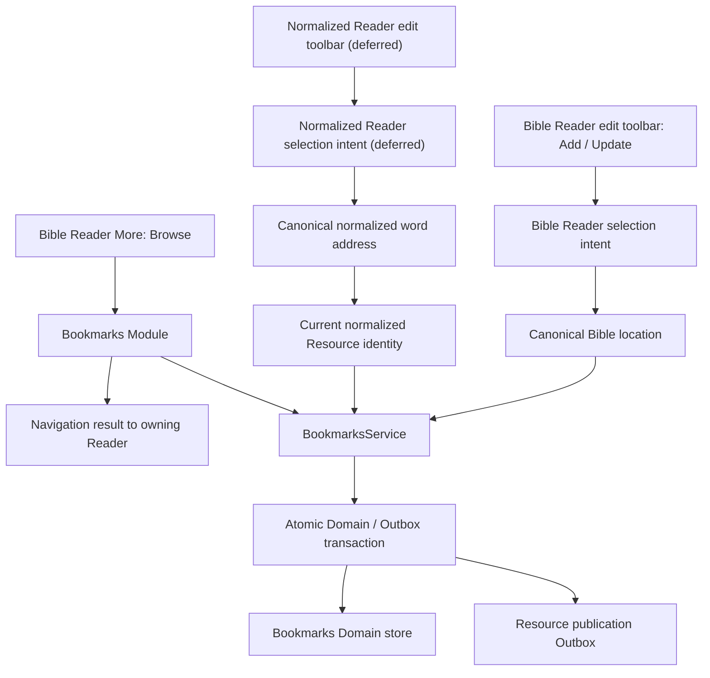
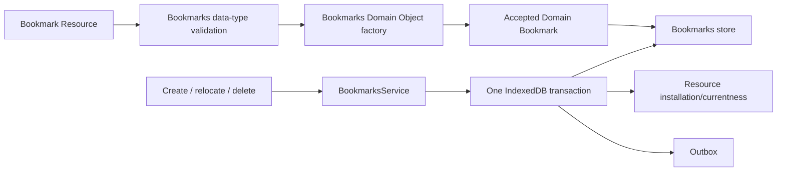
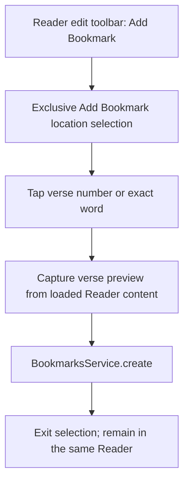
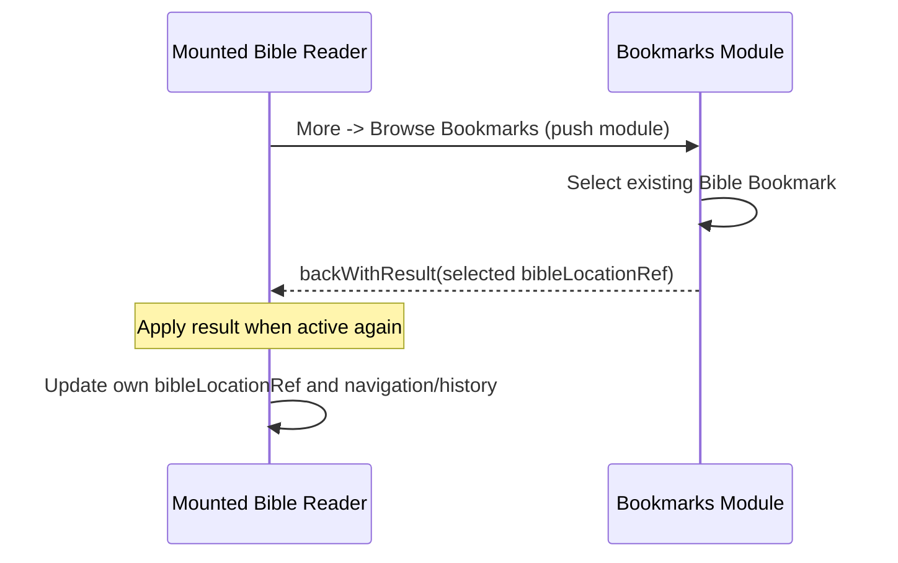

# Bookmarks Domain and Module — Implementation and Verification

**Status:** Bookmarks Domain, Resource lifecycle, service, Bookmarks Module and Bible Reader Add/Browse/Update/Delete wiring are implemented. Local cross-Reader create/delete refresh was manually verified; focused inline-marker and pane-navigation regression tests have been added but were not executed in the reconstructed archive. Full browser validation and generic external Resource-installation invalidation remain unverified. Normalized Reader UI is deferred.
**Scope:** One first-class Bookmarks domain and Bookmarks Module supporting Bible and normalized-document content, with tightly limited Reader integration.
**Reference:** Current Notes, Bible Reader, Search result actions and normalized-document implementations. Verify exact API names and paths against the source when implementing. This document distinguishes existing behavior from proposed changes.

This implementation record follows [Application Domains](../../../01_application-architecture/004-domains.md), [Module Presentation](../../../01_application-architecture/012-module-presentation.md), the [Resource Boundary](../../../02_resource-boundary/_index.md), and the [Domain Implementation Map](../../010-domain-implementation-map.md). The current source is authoritative for implemented behavior; remaining verification requirements are distinguished below.

## 1. Decision record

The following decisions are **accepted** for this workstream:

1. Bookmarks form a **new, first-class Domain** with their own model, Resource contract, validation, factory, Domain store, services, publication, module UI, and tests.
2. A Bookmark has a **stable identity independent of its target**. Relocation changes the existing Bookmark; it does not create a replacement identity.
3. **Multiple independent Bookmarks may target exactly the same location**, even for the same user.
4. **Add Bookmark and Update Bookmark are separate Bible Reader edit-toolbar actions.** Add saves directly and stays in the Reader. Update selects the **new destination first**, then opens Bookmarks to choose the existing Bookmark to move. Neither is a normal-reading word action.
5. Bible Bookmarks use **canonical `bibleLocationRef`**, without Bible version/publisher in the Bookmark target identity.
6. Normalized-document Bookmarks belong to **one specific publisher-owned Resource**, identified by its `publisher + resourceId` pair (the Normalized Content Domain's existing document identity). They do not match another publisher's copy and require no content hash.
7. Normalized word locations use the existing **canonical `blockId + contentIndex`** address within that document. These addresses are snapshot-local; when a Resource is updated, revalidate the address against loaded content rather than guessing a relocated word.
8. Changes are **concentrated within Bookmarks**. Outside that domain, use only small composition/registration wiring and the minimum existing Bible Reader edit-option, More, selection and navigation-result paths; normalized Reader UI is deferred. Do not redesign Notes, Bible mode, normalized parser/renderer, generic Resource lifecycle, or navigation runtime.
9. **Browse Bookmarks belongs in the Bible Reader More actions**, not the edit toolbar. Use the supplied **bookmark-stack** SVG. A selection made from that Reader returns a location result and updates that **same mounted Reader**; do not push another Bible Reader. A standalone Bookmarks module may still open a Bible Reader.
10. **Update Bookmark** uses the supplied **bookmark-check** SVG: choose a new Bible verse/word in Reader edit mode, open Bookmarks in relocation mode, select an existing Bible Bookmark, confirm old/new locations, then save the existing ID. Relocation is not based on the newest Bookmark or an automatically chosen Bookmark.
11. **Delete Bookmark** starts from its own list-item action, opens a confirmation view, and deletes by stable ID only after confirmation. Cancel/Back makes no change.
12. Store an **updated timestamp and a short display-text snapshot** on the Bookmark. Bible previews show the containing verse even for word-level targets; normalized-document previews will show suitable sentence/context text when its Reader integration is implemented. Preview metadata is presentation context, **not target identity**.
13. Reuse `BookmarksService.subscribe()` / `refresh()` as the Bookmark change-invalidation mechanism for every mounted consumer; audit accepted external Resource installation notifications rather than adding another PubSub architecture.
14. Existing Bookmarks model/Resource, IndexedDB transactions, service, App/Resource registration, initial module, Bible Add selection and inline-indicator wiring are present. The metadata model, Resource contract and Reader-captured verse previews are implemented; Reader More → Browse and result navigation are implemented; Update destination-first selection and relocation confirmation are implemented; Delete list action and confirmation UI are implemented; full browser validation remains pending. Normalized Reader integration stays deferred.

## 2. Source audit and architecture facts

Confirmed in the source snapshot used for this design (revalidate before implementation):

| Existing component | Relevant fact | Consequence |
|---|---|---|
| `domains/notes` | Notes has a dedicated model, data-type handler, Domain Object factory, service, IndexedDB transaction, Resource publication and navigation module. | Use as the implementation pattern, not as Bookmark storage. |
| `notes-write-transaction.ts` | Writes the Domain Object, installation currentness, and Outbox within one transaction. | Preserve atomic local authority/publication semantics. |
| `bible-reader-edit-context.ts` | Holds temporary mutually exclusive edit intents, including Note and Bookmark location selection, outside persisted Bible mode. | Reuse it for separate Add and Update selection flows, without coupling Notes and Bookmarks prompts. |
| `bible-chapter-click.ts` | The chapter has one capture-phase delegated click router with distinct Note and Bookmark branches. | Add/Update Bookmark selection reuses this router; do not merge Note/Bookmark semantics or add a second per-word listener. |
| `bible-token-location.ts` | Converts chapter + verse/word token into `bookID_chapter_verse_wordIndex`; verse-number token has index `0`. | Use the shared Bible Reader token-location helper for Notes and Bookmarks. |
| `normalized-content-address.model.ts` | `NormalizedContentAddress` is `{blockId, contentIndex}` and is **snapshot-local**, not cross-revision. | Validate the target is a `word` against the opened document. |
| `normalized-document-id.ts` | Standalone normalized Domain identity is `publisher/resourceId`. | Reuse this document Resource identity for normalized Bookmark lookup and navigation. |
| `normalized-content-text-markup.model.ts` | Existing markup identity includes publisher, Resource ID and `modifiedAt`. | Bookmarks use the document's stable Resource identity, not markup's exact revision identity. |
| `normalizedContentReader.svelte` | Reader currently owns edit state and a word-activation callback. | Add selection and service integration at Reader level, not a second word handler. |
| `normalizedContentTextMarkupEditOptions.svelte` | Owns normalized edit toolbar. | Reserve future normalized Bookmark actions for this boundary; integration is deferred. |
| `resource-descriptor.ts` | Descriptor metadata carries `publisher`, `resourceId`, and `modifiedAt`. | The Reader already has the required document identity; content hashing is unnecessary. |
| `bible-menu-navigation-result.ts` / `bible-location-navigation-result.ts` | Menu and location results use `backWithResult()` plus activation-aware handling. | Reuse the result flow when Browse returns to the same mounted Reader. |
| `searchResultActions.svelte` | Search list rows use separate `KJVIconButton` actions. | Follow this structure for the Bookmark row Delete action, distinct from tapping the row body. |
| `BookmarksService` | `subscribe()` returns an unsubscribe callback and `refresh()` notifies subscribers; writes notify after commit. | Reuse this PubSub/invalidation contract rather than creating another event bus. |

## 3. Ownership and boundaries



- **Bookmarks** owns Bookmark identity, targets and saved display metadata, validation and acceptance, queries, create/relocate/delete operations, Bookmarks list/selection/confirmation views, and Bookmark Resource publication. It returns navigation **intent/results**, not direct mutations of a Bible Reader.
- **Bible** continues to own Bible reference formats, token-to-reference conversion, chapter DOM target resolution, Reader interaction policy, version selection, and updating the Reader location when it receives a Bookmark navigation result. Bookmarks stores a Bible-owned reference but does not invent a new Bible addressing grammar.
- **Normalized Content** continues to own normalized schema, canonical block/content addressing, token semantics, and document presentation. The Bookmarks boundary consumes its public `NormalizedDocument`/`NormalizedContentAddress` contracts, without altering their identity.
- **Resource** owns generic discovery, resolution, validation dispatch, installation and currentness. Bookmarks supplies its domain-specific handler/factory/publication only.
- **Application** owns composition and module/runtime registration. Minimal additions here are unavoidable and explicitly allowed.

**Import rules:** Within Bookmarks use relative imports. Cross-owner consumers use `$lib/domains/bookmarks`; browser/Svelte exports use `$lib/domains/bookmarks/ui`; keep the root barrel Node-safe. Do not introduce a shared generic annotation/target domain simply for this feature.

## 4. Domain model — discriminated target, independent ID

The following is the **current Bookmark model**, including its saved display metadata:

```ts
/** Stable Bookmark-owned domain ID: <owner>/default/<uuid>. */
interface Bookmark {
  readonly id: string;
  readonly target: BookmarkTarget;
  /** Milliseconds since Unix epoch; changes on creation/relocation. */
  readonly updatedAt: number;
  /** Bounded, plain-text snapshot for a recognizable list preview. */
  readonly previewText: string;
}

type BookmarkTarget =
  | {
      readonly kind: 'bible';
      /** Version-independent canonical exact reference. */
      readonly bibleLocationRef: string;
    }
  | {
      readonly kind: 'normalized-document';
      /** Exactly one normalized document Resource (publisher + Resource ID). */
      readonly document: {
        readonly publisher: string;
        readonly resourceId: string;
      };
      /** Initial supported target is an exact canonical word. */
      readonly address: {
        readonly kind: 'word';
        readonly blockId: string;
        readonly contentIndex: number;
      };
    };
```

Implementation may select other names, but preserve the **identity distinctions and serialized semantics**. Keep Resource-level identity and Domain Object ID separate (e.g. `bookmarks/bookmark:<owner>/default/<uuid>` for stored-object type + ID, following the current infrastructure conventions).

**Identity examples:**

- Bookmark ID: `<owner-pubkey>/default/<uuid>`.
- Resource type: `bookmarks/bookmark`.
- Resource ID: `kjvonly/bookmarks/bookmark/default/<uuid>`.
- Data type/version: `kjvonly.bookmark` / `1` (single current contract; metadata required).
- One Bookmark per replaceable Resource; bundles are unsupported.
- The normalized target includes the **document's publisher and Resource ID** as its durable matching and navigation identity. Relocation may change this target but not the Bookmark ID.

`updatedAt` and `previewText` are the only new model fields. Do not add title, description, order, folder or color as part of this change. A future `anchor.kind: 'block'` can be added with an explicit versioned contract; **the current target contract supports Bible verse/word and normalized word**.

### 4.1 Saved display metadata (domain and Resource contract implemented)

- `updatedAt` is a UTC Unix-epoch **millisecond** number, set by the Bookmarks service on **creation and successful relocation**; consumers display it in local format. Values must be positive safe integers. The clock is injectable and relocation advances at least one millisecond even if the clock has not advanced. It is not the Resource publication `modifiedAt`, which serves ordering/currentness. Use an injectable clock for deterministic tests.
- `previewText` is a validated **plain-text snapshot** bounded to 4096 UTF-16 code units and captured from the selected content, not a live content reference. Selecting an individual Bible word still snapshots the **containing verse**, not just that word. For normalized content, the Reader captures a short word-context preview.
- The Reader/owning content layer will supply the actual display text from its loaded content, while Bookmarks validates, stores and publishes the snapshot. The Bookmarks list renders it without loading every referenced chapter or document. The source translation may differ from a later Reader selection: **preview text is context, not authoritative Scripture or a target identity**.
- Relocation refreshes `target`, `updatedAt` and `previewText` together under the **same Bookmark ID** and one existing atomic Domain/Outbox transaction. Neither display field affects target matching. Deletion is still by ID.
- The model, Data Type validation, factory, Resource representation, publication, persistence and service tests use the single `kjvonly.bookmark` / `1` contract with required `updatedAt` and `previewText` fields. No compatibility handler or installed-object migration is retained during development. Target-only Bookmark Resources or stored objects created before this contract change must be cleared or republished in the development environment. Empty previews remain valid for callers without available preview metadata.


### 4.2 Target comparison and duplicate policy

- `Bookmark.id` determines object identity and replacement/deletion.
- Bible target equality means same canonical `bibleLocationRef`.
- Normalized target equality means same `document.publisher + document.resourceId`, `address.kind`, `blockId`, and `contentIndex`. Other publishers or Resource IDs never match automatically.
- `listAtTarget()` returns an **array**, never a singleton, because duplicate locations are allowed.
- Creating a second Bookmark for the same owner and location creates a **new UUID**. Do not silently update or deduplicate.
- Moving a Bookmark changes its `target`, `updatedAt` and `previewText`; it re-publishes under its **existing ID**. Other Bookmarks at the old or new location are unaffected.

## 5. Normalized-document Resource identity and word addressing

### 5.1 Document scope

Each normalized Bookmark targets **exactly one normalized-document Resource**, using the same `publisher + resourceId` identity as `createNormalizedDocumentId()` in the Normalized Content Domain. The Reader obtains these values from its existing validated `ResourceDescriptor`; it must not read or hash the document payload just to create a Bookmark.

- The Bookmark's **owner/publisher** identifies who may edit the Bookmark and is separate from the **document publisher** inside the target.
- Two Resources containing identical words or normalized blocks, but published under different identities, have **different Bookmark targets**. Cross-publisher equivalence is deliberately unsupported.
- A different Reader opening the *same* publisher + Resource ID can display the Bookmark at the saved word address, subject to anchor validation.
- Document Resource IDs are opaque and may contain `/`; do not parse the combined Domain ID by naïvely splitting it into path segments. Keep the publisher and Resource ID as two opaque target fields; Bookmarks validates their structure without constructing a Normalized Document Domain Object.

### 5.2 Word anchor

`NormalizedContentAddress` is the existing `{blockId, contentIndex}` pair. The selected address is valid for Bookmark creation only if `resolveNormalizedContentAtAddress(document, address)?.type === 'word'`. The Reader can use that exact address to place a marker; no digest, extra index scheme, or different word-resolution mechanism is necessary.

These positions are **snapshot-local**. A future publication under the same Resource ID may revise the document and shift or remove words. The Bookmark target contract does not automatically migrate anchors: recheck the address against the opened document and avoid rendering markers on nonexistent or non-word entries. If the same address now points at a *different* word, Resource identity alone cannot detect that semantic change; revision-aware re-anchoring is deferred rather than introducing new hashing infrastructure.

### 5.3 Indexed lookup

Query normalized Bookmarks by the exact `publisher + resourceId` pair, then group by `blockId + contentIndex` for visual markers. Avoid querying the entire Bookmark collection for each word. Do not use document body hashing or Blossom/content transport hashes for lookup.

## 6. Bible location semantics

- Bible target is only `{kind:'bible', bibleLocationRef}`: **no Bible version ID, Resource publisher, translation code, chapter Resource ID or revision**.
- Verse number anchor uses `bookID_chapter_verse_0`.
- Word anchor uses `bookID_chapter_verse_wordIndex` with a positive word index.
- Derive and validate through existing Bible reference ownership, not regex heuristics invented in Bookmarks.
- Query and render the same Bookmark against any loaded Bible version at the same canonical reference **when that target token is available**. Different Bible translations may tokenize words differently; the stored identity remains version-independent but cannot promise the *same lexical word* in every translation. Never silently remap an out-of-range word to an unrelated token; verse-level references are more robust.
- Changing Bible version must re-evaluate rendered markers for the same canonical reference, without modifying stored Bookmarks.

## 7. Resource, installation, persistence, publication



**External Resource path:** validate data type/version and a strict `BookmarkTarget` discriminant; parse Bookmark identity from Resource publisher + Bookmark-owned Resource ID; verify the publisher corresponds to the Domain owner; factory creates exactly one Bookmark Domain Object. Reject unknown/ambiguous target kinds, invalid UUID/owner parts, invalid document Resource identity, invalid/negative content indices and unwanted extra fields. A normalized target's final `blockId/contentIndex` can only be verified **against the actual document** when available; do not claim a Bookmark Resource alone proves the referenced document exists.

**Local write path:** `BookmarksService` validates permission/owner and target; atomically writes Domain Object, associated local Resource installation/currentness state, and a last-write-wins Outbox entry keyed by the stable Bookmark Domain ID. The `updatedAt`/`previewText` fields participate in the same write. Follow Notes' monotonic Resource `modifiedAt` and publish/delete semantics, without bypassing the generic Outbox or creating a Bookmark-specific sync engine. Wake publication and notify subscribers **after** the transaction succeeds. Preserve offline CRUD.

**Deletion:** include deletion Resource publication and local removal in v1 service contracts, even if the first UI slice adds delete later. The delete targets the **Bookmark ID**, never all bookmarks at an equal location.

**Authenticated ownership:** Only the active account can edit/delete its Bookmark. Do not let a late async callback from a prior account write on behalf of a newly active account. Imported third-party Bookmarks may be displayed if accepted by the generic Resource pipeline; ownership controls mutation.

**Archive/import/export:** Bookmark objects participate via existing Domain Object / Resource archive registration. Do not introduce bespoke archive protocols. Register only the Bookmark-specific codecs/factories where architecture already requires them.

## 8. Domain-facing service API and PubSub

The existing `BookmarksService` already provides create/relocate/delete, target queries,
`getChapterBookmarksByLocation(bibleLocationRef)`, `subscribe(listener)` and `refresh()`.
The service accepts the Reader-captured containing-verse preview for Add; it also accepts an empty string for callers without a preview (including deferred normalized Reader integration):

```ts
interface BookmarksService {
  create(target: BibleBookmarkTarget, previewText?: string): Promise<Bookmark>;
  relocate(id: string, target: BibleBookmarkTarget, previewText?: string): Promise<Bookmark>;
  delete(id: string): Promise<void>;
  get(id: string): Promise<Bookmark | undefined>;
  list(): Promise<readonly Bookmark[]>;
  getChapterBookmarksByLocation(bibleLocationRef: string): Promise<ChapterBookmarksByLocation>;
  subscribe(listener: () => void): () => void;
  refresh(): void;
}
```

- The service, not the Reader, stamps `updatedAt` on creation/relocation. It also verifies ownership and writes the preview snapshot together with the target. Normalized-document operations use the same `create(target, previewText?)` and `relocate(id, target, previewText?)` signatures as Bible operations. Only the Normalized Content Reader interprets and validates word addresses against document content.
- `create` allocates a new UUID even if other Bookmarks share the target. `relocate` retains the selected Bookmark's ID and Resource publication key; never delete/recreate to move it. `delete` acts on one exact ID.
- The Reader sends the **current `bibleLocationRef`** to the chapter lookup. The Bookmark service extracts chapter scope and projects exact verse/word anchors; do not reintroduce chapter-owned filtering or per-word requests. This is analogous to Paragraphs and Pericopes loading.
- `subscribe(listener)` is **change invalidation**, not a second canonical Bookmark store. The chapter and each mounted Bookmarks view unsubscribe through their normal lifecycle, and on notification they re-query only the projection they display. Multiple open Readers/panes must all refresh after add/move/delete. No additional custom PubSub layer or cross-component calls.
- Existing local commits notify **after success**; Application explicitly invokes `refresh()` after accepted archive imports. Generic Resource-worker installations do **not** currently invoke this Bookmark invalidation path; automatic live-sync updates are unverified. A proposed generic `ResourceWorkerClient` handled-install listener was deliberately backed out. Do not claim that external acceptance automatically refreshes Readers or reintroduce that listener without a demonstrated use case and an accepted owning boundary. Keep Resource/Data ownership and Outbox wakeup separate from UI delivery.
- Delayed asynchronous queries must not replace a different currently displayed chapter or document. Follow the existing Paragraphs/Pericopes request and lifecycle conventions; do not introduce a parallel Bookmark request-sequence manager without a demonstrated need.
- The active account is verified before and during writes; a delayed update may not mutate another account's Bookmark.

## 9. Reader and Bookmarks Module workflows — Bible first

### 9.1 Reader action placement and icons

| Action | Entry point | Icon | Effect |
|---|---|---|---|
| Add Bookmark | **Bible Reader edit toolbar**, after Notes with the existing group separator | Existing supplied `bookmark-add` SVG | Select verse/word, create immediately, remain in Reader |
| Update Bookmark | **Bible Reader edit toolbar**, next to Add Bookmark | Supplied `bookmark-check` SVG | Select **destination first**, then choose which existing Bookmark to move |
| Browse Bookmarks | **Bible Reader More actions**, not edit toolbar | Supplied **bookmark-stack** SVG | Show Bookmark list and return selection to the **same** Reader |
| Inline Bookmark marker | Beside bookmarked verse-number/word, including in reading mode | Supplied `bookmark` SVG | Open Bookmarks scoped to this exact location |
| Delete Bookmark | Separate list-item action | Shared Delete/trash control | Push Bookmark-owned confirmation view; only confirmation deletes |

Use the caller's standard header/action affordances and SVG component conventions. `bookmark-check` uses the supplied path
`m438-400 198-198-57-56-141 141-57-57-57 57 114 113ZM200-120v-640q0-33 23.5-56.5T280-840h400q33 0 56.5 23.5T760-760v640L480-240 200-120Zm80-122 200-86 200 86v-518H280v518Zm0-518h400-400Z`;
`bookmark-stack` uses
`M480-240 63-467l84-46 333 182 333-182 84 46-417 227Zm0 160L63-307l84-46 333 182 333-182 84 46L480-80Zm0-320L40-640l440-240 40 22v178h327l73 40-440 240Zm0-91 200-109H440v-167L207-640l273 149Zm-40-109Z`.
Do not reuse the earlier Chapter Bookmarks icon for Browse.

### 9.2 Add Bookmark — save without opening the list



- Verse-number target is `bookID_chapter_verse_0`; a word uses its positive `wordIndex`. Neither includes Bible version.
- Add does **not** navigate to the Bookmarks module or display a post-save Bookmark list. Subscription invalidation refreshes inline indicators; the current Reader and location remain unchanged.
- Keep the existing delegated chapter click router with a **separate Bookmark branch**, and separate Bookmark and Note prompt snippets. Selection excludes Text Markup changes, Note activation and normal reading clicks without interfering with scrolling.
- Cancel/back/edit exit does not create a Bookmark. Report a failed write and leave the interaction recoverable without falsely showing a saved marker or discarding unrelated Text Markup.

### 9.3 Update Bookmark — destination first, then choose the existing ID

```mermaid
sequenceDiagram
    participant R as Existing Bible Reader
    participant B as Bookmarks Module
    participant S as BookmarksService
    R->>R: Update action; pick destination verse/word
    R->>B: pushModule Bookmarks (relocate mode, destination)
    B->>B: Show existing Bible Bookmarks (all books)
    B->>B: Select Bookmark ID to replace/move
    B->>B: Show confirmation: current location -> destination
    B->>S: relocate(existing ID, destination, captured verse preview)
    S-->>B: Same ID with updated target + metadata
    B-->>R: Back to existing Reader
```

- A **new destination is chosen first** in the Bible Reader edit toolbar, using the supplied `bookmark-check` icon and an Update-specific prompt (for example, *Select the new verse or word for this bookmark*). This is distinct from Add and distinct from the Notes selection prompt.
- Only **after** the destination is selected does the Reader push the Bookmarks module with an explicit relocation navigation intent carrying the destination reference and its verified verse-preview snapshot. The Reader does not pick or guess a Bookmark ID.
- In relocation mode, the Bookmarks module lists selectable **Bible** Bookmarks across every chapter and book; don't chapter-filter to the destination. Normalized-document Bookmarks are not selectable for this Bible-only relocation flow.
- Tapping a Bookmark in relocation mode **selects that ID** and shows a confirmation view showing the **old and new locations**. It does not navigate the Reader or mutate the Bookmark yet. Confirmation invokes `BookmarksService.relocate` for the existing ID. Cancel/Back leaves it unchanged.
- On success, return/pop to the **existing mounted Reader** at the destination, with refreshed inline markers. When an identical target is selected, treat it as a no-op rather than manufacturing a new ID/publication. On failure, retain the confirmation/selection context and present the error.
- Do not introduce a "last Bookmark", active-Bookmark flag or timestamp-based relocation heuristic. `updatedAt` is for display/sorting, **not** choosing which Bookmark to move.

### 9.4 Browse Bookmarks — More action and existing-Reader navigation



- Browse originates from **Reader More actions** via the **bookmark-stack** icon. It opens all Bible Bookmarks by default, not only the current chapter; an inline marker can instead request exact-location scope. Retain exact/chapter scoping for other explicit entry points, but do not confuse such filters with Bookmark anchor precision.
- In Reader-origin Browse mode, tapping a Bible Bookmark returns a **typed navigation result**, carrying its version-independent canonical `bibleLocationRef`. The Bookmarks view uses `navigation.backWithResult()`; the **Bible Reader** handles the result through `whenActive` and its existing location-update path. Bookmarks must not mutate the Reader's state directly, and **must not push another Bible Reader** in this flow.
- The Reader keeps its mounted instance, selected Bible version, pane and navigation stack. A standalone Bookmarks module opened from the Modules launcher, with no originating Reader requesting a result, may still push a Bible Reader when a Bookmark is opened.
- The Bookmarks-owned navigation contract uses `browse` (with optional Reader return result / exact-location filter) and `relocate` (with destination). Its implemented shape, simplified for documentation, is:

```ts
type BookmarksNavigationIntent =
  | {
      mode: 'browse';
      returnBibleLocationToReader?: boolean;
      bibleChapterRef?: string;
      bibleLocationRef?: string;
    }
  | {
      mode: 'relocate';
      destinationBibleLocationRef: string;
      destinationPreviewText: string;
    };

// Result returned only to an originating Bible Reader:
interface BookmarkBrowseResult {
  type: 'bookmarks.bible-location-selected';
  bibleLocationRef: string;
}
```

  The absence of a Reader-return request distinguishes standalone Browse from Reader-origin Browse. Chapter and exact-location list filters are **not** relocation targets. Validate **only Bookmarks-owned** navigation fields. Do not examine, copy or manually rebuild `resourceSelections`, which remains owned by the existing navigation system.
- The return result must be distinguished from Notes/other Bible navigation results, and stale/hidden parent entries should follow the existing activation-aware result handling. `backWithResult()` delivers before the child is popped; the Reader applies its state change once active.

### 9.5 Delete Bookmark — explicit confirmation

```text
Bookmarks list -> Delete action -> Bookmarks confirmation view
                                 -> Cancel / Back: no change
                                 -> Confirm: BookmarksService.delete(bookmark.id)
                                 -> Return to refreshed list
```

- The separate Delete icon belongs to the Bookmark row's standard action area, following the Search result action-item pattern (`KJVIconButton` and a distinct primary row hit target). It cannot accidentally invoke Browse or relocation row selection.
- The confirmation view identifies the Bookmark by its preview/reference. Only an explicitly confirmed action deletes it **by stable ID**, never all Bookmarks sharing the location.
- On a failed delete, remain on the confirmation view and show the error. On success, subscriber invalidation refreshes lists and all mounted Reader markers. Cancel/Back is non-destructive.

### 9.6 Normalized Content Reader — implemented

The normalized Reader handles Add, inline indicators, current-document Browse,
and destination-first relocation. The Reader verifies selected and returned word
addresses against the loaded `NormalizedDocument`, captures `previewText`, and
passes only the canonical target and preview to Bookmarks. The Bookmarks Domain
never receives a `NormalizedDocument` or queries content to validate an address.
Inline markers are projected from Bookmarks' stored Resource IDs and addresses;
the generic renderer attaches them only to rendered word elements. The main
Bookmarks Module also opens normalized documents through Resource-aware Reader
navigation without retrieving content before opening the Reader.

## 10. Bookmark list presentation, rendering and accessibility

The Bookmarks list follows the existing **Search result row/action structure**:

- **Primary content:** icon indicating source kind (Bible icon for Bible, document icon for normalized), human-friendly location (`John 3:16`, without appending `word 7` or `(verse)`), saved verse/context `previewText`, and localized last-updated date from `updatedAt`.
- **Independent actions:** a Delete `KJVIconButton` in the standard actions area. Clicking it is not the same event as clicking the primary content. Row click returns a location in Reader-origin Browse mode or selects an ID in Update mode; do not make one callback cover both semantics implicitly.
- **Recognition:** even if the target is an exact word, display its **containing verse** as saved text so the reader can recognize the place. The snapshot avoids one Bible Resource lookup per Bookmark row. Preview can be stale after a version/content change; keep canonical target as source of truth.
- **Sorting:** newest `updatedAt` first is a display default only. Never use sorting to infer which Bookmark to relocate. Stable tie-breaking is needed for equal timestamps.
- **Normalized-document rows:** distinguish with a document icon and eventually a sentence preview. Normalized Reader opening and relocation are implemented using canonical targets and the existing pane navigation.

The shared inline `bookmark` SVG appears **immediately left** of its exact verse-number or word target, using the existing Notes affordance positioning. Group duplicates at one location instead of stacking inaccessible identical icons; selection opens a chooser/list preserving every distinct Bookmark ID. Bible markers are keyed by version-independent `bibleLocationRef`, while normalized markers are keyed by exact document Resource plus word address. Missing tokens/anchors must never be guessed.

Inline indicators and list views re-query on `BookmarksService` invalidation after successful local save, move and delete, or after an explicit `refresh()` (including archive import). Local cross-Reader create/delete refresh has been manually verified. Automatic invalidation after generic external installations has **not** been verified. No UI directly pushes updates into another component's local state. Preserve scrolling, text selection, markup and accessible keyboard/pointer activation, with clear errors and no success feedback before a transaction commits.

## 11. Current implementation layout

Representative implemented Bookmarks files (consult the source for the complete tree):

```text
client/pwa/src/lib/domains/bookmarks/
  index.ts                              # Node-safe public API
  models/
    bookmark.model.ts                   # target discriminated union
    bookmark-id.ts                      # stable Bookmark identity
    bookmarks-navigation.model.ts       # Browse / relocation mode + result contract
  services/
    bookmarks.service.ts                # create/relocate/delete/query
    bookmark-target-validation.ts       # target semantics and policy
  persistence/
    bookmarks-store.ts
    indexeddb-bookmarks-store.ts
    bookmarks-write-transaction.ts
  resources/
    bookmarks-resource-contract.ts
    bookmarks-resource-id.ts
    bookmark-data-type-handler.ts
    bookmark-domain-object-factory.ts
    bookmarks-resource-publication.ts
    bookmarks-write-stores.ts
  modules/
    bookmarks.svelte                    # list, Browse / relocation choices, row actions
    bookmarkRelocationConfirmation.svelte
    bookmarkDeleteConfirmation.svelte
    bookmarksActionsView.svelte         # list More: split horizontal/vertical
    runtime/
      bookmarks-navigation-view-registrations.ts
  ui/
    index.ts                            # browser-only exports, if needed
  ... *.spec.ts
```

**Implementation state:** Reader Add/Browse/Update, relocation/delete confirmations, list previews/sorting, and split actions are wired. The Bookmarks list hides Delete during relocation selection and uses no horizontal row dividers. Complete the outstanding browser/integration validation before closing the Bible-first workstream. Keep normalized-document target contracts intact; do not touch normalized Reader files in this phase.

**Expected non-domain touch budget:** Existing composition, module/Resource registration, the Bible Reader edit-options/More entry points, narrow navigation-result handling, chapter selection/marker code and shared SVGs where necessary. These integration points are not permission to refactor neighboring domains, the generic navigation runtime or `resourceSelections`. Any additional changed file must be justified by its ownership or focused test.

## 12. Verification matrix and acceptance criteria

### Domain, identity, metadata and Resource tests

1. Distinct IDs may share the same exact Bible/normalized target; relocate/delete affect the chosen ID only.
2. Canonical Bible locations support verse token `0` and word indices with **no Bible version**; normalized targets match only the exact publisher + Resource ID and valid word address, without hashes.
3. `updatedAt` is populated on create, advances on relocation and is persisted/published with `previewText`. Resource `modifiedAt` remains a distinct monotonic publication concern; both fields survive install/import/export round trips.
4. Bible word-level Bookmark preview captures the **whole verse** in the loaded Reader version; relocating updates text/time together. Invalid/oversize metadata fails validation; old or malformed Resource handling follows the chosen explicit data-version contract.
5. Same-target multiple Bookmarks retain independent previews, timestamps and deletion behavior; timestamp sorting does not choose a relocation target.
6. Domain Store + currentness + Outbox remain atomic on create, relocate and delete; a failed transaction produces no UI success event or partial state. Ownership is checked before and during writes.
7. Invalid normalized word locations, owner/resource identity mismatches and unsupported payload shapes are rejected. Cross-publisher matching and automatic re-anchoring remain unsupported.
8. Subscribers are notified after committed create/move/delete; each listener may unsubscribe. Archive import explicitly refreshes subscribed consumers. Automatic refresh after generic externally synchronized/installed Resources remains an unverified follow-up; rejected/uncommitted Resources must not generate false success notifications.

### Reader, navigation and browser acceptance tests

9. Add is only in the Bible Reader **edit toolbar**; verse/word selection saves and stays in the same Reader without opening Bookmarks. Cancelling does not write. Note and Bookmark prompts/handlers are separate and do not intercept one another.
10. Update uses the specified `bookmark-check` icon and prompts for the **destination first**. Bookmarks opens in relocation mode with that destination and lists Bible Bookmarks across all books; the selected existing ID is explicit.
11. Update confirmation displays old and new locations. Cancel/Back does not modify the Bookmark; Confirm updates only the selected ID, preview and timestamp, then returns to the already-mounted Bible Reader. Failed save is recoverable.
12. The Reader **More** action uses the supplied `bookmark-stack` SVG. Browse selection uses `backWithResult` and activation-aware Reader handling, updating that Reader's `bibleLocationRef` **without adding a second Bible Reader**. Standalone module opening is a distinct flow.
13. Navigation intent validation reads only Bookmarks-owned fields; it does not inspect or rebuild `resourceSelections`. Explicit exact-location filters continue to work for inline markers.
14. Bible list rows use the Bible icon, readable Bookname reference, verse `previewText`, last-updated display and a separate Delete action like Search results. A word-level target does not append `word N` to the label.
15. Delete icon opens a Bookmark-owned confirmation view and does not trigger the row's Browse/Update action. Cancel is non-destructive; Confirm deletes only the selected ID; failures remain visible.
16. A Bookmark indicator renders beside its exact verse/word and refreshes after successful local add, relocate and delete across **multiple mounted Readers/panes**. Duplicate markers remain accessible without overlap. External installation refresh requires separate verification.
17. Normalized Reader remains unchanged and its existing Resource-specific Bookmark target contract remains valid. Its word-anchor/presentation and sentence-preview tests are deferred until that workstream resumes.
18. Test offline create/relocate/delete, account changes during async writes, subscription cleanup, failed writes and persisted navigation restore.

### Validation commands

Run focused tests first, then (from `client/pwa`) `npm run test && npm run build`, and `npm run test:browser` for browser/IndexedDB/navigation work. Use `git diff --check` before generating code patches. Do not mark these pending UI flows complete based on structural/syntax checks alone.

## 13. Implementation slices

1. **Existing foundation** — Bookmarks model/identity, strict Resource validator/factory/publication, IndexedDB/Outbox transaction, service CRUD/query/subscription, application/worker composition and initial Bookmarks module exist.
2. **Existing Bible wiring** — Add stays in Reader, and general Browse has moved to **Reader More** (bookmark stack). The chapter-loading service and inline marker remain in place.
3. **Metadata contract (implemented)** — `updatedAt` / `previewText` are stored, published and validated in the single v1 contract. The Bible Reader now captures the containing verse when a verse number or word is selected for Add or Update.
4. **Browse navigation implemented** — Reader-origin Bookmarks lists return a typed location via `backWithResult`, applied by the **same** Reader when active. Standalone Browse still opens a Reader. Exact-location inline access also returns to the originating Reader.
5. **Update/relocate (wired; browser verification pending)** — bookmark-check edit action; destination-first Reader picker; Bookmarks selection mode for choosing existing ID; confirmation; atomic `relocate` and return to the existing Reader.
6. **List metadata presentation (wired; browser verification pending)** — the Bookmarks list displays saved verse/context previews and local date/time, sorts newest first with stable ID tie-breaking, and distinguishes Bible from normalized-document entries. Its primary Bible action and independent Delete action remain separate.
7. **Delete (wired; browser verification pending)** — each Bookmark list row has an independent Delete `KJVIconButton`; a Bookmark-owned confirmation view loads the selected ID, supports non-destructive Cancel/Back, and calls the existing atomic `BookmarksService.delete` only after confirmation. Successful deletion returns to the subscribed list; failed deletion stays on confirmation with an error.
   - In **relocation selection mode**, list rows offer selection only; hide Delete actions so moving cannot be confused with deleting. The Bookmarks list header uses the shared More actions menu for horizontal/vertical pane splits, returning the command to the mounted list before splitting to Modules.
8. **PubSub and Reader audit (in progress)** — the user verified that creating/deleting a Bookmark updates another mounted Bible Reader in real time. Service tests cover multi-Reader/list subscribers, duplicate targets, archive-style refresh and cleanup. Browser regression tests were added for exact inline markers, duplicate/relocated targets and real pane-navigation service handoffs (Browse, Update, Cancel, separate panes), but have not been executed under the full browser/Vitest environment. Application invokes `bookmarksService.refresh()` after accepted archive imports. A generic Resource-worker install does not notify `BookmarksService` automatically; an attempted listener mechanism was backed out. Live sync/install invalidation remains unverified.
9. **Normalized Reader integration (deferred)** — later implement per-document marker, word selection and sentence-preview capture; no normalized Reader changes in the Bible-first phase.

Keep patches small and incremental. Distinguish *existing code* from *new requirements*; avoid changing neighboring Domains or navigation/Resource infrastructure to implement Bookmark presentation.

## 14. Explicit non-goals and unresolved follow-on work

**Out of scope now:** generalized annotations platform, comments, Notes/Text Markup migration, all-purpose normalized-content identity redesign, changes to normalized parser/schema, content-diff/re-anchoring between document revisions, content fingerprinting and cross-publisher document equivalence, collaboration/overlays of other users' Bookmarks, Bookmark categories/tags/colors/folders, active/last-reading-Bookmark heuristics, mass bookmark import workflows, and a generic Reader mode refactor.

**Known limits intentionally accepted:**

- Normalized Bookmarks are **publisher/Resource-specific**, even when two documents contain identical content.
- Normalized addresses are snapshot-local; changed documents may leave stale or shifted anchors. Exact semantic matching across revisions is not guaranteed, and no automatic re-anchoring is attempted.
- Bible word-index anchors may not map identically between translations; Bible version is intentionally not part of the Bookmark target anyway.
- UI marker projection should query Bookmarks once per active document, not once per word, including for large Matthew Henry chapters.

## 15. Maintenance and remaining verification

For each follow-up, inspect the most recent source, preserve Reader/Bookmarks ownership and the existing Resource and navigation boundaries, and verify the affected contracts with focused tests. Run the full browser/Vitest/build suites before declaring the Bible-first workstream complete. Investigate generic external Resource-installation invalidation separately; local PubSub and archive-import refresh do not by themselves establish that behavior. Normalized Reader integration is described in `002-normalized-content-reader-integration.md`.

Do not expand Resource-worker notification APIs or navigation infrastructure solely to satisfy a speculative Bookmark integration need.
