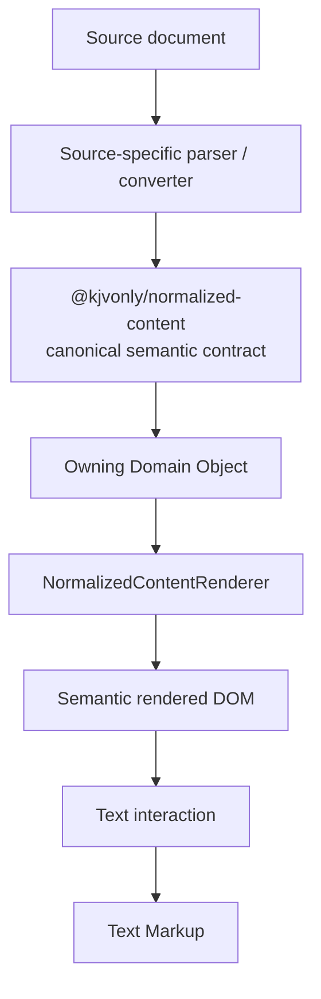

# Normalized Document Implementation

**Status:** Current architectural direction
**Domain area:** Normalized Content
**Semantic data type:** `kjvonly.normalized-document`
**Primary implementation owner:** shared Normalized Content contract + PWA renderer
**Date:** 2026-10-07

---

# 1. Purpose

`NormalizedDocument` is the canonical structured-text value used to present document-like content through one shared renderer.

It is intended to provide a reusable text substrate for content such as:

```text
sermons
books
articles
blogs
commentary
long-form notes/read views
Bible content where the owning Bible model chooses to use it
other document-like Domain values
```

The architectural objective is:

```text
many source formats
    ↓
one canonical structured-text value
    ↓
one canonical renderer
    ↓
one semantic token-addressing model
    ↓
reusable text interactions
```

`NormalizedDocument` is not universal Domain identity.

An owning Domain retains its own:

```text
objectType
objectId
behavior
persistence/publication semantics
```

while its displayable value may use:

```text
dataType = kjvonly.normalized-document
```

---

# 2. Ownership

The responsibilities are intentionally separated.



The shared package:

```text
client/packages/normalized-content
```

owns the canonical semantic contract.

It should remain:

```text
DOM-independent
browser-independent
Svelte-independent
source-parser-independent
application-navigation-independent
```

The CLI/parser side owns source interpretation and normalization.

The PWA renderer owns projection from accepted normalized semantics into DOM presentation.

The owning feature/Domain owns the meaning and persistence of user interaction such as Text Markup or Notes.

---

# 3. Renderer Boundary

By the time a document reaches `NormalizedContentRenderer`:

```text
source parsing has happened
semantic conversion has happened
runtime validation has happened
```

The renderer consumes canonical state.

It does not:

```text
parse HTML
repair malformed source markup
guess source semantics
sanitize imported source HTML
generate missing canonical identity
re-tokenize text
own Text Markup persistence
own Notes persistence
interpret Bible/application navigation meaning
```

The renderer owns:

```text
semantic DOM projection
recursive structural rendering
canonical inline ordering
ordinary normalized word spacing
joinPrevious presentation
zero-width anchor placement
line-break presentation
closed mark/class presentation
link presentation and activation delegation
exposure of canonical document-local identity to the rendered DOM
```

Application-typed links such as `bibleLocationReference:1_1_1` or
`bibleLocationReference:1_1_10-15` are
resolved by the application's registered reference consumers after the Reader
receives the renderer's activation event. The generic renderer must not parse
Bible locations or create navigation state. Document-local anchors retain
priority in the Reader's link handler.

Linked words use the active theme's primary accent color and an underline,
so links are recognizable without relying on color alone. The styling applies
to all normalized links regardless of reference type or local-anchor target.

See [Navigation Architecture — Typed Application References](../../runtime/016-navigation-architecture.md#37-typed-application-references) for the implemented syntax, validation, and ownership requirements.

---

# 4. Canonical Inline Content

Canonical inline content is ordered by the block's `content[]` array.

Current inline entries include:

```text
word
anchor
line-break
```

`content[]` is authoritative.

Do not duplicate the same textual content in another persisted block-level text field merely to make rendering or markup easier.

The array position is meaningful:

```text
contentIndex = index inside the owning block's canonical content[]
```

For example:

```ts
content: [
    { type: 'word', text: 'In' },
    { type: 'word', text: 'the' },
    { type: 'anchor', id: 'beginning-note' },
    { type: 'word', text: 'beginning' }
]
```

has addresses:

```text
0 → word "In"
1 → word "the"
2 → zero-width anchor
3 → word "beginning"
```

Therefore `contentIndex` is intentionally not called `wordIndex`.

It indexes the canonical inline sequence, not only visible words.

---

# 5. Block Identity

Every canonical normalized block has an exact document-local `id`.

The renderer preserves that identity.

It must not:

```text
generate replacement block IDs
reinterpret block IDs
normalize block IDs into another addressing grammar
use DOM traversal order as canonical block identity
```

Inline anchors and block IDs participate in the document-local identity namespace enforced by the canonical validator.

Generated normalized IDs should be treated as addresses within the current `NormalizedDocument` snapshot.

They are not automatically guaranteed to be stable logical identity across later reparsing or revision of the source.

Cross-revision migration/reconciliation is a separate concern and is not owned by the renderer.

---

# 6. Semantic Token Address

The canonical whole-token address used by Normalized Content interaction is:

```text
blockId + contentIndex
```

Conceptually:

```ts
interface NormalizedContentAddress {
    blockId: string;
    contentIndex: number;
}
```

This address identifies one entry in one block's canonical `content[]` sequence.

It is the Normalized Content equivalent of the Bible Reader's semantic word address:

```text
Bible Text Markup
    verseNumber + wordIndex

Normalized Content
    blockId + contentIndex
```

The address is semantic document state.

It is not:

```text
a DOM path
a text-node index
a CSS selector
a browser Range
a screen coordinate
```

---

# 7. Markable Tokens

Although `contentIndex` addresses every canonical inline entry, current whole-token Text Markup should target only:

```text
type = word
```

The following are addressable but not current Text Markup targets:

```text
anchor
line-break
```

This distinction matters because the canonical inline sequence must remain one sequence even when some entries are zero-width or non-markable.

Text Markup interaction must validate that the resolved address belongs to a canonical word before applying word presentation classes.

Do not create a second word-only index solely for markup.

---

# 8. Renderer DOM Metadata

The renderer exposes semantic metadata so browser interaction code can recover the canonical token address from rendered DOM.

Current rendering uses markers equivalent to:

```html
<p
    id="paragraph-12"
    data-normalized-block
>
    <span
        data-normalized-content-index="17"
        data-normalized-content-kind="word"
    >
        grace
    </span>
</p>
```

The canonical token address is recovered as:

```text
nearest owning [data-normalized-block]
    → element.id = blockId

[data-normalized-content-index]
    → contentIndex

[data-normalized-content-kind]
    → semantic inline kind
```

The exact DOM arrangement may change as the renderer evolves.

The persistent/semantic contract is:

```text
blockId + contentIndex
```

not the current element hierarchy.

DOM attributes are presentation metadata and an interaction bridge only.

---

# 9. DOM Address Resolver

The UI layer may expose a helper such as:

```text
resolve DOM node
    ↓
NormalizedContentDomAddress
    blockId
    contentIndex
```

That helper is useful because mark rendering can introduce wrappers such as:

```html
<span data-normalized-content-index="17" data-normalized-content-kind="word">
    <strong>
        <mark>grace</mark>
    </strong>
</span>
```

Interaction code should still resolve any descendant of that word to the same canonical token address.

The resolver should be scoped to one rendered NormalizedDocument root so separate mounted documents can reuse snapshot-local IDs without colliding.

---

# 10. Text Markup Domain and Resource Contract

Normalized Content Text Markup follows the architecture already proven by Bible Text Markup:

```text
semantic token identity
    ↓
user-owned markup state
    ↓
renderer applies classes
```

It does not persist browser `Range`, `Selection`, DOM paths, or pointer geometry.

The canonical application type is:

```text
objectType = normalized-content/text-markup
```

The Resource boundary uses the same application type:

```text
resourceType = normalized-content/text-markup
```

The semantic payload contract is independently versioned:

```text
dataType = kjvonly.normalized-content.text-markup
dataVersion = 1
```

The value model is conceptually:

```ts
interface NormalizedContentTextMarkup {
    readonly id: string;

    readonly document: {
        readonly publisher: string;
        readonly resourceId: string;
        readonly modifiedAt: number;
    };

    readonly markings: NormalizedContentTextMarkupMap;
}
```

The markings remain:

```text
blockId
    ↓
contentIndex
    ↓
{ class: string[] }
```

Only canonical `word` entries are valid marking targets.

## 10.1 Exact document snapshot identity

Normalized token addresses are snapshot-local.

Therefore durable Text Markup must identify not only the target Resource but the exact Resource revision that produced the normalized token addresses.

The target snapshot is:

```text
document publisher
+
document resourceId
+
document modifiedAt
```

`modifiedAt` is intentionally part of Text Markup identity.

Example:

```text
document Resource
    publisher  = author-pubkey
    resourceId = sermons/grace
    modifiedAt = 42

Text Markup target
    author-pubkey
    sermons/grace
    42
```

If the document is republished as:

```text
modifiedAt = 43
```

that is a different Text Markup target snapshot.

The application must not silently apply markup created for revision `42` to revision `43`, because block IDs or `contentIndex` values may have changed.

This preserves the older markup instead of destroying it and leaves future migration/remapping as an explicit higher-level operation.

## 10.2 Application identity

One user owns one Text Markup object for one exact target document snapshot.

The canonical application ID is:

```text
<markupPublisher>/<documentPublisher>/<encodedDocumentResourceId>/<documentModifiedAt>
```

Example:

```text
user-pubkey/author-pubkey/sermons%2Fgrace/42
```

The target `resourceId` is encoded as one segment.

This is important because generic Resource IDs are opaque strings and may themselves contain `/`, `%`, or Domain-owned path grammar.

Normalized Content Text Markup must not parse the target Resource ID into assumed generic path segments.

## 10.3 Resource identity

The individual Text Markup Resource ID is:

```text
kjvonly/normalized-content/text-markup/<documentPublisher>/<encodedDocumentResourceId>/<documentModifiedAt>
```

The Resource publisher is the Text Markup owner.

Example:

```text
publisher = user-pubkey

resourceId =
    kjvonly/normalized-content/text-markup/
    author-pubkey/
    sermons%2Fgrace/
    42
```

The target document publisher is therefore distinct from the Text Markup Resource publisher:

```text
Text Markup publisher
    = user who owns the markup

document publisher
    = publisher of the document being marked
```

## 10.4 Resource payload

The Text Markup Resource payload contains the markings map only.

Conceptually:

```json
{
  "paragraph-12": {
    "17": {
      "class": ["bg-highlighta"]
    }
  }
}
```

The payload does not duplicate:

```text
markup publisher
document publisher
document resourceId
document modifiedAt
objectType
resourceType
dataType
dataVersion
```

Those values belong to Domain/Resource identity and envelope contracts.

## 10.5 Current scope

The first durable implementation targets Resource-backed documents opened through the standalone Normalized Content reader.

That reader already has the target `ResourceDescriptor`, including:

```text
publisher
resourceId
modifiedAt
dataType
dataVersion
```

The renderer itself remains reusable by other Domains.

This Text Markup Resource contract must not be generalized into a universal cross-Domain annotation identity until another owning Domain has a concrete persistence requirement.

A sermon, Note, Bible view, or other Domain may reuse `NormalizedContentRenderer` without automatically becoming owned by the standalone Normalized Content Text Markup persistence contract.

## 10.6 Signed-out state and save boundary

Durable Text Markup is user-owned and therefore requires a publisher identity.

When no current user publisher exists:

```text
render document normally
markup may be absent
no synthetic/anonymous publisher is created
no durable Text Markup publication occurs
```

The signed-out Reader renders the document without entering durable Text Markup edit mode. Editing requires an authenticated publisher; no anonymous markup identity is persisted.

Durable writes remain at the explicit save boundary:

```text
accepted Text Markup
    ↓
mutable Reader draft
    ↓ click / drag
updated draft
    ↓ Save
Domain persistence + Resource revision + Outbox intent
```

Crossing a word during drag must never cause an independent durable write.

Do not make the renderer the persistence owner merely because it exposes token addresses.

## 10.7 Implemented v1 lifecycle and boundaries

The current `documentEditMode`/word-selection implementation below is the
baseline for the proposed [Reader Action State Pattern](./002-reader-action-state-pattern.md).
That refactor is a **design**, not implemented behavior.

The standalone Reader owns `documentEditMode`, the shared document action
surface for Text Markup, Notes, and Bookmarks. It obtains markup through
`NormalizedContentTextMarkupService` for the authenticated publisher and the
exact validated document descriptor.

```text
Reader enters / authenticated publisher changes
    ↓
Text Markup service.get(publisher, descriptor)
    ↓
local accepted Domain Object, or exact Resource load on local miss
    ↓
Reader subscribes to that Text Markup Domain identity
    ↓
Reader clones accepted markings into a separate mutable draft
    ↓
click / horizontal drag edits the draft; renderer projects the classes
    ↓
Save, or a Notes/Bookmarks action that exits documentEditMode
    ↓
compare visible draft markings with accepted markings
    ├─ unchanged → close actions without a write
    └─ changed → service.put(draft snapshot)
                  ↓
                  IndexedDB transaction: Domain Object + Resource installation + Outbox
    ↓
notify subscribers, then wake Outbox publication
```

The IndexedDB transaction is the durable commit boundary. Publication is
asynchronous: a remote Nostr relay is not required to accept an event before
local Save succeeds. The pending Outbox entry carries the outbound Resource
intent, whose content is the markings map and whose media type is
`application/json+gzip+hex`. The transaction also advances the local Resource
installation timestamp monotonically, including repeated saves within one
second.

Resource discovery and installation use the generic Resource Worker path, not
a Text Markup-specific Nostr client. Archive import refreshes active Text Markup
subscribers using the same accepted local store. No import or subscription
callback publishes a new draft on behalf of the Reader.

Lookup failure and explicit new drafts:

- On document entry, the Reader first reads the signed-in user's accepted Text
  Markup directly from IndexedDB and displays its markings immediately, without
  waiting for a relay. It subscribes to the same Domain object for accepted
  updates across panes. Reading the document never requires a network lookup.
- Independently, the Reader verifies the published Text Markup through the
  generic Resource installation lifecycle. The Edit control remains disabled
  until this verification completes. The service then reads accepted markup
  from IndexedDB, which may have been updated by a newer installed Resource.
  The Reader applies that accepted result without changing the document's
  canonical content. A confirmed remote miss retains the local copy if one
  exists, or provides an empty markup object otherwise.
- A failed relay lookup **does not** prove that the local copy is current or
  that no published markup exists. It does not clear locally rendered markings.
  Even with saved local markup, the failure remains unresolved so selecting
  **Edit** presents the recovery choices.
- On lookup failure, the Reader continues displaying the document without an
  inline warning. Selecting **Edit** opens a dedicated navigation view explaining
  the uncertainty and listing **Retry lookup**, **Continue with new Text Markup**
  when no saved local copy exists (or **Continue with local Text Markup** when
  one exists), and **Continue without Text Markup**. The local choice uses the
  accepted IndexedDB object without contacting the relay or creating an empty
  draft. Back returns to ordinary reading without
  selecting an option.
- Retry is handled directly in the lookup view, displaying progress while
  the Resource is retrieved and the accepted object is read from IndexedDB.
  Retry checks the relay even when a saved local copy exists.
  A failed Retry stays in that view with an error
  and the same options. Only completed outcomes cross the navigation boundary:
  accepted markup (`loaded`), use a saved local copy (`use-local`), start new
  markup, or continue without markup. Choosing local markup keeps the unresolved
  lookup state so that the next Edit action offers the choices again.
  A successful lookup opens document actions without a second lookup. Either
  Continue option returns to the Reader with document actions open.
- Neither continuation choice creates or publishes markup immediately. When
  continuing with new markup, only changed markings are saved at the normal
  Save boundary. When continuing without markup, the palette, markup Save action,
  and click/drag marking gestures are unavailable. No markup action is selected;
  document action mode waits for the user to choose Notes or Bookmarks. These
  actions do not initiate a Text Markup write.
- A Continue choice applies to the current document action session. If the
  lookup is still unresolved, choosing **Edit** again opens the choices view,
  allowing the user to change their mind. A successful Retry resolves the
  warning. Re-entering new-markup mode reuses any accepted local draft rather
  than replacing it with an empty object.
- The lookup decision resets when the Reader switches documents or authenticated
  users.

Reader lifecycle behavior:

- A repeated authentication notification for the **same publisher** keeps the
  current edit draft. Switching publishers resets the editor and changes the
  active document-specific Text Markup subscription.
- Accepted Text Markup notifications update the displayed markings, even during
  an open edit. The latest accepted event replaces the Reader draft; there is
  no merge of unsaved changes.
- The Reader edits only the signed-in user's Text Markup. It permits one
  in-flight save at a time, including across authentication changes. A save
  captures a clone of the draft; a completed write updates the displayed
  editor only if that Text Markup object is still active. A failed write leaves
  the active editor open.
- Document retrieval uses the currently selected Resource identity, not a
  Reader-local generation counter. Concurrent requests for that same identity
  use last-completion-wins behavior.
- Notes collection notifications refresh word-note indicators, and Bookmarks
  collection notifications refresh Bookmark indicators. Neither mutates the
  canonical Normalized Document.
- Subscription callbacks are observer notifications, not part of the durable
  commit. One throwing subscriber is logged without blocking the others or
  preventing the Outbox wakeup.
- Archive refreshes are guarded against outdated reads: newer refreshes or a
  committed local Save invalidate older results. A replaced/unsubscribed
  listener does not receive a notification from its previous subscription.

Tests intentionally use in-memory Nostr transport for the publication →
installation round trip; the normal browser suite must not require a live
relay. Multi-user markup overlays and cross-revision token migration are
future features, not v1 Reader behavior.

---

# 11. Bible Text Markup Analogy

Bible Text Markup already follows this pattern.

Rendered Bible words expose semantic metadata equivalent to:

```html
<span
    data-bible-word
    data-verse="3"
    data-word-index="17"
>
```

Browser hit testing turns geometry into Bible semantic identity:

```text
pointer coordinates
    ↓
elementFromPoint(x, y)
    ↓
nearest Bible word element
    ↓
verse + wordIndex
    ↓
Bible Text Markup operation
```

Normalized Content should use the same architectural approach:

```text
pointer coordinates
    ↓
elementFromPoint(x, y)
    ↓
nearest normalized word token
    ↓
blockId + contentIndex
    ↓
Normalized Content Text Markup operation
```

The two features may share interaction patterns and presentation vocabulary without collapsing Bible semantic identity into generic Normalized Content identity.

---

# 12. Click and Drag Editing

Normalized Content Text Markup v1 implements Bible-style whole-token editing
with Reader-local gesture state and canonical token addressing.

Conceptually:

```text
click word
    ↓
toggle selected markup family on one semantic token

left-to-right horizontal drag
    ↓
apply selected markup to each unique crossed word token

right-to-left horizontal drag
    ↓
remove selected markup from each unique crossed word token
```

Horizontal direction is selected when a drag crosses the gesture threshold.
Vertical movement remains scrolling rather than a markup stroke. The action
uses coordinate hit testing and de-duplicates visited semantic word addresses;
intervening browser pointer events do not create independent persistence
writes. A completed drag suppresses its trailing click to avoid toggling a
word twice.

The renderer provides the semantic DOM bridge; the Reader-local Svelte action
and gesture controller own the pointer lifecycle, and markup helpers own token
mutation. The renderer does not own either gesture state or persistence.

---

# 13. Coordinate Hit Testing

For Bible-style drag editing, browser geometry should be resolved through browser-native hit testing rather than by measuring/enumerating the complete document.

Conceptually:

```ts
document.elementFromPoint(clientX, clientY)
```

then locate the nearest eligible normalized word marker.

The interaction obtains:

```text
blockId
contentIndex
content kind = word
```

and performs the appropriate markup operation once for that semantic token.

This avoids:

```text
chapter/document-wide word scans on pointer movement
per-token geometry measurement loops
polling
MutationObserver-based hit tracking
idle background work
```

The interaction cost should remain proportional to the active gesture rather than document size.

---

# 14. Browser Selection and Range Boundary

Browser `Selection` and `Range` are useful browser APIs for capabilities such as:

```text
native text selection
copy/share
caret placement
partial-word interaction
character-level annotations
restoring a browser selection
```

They are **not the Text Markup identity model** for current whole-token Normalized Content markup.

Current Text Markup identity should remain:

```text
blockId + contentIndex
```

A browser `Selection` or `Range` may be used later as temporary UI state when a concrete character-level feature requires it.

If such a feature is added:

```text
browser Selection / Range
    = ephemeral interaction representation

Domain markup / note identity
    = explicit semantic application contract
```

Do not make DOM `Range` endpoints or character offsets part of persisted Text Markup merely because the browser exposes them.

---

# 15. DOM Point / Range Helpers

Generic DOM point/range helpers are not required for Bible-style whole-token Text Markup.

The minimum Text Markup addressing substrate is:

```text
block identity
content index
content kind
DOM → semantic token address resolution
```

Character-offset points and DOM Range projection should exist only when justified by a concrete feature such as partial-word selection or arbitrary character-level annotations.

They should not be treated as prerequisites for whole-word highlighting.

Existing point/range code should therefore be evaluated by actual consumers rather than preserved solely because it has already been implemented.

---

# 16. Markup Rendering

Text Markup remains overlay/application state rather than canonical document content.

The base `NormalizedDocument` should not be mutated to persist user highlight classes.

Conceptually:

```text
NormalizedDocument
    +
Text Markup state
    ↓
NormalizedContentRenderer / host composition
    ↓
rendered word classes
```

This keeps the source document independent from user-owned mutable state.

It also allows:

```text
one base document
multiple users
multiple markup collections
markup absent without changing the document
```

---

# 17. Mutable Edit Draft

Text Markup v1 edits a Reader-owned mutable clone of the accepted markings.
The accepted Domain object is not mutated by pending clicks or drag strokes.

Conceptually:

```text
accepted Text Markup
    ↓
mutable UI draft
    ↓
click / drag mutation
    ↓
reactive rerender
    ↓
immediate visual feedback
    ↓
explicit Save
    ↓
persistence/publication
```

Crossing many words during a drag must not cause one persistence/publication write per word.

Markup interaction should mutate the draft only.

The durable write boundary remains owned by the Text Markup feature/service.

---

# 18. Markup Mutation Semantics

The Reader's click and drag handlers use the shared Text Markup edit helpers;
mutation rules are centralized rather than duplicated.

Implemented operations are:

```text
toggle token markup
apply token markup
remove token markup
```

Gesture/click code should resolve a semantic token and request one of those operations.

The helpers own presentation-family rules including:

```text
replace conflicting value in the same markup family
preserve independent markup families
add/remove required decoration companion classes
idempotent apply
idempotent remove
```

The renderer should not own those mutation semantics.

---

# 19. Snapshot and Revision Semantics

A normalized token address is tied to the document structure that produced it.

Current addressing:

```text
blockId + contentIndex
```

must therefore be treated as snapshot-local unless a stronger identity contract is deliberately introduced.

A later reparse or source revision may:

```text
remove a block
change a block ID
insert/remove inline entries
shift contentIndex values
retokenize words
```

Persisted Text Markup that targets the old snapshot may then require migration or may become unresolved.

The renderer must not perform fuzzy cross-revision reconciliation.

If durable markup must survive arbitrary document revisions, that requires a separate versioning/migration design above the renderer.

---

# 20. Relationship to Notes

Text Markup and Notes may eventually use related semantic addresses, but they are not required to have the same interaction granularity.

For example:

```text
Text Markup
    current direction: whole word tokens

Notes
    may target whole document, block, word, or another explicit semantic reference
```

Do not force Text Markup to adopt browser Range identity merely because a future Notes feature may need richer selection behavior.

Each feature should define the smallest semantic reference contract it actually requires.

---

# 21. Relationship to Bible Identity

Bible semantic identity remains Bible-owned.

```text
BibleLocationRef
    ≠
Normalized Content token address
```

A Bible view using normalized rendering may be able to map between:

```text
Bible semantic location
    book / chapter / verse / word

and

Normalized Content location
    blockId / contentIndex
```

but the generic renderer must not reinterpret one as the other.

The Bible Domain remains responsible for Bible location semantics.

---

# 22. Performance Contract

Semantic DOM metadata has effectively zero active processing cost when no interaction is occurring.

The renderer may emit static attributes for addressable content.

Text Markup interaction should not introduce:

```text
polling
recurring timers
MutationObserver scans
continuous word enumeration
continuous document geometry measurement
```

During an active drag, work may include:

```text
pointer-event processing
bounded elementFromPoint hit testing
visited-token deduplication
in-memory markup mutation
reactive presentation updates
```

This mirrors the performance model already used by Bible Text Markup drag editing.

---

# 23. Testing Invariants

Normalized Content addressing/markup tests should protect at least these rules:

```text
1. Every markable rendered word can resolve to blockId + contentIndex.

2. Nested presentation wrappers do not change the semantic token address.

3. contentIndex remains the canonical content[] array index.

4. Anchors and line breaks remain addressable inline entries but are not
   current whole-word Text Markup targets.

5. Separate rendered documents scope address lookup independently.

6. DOM element hierarchy is not persisted identity.

7. Renderer-generated inter-word spacing does not create a new markable token.

8. Click/drag markup operates on semantic word targets, not browser Range identity.

9. Markup editing can rerender immediately without persistence per crossed word.

10. Point/Range character-offset support is optional and feature-driven,
    not a prerequisite for whole-token markup.
```

Browser tests are appropriate for:

```text
coordinate hit testing
DOM closest/ancestor resolution
real-time drag feedback
selection/scroll interaction
pointer cancellation
```

Pure markup mutation rules remain unit-testable without DOM geometry.

The v1 integration tests also cover edit/save cancellation, account changes,
subscriber isolation, stale archive refreshes, atomic IndexedDB + Outbox
writes, and in-memory signed Nostr Resource publication/reinstallation.

---

# 24. Non-Goals

The current Normalized Content Text Markup direction does not require:

```text
native browser Selection as markup identity
browser Range as persisted markup identity
character-offset markup
partial-word highlighting
DOM paths in persistence
renderer-owned Text Markup persistence
renderer-owned Resource publication
cross-revision fuzzy address migration
a second word-only indexing system
BibleLocationRef inside the generic renderer
```

Those capabilities may be designed later if a concrete feature requires them.

---

# 25. Architectural Invariants

1. `NormalizedDocument` is reusable structured-text data, not universal Domain identity.
2. `content[]` is the authoritative inline sequence.
3. Every canonical block preserves its exact document-local `id`.
4. `contentIndex` is the index in canonical `content[]`, not a derived visible-word index.
5. Whole-token Normalized Content address is `blockId + contentIndex`.
6. Current Text Markup applies only to canonical `word` entries.
7. DOM metadata bridges browser interaction to semantic token identity; DOM structure is not persisted identity.
8. Text Markup state remains external to the base `NormalizedDocument`.
9. Renderer presentation and Text Markup persistence remain separate responsibilities.
10. Browser Selection/Range is not the current Text Markup identity model.
11. Character-offset Point/Range support must be justified by a concrete character-level feature.
12. Generated normalized IDs/content indexes are snapshot-local unless a stronger revision contract is deliberately introduced.
13. Durable Text Markup identity includes the target document Resource `modifiedAt`, so markup from one snapshot is never silently applied to another.
14. Target Resource IDs remain opaque and are encoded as one Text Markup identity segment rather than generically parsed.
15. The first durable Text Markup contract targets standalone Resource-backed Normalized Content documents; renderer reuse does not transfer persistence ownership across Domains.
16. Bible semantic identity remains Bible-owned even when normalized rendering is reused.
17. Click and drag interactions should share one markup mutation implementation.
18. Drag editing should use browser hit testing rather than repeated full-document geometry scans.
19. Durable writes/publication occur at the feature's save boundary, not once per crossed word.

---

# 26. Final Mental Model

```text
Owning Domain Object
    ↓ value
NormalizedDocument
    ↓
NormalizedContentRenderer
    ↓
semantic rendered word
    blockId + contentIndex
    ↓
DOM metadata bridge
    ↓
click / elementFromPoint drag hit testing
    ↓
semantic word target
    ↓
Text Markup edit helper
    ↓
mutable markup draft
    ↓
reactive highlight/text/decoration classes
    ↓
explicit save
    ↓
Text Markup persistence / publication
```

The central rule is:

> Browser geometry helps locate normalized semantic content. It does not become Text Markup identity.

For current whole-token markup, the semantic identity is deliberately simple:

```text
blockId + contentIndex
```

This mirrors the successful Bible Text Markup model while remaining native to the `NormalizedDocument` contract.

---

# Height-Driven Nested Reader Block Rendering

**Status:** Current Reader implementation (October 2026).

The accepted `NormalizedDocument` is kept complete in memory. The standalone
Reader bounds **DOM work** by rendering canonical leaf blocks in depth-first
order, including those nested under quotes, lists, list-items, tables, figures,
and other structural blocks. A table row is one atomic window unit: all
cells are mounted together to preserve table structure. One incremental
operation adds one complete renderable leaf or row. Its necessary ancestor
elements are projected without mounting unrelated descendants. The projection does not change the original
Normalized Document, its canonical IDs, word `contentIndex`, or inline anchors.

The window is height-driven, **not a fixed number of blocks**. After each added
block and Svelte DOM update, the Reader measures the rendered leaf bounds within
its existing `ViewBody` scroll container. Initially it aims for approximately
three screens of content. As the user scrolls, it retains roughly one viewport
above and one below, with a half-screen refill threshold to avoid churn. A leaf
is removed only when its removal will preserve the one-screen buffer. Scroll
anchoring retains the visible leaf's pixel position when leaves are inserted or
removed above it. A single particularly large leaf or row is indivisible and may
exceed the intended height; no word, paragraph, or table row is split.
Ordered lists retain original item numbering when earlier items are outside
the rendered window. Empty and single-leaf documents stop at their canonical
boundaries without attempting extra window changes.

**Triggers:** one passive scroll handler with checks throttled to at most once
per 100 ms, initial Reader mount, navigation reactivation, and changes to the
Pane's existing reactive `clientWidth`/`clientHeight` context. No
`ResizeObserver`, `IntersectionObserver`, background polling, or second scroll container. Work stops when the Reader is
hidden or disposed. Work started before a document reset or explicit navigation
jump is invalidated rather than applying stale window or scroll-anchor changes.
Reconciliation yields the browser a paint opportunity after approximately one second of block-by-block work before continuing. The trailing
accent spinner remains until the final canonical leaf enters the window.
Floating Previous/Next controls distinguish the **actual** document boundaries
from the current rendered window's scroll boundaries: reaching the latter does
not force the controls visible while more canonical leaves remain. Controls
start visible for each loaded document, hide on downward scrolling, and return
on upward scrolling. Height-window scroll-anchor corrections do not change
control visibility, because they are not user scrolling.

Bookmark targets and local anchors are resolved to a canonical leaf index
without mounting preceding blocks. The Reader mounts that leaf and its ancestor
structure, scrolls to its semantic word/anchor, then reconciles the surrounding
viewport. This preserves Back, Notes, Bookmarks, Text Markup, and ordinary
non-windowed `NormalizedContentRenderer` consumers.

The window's numeric indices are **presentation-only** and are never persisted
as Bookmark, Note, or Text Markup identities.
