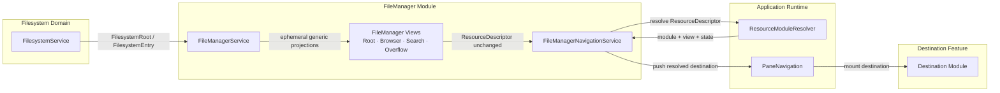
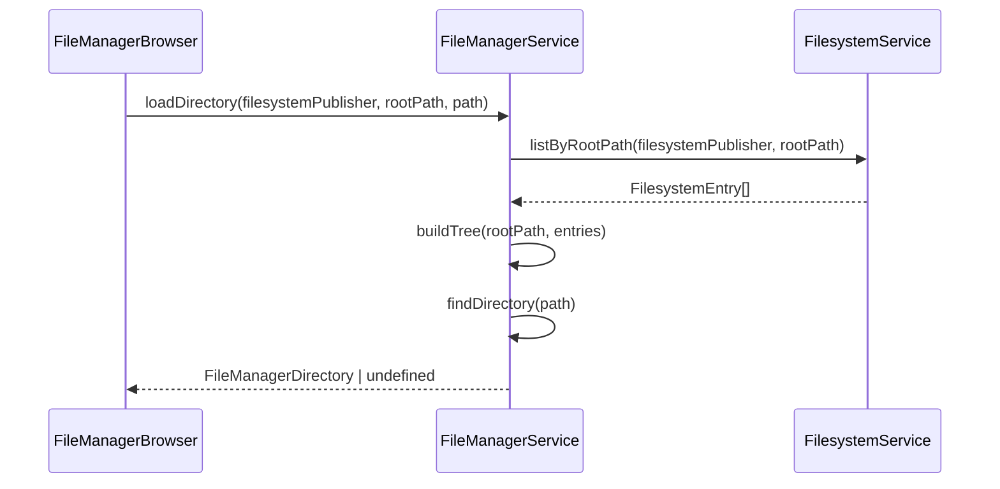
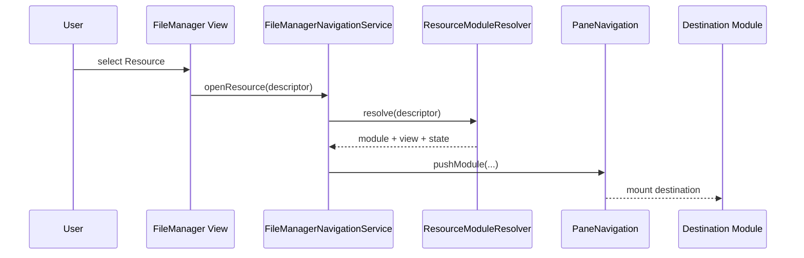

# FileManager Module Implementation

## Status

**Current**

**Area:** `client/kjvonly-pwa`

Primary implementation:

```text
client/kjvonly-pwa/src/lib/application/modules/file-manager/
```

Related implementation documentation:

```text
docs/03_implementation/runtime/016-navigation-architecture.md
docs/03_implementation/platform/002-workers.md
docs/03_implementation/modules/001-module-contract.md
```

---

# Purpose

The FileManager module presents mounted filesystem mappings as a familiar file-browser experience without becoming a second persistence layer or a generic Resource reader.

It provides:

```text
mounted-root discovery
filesystem-publisher/root presentation
folder navigation
synthetic directory projection
list/grid presentation
global filesystem/catalog metadata search
generic Resource metadata presentation
Resource-to-Module routing and Pane navigation handoff
```

The central implementation boundary is:

```text
FilesystemEntry
    ↓
FileManager projection / presentation
    ↓
ResourceDescriptor
    ↓
ResourceModuleResolver
    ↓
Pane navigation
    ↓
destination Module
```

FileManager stops at Resource-to-Module routing and the Pane navigation handoff. It does not acquire, install, decode, validate, or interpret the selected Resource's semantic content.

---

# Mental Model

FileManager is an application-facing projection over the filesystem Resource catalog. Each layer answers a different question:

```text
Filesystem
    "Where is this Resource exposed?"

FilesystemEntry
    application-visible filesystem location
    +
    ResourceDescriptor

FileManager
    "How can the user browse, find, and select it?"

ResourceModuleResolver
    "Which application Module handles this Resource?"

Destination Module
    "What does this Resource mean, and how is it acquired and used?"
```

A `FilesystemEntry` in this projection is already first-class accepted Filesystem state. "Resource availability" describes the target identified by its `ResourceDescriptor`; it does not mean the mapping itself is provisional. The target Resource may remain unresolved or uninstalled until a later application action.

The filesystem location and the Resource identity remain separate. Resource metadata also keeps machine-facing contracts distinct from optional user-facing presentation metadata:

```text
descriptor.metadata.resourceType
    canonical application Resource type / routing contract

descriptor.metadata.dataType + dataVersion
    semantic payload contract

descriptor.resourceMetadata.category
    optional human-facing classification used by FileManager
```

FileManager projects filesystem mappings into roots, synthetic directories, generic Resource presentation, and metadata Search without taking ownership of Resource meaning.

When the user selects a Resource, FileManager forwards its `ResourceDescriptor` unchanged into application Resource-to-Module routing. `FileManagerNavigationService` then hands the resolved destination to Pane navigation. After that handoff, the destination feature owns Resource acquisition, semantic interpretation, validation, installation, and rendering.

> **FileManager knows where Resources are exposed and how to present/find them generically. Destination Modules know what those Resources mean and how to use them.**

---

# 1. Runtime Ownership

The current implementation separates filesystem ownership, FileManager runtime projection, application routing/navigation, and destination-feature ownership. The diagram below shows runtime collaboration and handoff; its arrows do not represent persistence ownership.



The important ownership rules are:

```text
FilesystemService
    owns persisted filesystem reads

FileManagerService
    owns FileManager-specific runtime projection and Search runtime

FileManagerNavigationService
    owns FileManager navigation intents and the Resource-to-Module routing handoff

ResourceModuleResolver / PaneNavigation
    own application routing and navigation mechanics

Destination Module
    owns Resource acquisition, semantic interpretation, validation, installation, and rendering
```

FileManager must not import destination feature internals such as Notes, Bible, normalized-content, or audio implementations.

The current cross-owner code dependencies are intentionally narrow:

```text
FileManager → $lib/domains/filesystem
FileManager → $lib/resource
```

Other direct imports from FileManager into navigation, pane, module, and shared UI/runtime code remain inside the Application owner. FileManager does not import filesystem persistence implementations or destination Domain internals.

---

# 2. Filesystem Identity and Path Semantics

A mounted root is identified by:

```text
filesystem publisher
+
rootPath
```

The filesystem publisher identifies the publisher/source of the filesystem mapping.

This is intentionally distinct from:

```text
entry.descriptor.metadata.publisher
```

which is the publisher of the target Resource.

A filesystem published by one publisher may expose a Resource published by another publisher.

`FilesystemEntry.path` includes the filesystem root path.

Example:

```text
rootPath = sermons
entry.path = sermons/spurgeon/grace
```

FileManager code must not treat persisted entry paths as root-relative.

---

# 3. Stable Navigation Views

FileManager registers four stable Pane navigation views:

```ts
FILE_MANAGER_VIEWS.ROOT
    = 'file-manager.root'

FILE_MANAGER_VIEWS.BROWSER
    = 'file-manager.browser'

FILE_MANAGER_VIEWS.SEARCH
    = 'file-manager.search'

FILE_MANAGER_VIEWS.OVERFLOW_ACTIONS
    = 'file-manager.overflow-actions'
```

They are registered through:

```text
file-manager-navigation-view-registrations.ts
```

`fileManagerNavigationEntry.svelte` resolves the current semantic view and provides the FileManager navigation context.

Folders do not receive unique registered view IDs. Folder location is state of the shared browser view.

---

# 4. Persisted Navigation State

The browser persists only semantic reconstruction state:

```ts
interface FileManagerBrowserNavigationState {
    publisher: string;
    rootPath: string;
    path: string;
    viewMode: 'list' | 'grid';
}
```

The search view persists user-visible search state:

```ts
interface FileManagerSearchNavigationState {
    query: string;
    publisher: string;
    rootPath: string;
    resourcePublisher: string;
    category: string; // optional human-facing resourceMetadata.category filter
    dataType: string;
    mediaType: string;
    fileType: 'all' | 'audio' | 'video' | 'image' | 'document';
    viewMode: 'list' | 'grid';
}
```

The persisted field name `publisher` is retained for navigation-state compatibility, but its meaning is specifically **filesystem-mapping publisher**. Runtime/local names should prefer `filesystemPublisher` so it remains visibly distinct from `resourcePublisher`.

The navigation stack does **not** persist runtime projections such as:

```text
FilesystemEntry[]
FileManagerDirectory trees
LocatedFilesystemEntry[]
FlexSearch indexes
Worker state
search request IDs
```

Those values are reconstructed from the current filesystem state.

---

# 5. Root Landing View

`fileManagerRoot.svelte` renders the FileManager landing page.

The visible hierarchy is:

```text
Files

Publisher A
    Documents
    Sermons
    Shared

Publisher B
    Library
    Audio
```

There is no separate publisher navigation page.

`FileManagerService` projects mounted roots into:

```ts
interface FileManagerRootGroup {
    filesystemPublisher: string;
    filesystemPublisherName: string;
    roots: readonly FileManagerRootDisplay[];
}
```

Each root display contains:

```ts
interface FileManagerRootDisplay {
    root: FilesystemRoot;
    name: string;
    path: string;
}
```

The primary root label is derived from the basename of `rootPath` while the full path remains available as supporting context.

Publisher display names are resolved through the existing application publisher/pet-name abstraction rather than inventing a FileManager-specific identity system.

---

# 6. Root Loading Boundary

Root loading stays on the public filesystem boundary and then enters FileManager projection:

```text
FilesystemService.listRoots()
    ↓
FileManagerService root presentation projection
    ↓
group by filesystem publisher
    ↓
resolve publisher display names
    ↓
sort publishers and roots
    ↓
FileManagerRootGroup[]
```

`fileManagerRoot.svelte` calls `FileManagerService.loadRootGroups(...)`; the service performs the public `FilesystemService.listRoots()` read and owns grouping/sorting. FileManager never reaches into filesystem persistence or IndexedDB directly.

The Svelte root view owns UI state such as:

```text
loading
ready
failure
retry
```

It does not own the grouping/sorting algorithm.

---

# 7. Tree Projection

Filesystem persistence stores flat `FilesystemEntry` mappings.

FileManager projects them into an ephemeral directory tree.

Example source entries:

```text
sermons/spurgeon/grace
sermons/spurgeon/faith
sermons/macarthur/romans/1
```

Runtime projection:

```text
sermons/
├── spurgeon/
│   ├── grace
│   └── faith
└── macarthur/
    └── romans/
        └── 1
```

The runtime tree model is:

```ts
interface FileManagerDirectory {
    kind: 'directory';
    name: string;
    path: string;
    directories: readonly FileManagerDirectory[];
    resources: readonly FileManagerResource[];
}

interface FileManagerResource {
    kind: 'resource';
    name: string;
    path: string;
    entry: FilesystemEntry;
}
```

Synthetic directories are never persisted back to the filesystem store.

---

# 8. File-vs-Directory Collision Rule

The projection must handle ambiguous flat paths deterministically.

Given:

```text
foo
foo/bar
```

FileManager interprets `foo` as a directory because descendants exist below it.

The rule is:

> **Directory wins.**

The Resource mapped directly at `foo` is ignored by the FileManager projection and a warning is emitted.

The underlying persisted `FilesystemEntry` is not deleted.

The same rule is applied when building the global Search snapshot, preventing a shadowed file from reappearing in Search when it is hidden in Browse.

---

# 9. Browser Loading

The browser reconstructs the requested directory from semantic navigation state.

Current flow:



Svelte owns load/failure/retry presentation state. `FileManagerService` owns the filesystem read orchestration needed for FileManager projection, while persistence remains behind the public `FilesystemService` boundary.

A missing projected directory is rendered as a FileManager load failure rather than silently falling back to another location.

---

# 10. Stale Async Load Protection

Root and Browser views guard asynchronous filesystem reads with a monotonically increasing load generation.

Conceptually:

```text
start load
    → generation N

retry/new load
    → generation N+1

old load resolves
    → generation mismatch
    → ignore result
```

Unmount also increments the generation so an in-flight result cannot mutate component state after the mounted navigation entry has been destroyed.

This is intentionally a small view-lifecycle guard rather than a new global cancellation framework.

---

# 11. Browser Presentation

Browser presentation supports:

```text
list view
grid view
```

Directories are shown before Resources.

The browser delegates row/card markup to shared FileManager components:

```text
components/fileManagerDirectoryListItem.svelte
components/fileManagerDirectoryGridItem.svelte
components/fileManagerResourceListItem.svelte
components/fileManagerResourceGridItem.svelte
```

This keeps Browse and Search Resource presentation consistent without merging directory and Resource semantics into one overly generic component.

`viewMode` is persisted through navigation state and is carried into child-directory navigation and Search.

---

# 12. Generic Resource Presentation

FileManager does not load target Resource content to construct a row or card.

`FileManagerService.describeResource(...)` projects generic descriptor metadata into:

```ts
interface FileManagerResourceDisplay {
    name: string;
    metadataLabel: string;
    iconID: FileManagerResourceIconID;
}
```

Display-name precedence is:

```text
descriptor.metadata.name.trim()
    ↓ fallback
basename(FilesystemEntry.path)
```

The generic metadata label currently follows:

```text
dataType
    ↓ fallback
resourceType
    ↓ fallback
mediaType
    ↓ fallback
Resource
```

Publishers may optionally provide a FileManager presentation hint through:

```text
descriptor.resourceMetadata.icon
```

Icon selection follows:

```text
resourceMetadata.icon
    ↓ recognized icon ID?
    yes → use that icon
    no
    ↓
dataType-derived icon fallback
```

The publisher value is an icon ID, not a content-kind alias. For example, a
sermon that should use the article visual advertises:

```text
resourceMetadata.icon = article
```

FileManager does not infer `sermon → article` or `blog → post`. Missing or
unknown icon metadata falls back only to `dataType`; `mediaType`, `resourceType`,
and human-facing `category` do not participate in Resource icon selection.

Search's friendly `fileType` classification remains a separate metadata-search
facet and may use `dataType`, `mediaType`, `resourceType`, and human-facing
`category`. It is not
Resource icon selection, Resource identity, or Module routing.

The icon hint is optional and presentation-only. It does not change `dataType`, Resource identity, Search classification, or the displayed metadata label.

This projection must remain Domain-neutral.

Do not add presentation branches such as:

```text
if Bible...
if Note...
if Sermon...
```

If additional metadata is broadly useful to FileManager, extend a deliberate generic Resource presentation contract instead.

---

# 13. Breadcrumbs and Pane Width

The Browser header title is only the current folder name.

Example:

```text
Spurgeon
```

It does not display the complete path in the header.

On wider panes, FileManager renders clickable breadcrumbs beneath the header.

The current threshold is approximately:

```text
pane client width >= 640px
```

The decision is based on Pane/container width through `PaneLayoutContext`, not global viewport width.

Breadcrumbs are supplemental context. Pane Back remains the primary navigation mechanism.

Selecting an ancestor breadcrumb calls `backToAncestorDirectory(...)`; it does not push a duplicate Browser entry. This relies on the invariant that each directory descent pushes exactly one `file-manager.browser` entry, so the path-depth delta equals the number of Pane Back operations required.

---

# 14. FileManager Navigation Service

`FileManagerNavigationService` is the FileManager-specific facade over the application's Pane navigation stack.

It owns these navigation intents:

```text
openRoot
openDirectory
openSearch
openOverflowActions
openResource
backToAncestorDirectory
```

Folder navigation pushes another `file-manager.browser` entry with a different semantic path.

Example:

```text
file-manager.root
    ↓
file-manager.browser { path = sermons }
    ↓
file-manager.browser { path = sermons/spurgeon }
```

No FileManager-private history stack exists.

Back behavior is provided by the shared Pane navigation architecture.

---

# 15. Resource Opening Boundary

Browse and Search use the same Resource-open path:



FileManager passes the `ResourceDescriptor` unchanged to the application resolver.

Resource resolution failure and Pane navigation failure are separate error boundaries.

If the application resolver cannot select a Module destination, FileManager logs the resolution failure and presents the shared unsupported-file toast:

```text
No application is available to open this file.
```

If a destination resolves successfully but Pane navigation itself fails, FileManager reports a generic open failure instead:

```text
Unable to open this file.
```

A navigation/runtime failure must not be misreported as an unsupported Resource.

FileManager does not try to inspect arbitrary content as a fallback.

---

# 16. Search Snapshot

Search is global filesystem/catalog search.

It is not Domain-content search.

The search snapshot is built by:

```text
FilesystemService.listRoots()
    ↓
for each root:
    FilesystemService.listByRootPath(...)
    ↓
apply FileManager tree/collision rules
    ↓
LocatedFilesystemEntry[]
```

The runtime provenance model is:

```ts
interface LocatedFilesystemEntry {
    filesystemPublisher: string;
    rootPath: string;
    entry: FilesystemEntry;
}
```

`filesystemPublisher` is the publisher/source of the filesystem mapping and is deliberately named to distinguish it from the target Resource publisher.

The target Resource publisher remains:

```text
entry.descriptor.metadata.publisher
```

The distinction is preserved throughout Search.

---

# 17. Search Runtime Ownership

`FileManagerService` owns the active FileManager search runtime.

The Search Svelte component does not construct or communicate with the Worker directly.

Service responsibilities include:

```text
create runtime lazily
build current filesystem snapshot
initialize worker index
replace an older runtime on retry
reject/ignore superseded initialization
execute searches
distinguish retryable query failure from terminal runtime loss
dispose runtime on unmount/replacement
```

The ownership shape is:

```text
FileManagerSearch UI
    ↓
FileManagerService
    ↓
FileManagerSearchRuntime
    ↓
FileManager search Worker
```

The Worker/index is ephemeral and reconstructable.

`fileManagerSearch.svelte` intentionally owns an entry-local `FileManagerService` instance. Hidden Pane navigation entries remain mounted, so sharing one global FileManagerService would allow one Search entry to replace or dispose another Search entry's Worker/runtime.

---

# 18. Worker Boundary

`FileManagerSearchRuntime` owns one Worker for one active search lifetime.

The Worker receives compact metadata documents rather than complete Resource descriptors.

A search document contains fields such as:

```text
stable located-entry ID
name
path
filesystem publisher
rootPath
Resource publisher
resourceType
category (optional human-facing Resource metadata)
dataType
mediaType
friendly fileType
```

The main thread retains the full `LocatedFilesystemEntry` map and converts returned Worker IDs back into entries.

This avoids transferring full descriptors into the Worker solely for metadata search.

The runtime also owns:

```text
request IDs
pending promises
Worker error propagation
message-deserialization failure handling
termination/disposal
```

Failure semantics are intentionally split:

```text
worker protocol error with requestId
    → reject only that query
    → runtime remains active

browser Worker error / messageerror
    → terminal runtime failure
    → terminate Worker and reject pending work
    → FileManagerService drops the runtime
    → Retry rebuilds the filesystem snapshot/index
```

---

# 19. Search Index and Filters

Search indexes generic filesystem/Resource metadata rather than Resource contents.

Current selectable filter dimensions include:

```text
filesystem publisher
rootPath
Resource publisher
category (optional human-facing Resource metadata)
dataType
mediaType
friendly file type
```

`resourceType` is indexed as searchable Resource metadata but is not currently exposed as the user-facing Category filter. The Category filter is sourced from `descriptor.resourceMetadata.category`.

The Search runtime filter model uses the explicit field `filesystemPublisher`. The persisted navigation-state field remains `publisher` for compatibility and is translated at the view boundary.

The Search view persists exact selected values in its navigation state.

`FileManagerService.buildSearchOptions(...)` extracts distinct filter values from the current snapshot and owns their stable ordering.

Publisher values are sorted using their resolved display names while the exact publisher identifiers remain the filter values.

---

# 20. Friendly File Type

FileManager exposes a user-oriented type facet:

```text
All
Audio
Video
Images
Documents
```

The indexed classification also supports an internal `other` value.

Classification is metadata-search/filtering state only. It is not Resource icon selection, Resource identity, or part of the semantic Module-routing contract.

Current classification precedence is:

```text
mediaType audio/* → audio
mediaType video/* → video
mediaType image/* → image

semantic dataType/resourceType/category containing audio → audio
semantic dataType/resourceType/category containing video → video
semantic dataType/resourceType/category containing image → image

text/*, application/pdf,
or document/article/book/blog/sermon semantics → document

otherwise → other
```

---

# 21. Search Result Presentation

Search reuses the same shared Resource list/grid components used by Browser.

Search may add filesystem context without changing the Resource display contract.

Current **list** results include filesystem context derived by `FileManagerService.describeSearchLocation(...)`:

```text
relative directory path, when present
resolved filesystem publisher · rootPath
```

Current **grid** results intentionally render only the shared generic Resource tile and do not add filesystem-location context.

Selecting a Search result calls the same:

```text
FileManagerNavigationService.openResource(...)
```

path used by Browser.

---

# 22. Loading and Error Ownership

FileManager owns errors it can explain at the filesystem/presentation layer:

```text
unable to load mounted roots
unable to load projected folder
invalid/missing projected path
search initialization failure
search request failure
terminal search runtime failure
file-vs-directory projection conflict
unsupported Resource opening
```

Destination features own errors that occur after FileManager has successfully navigated into the resolved destination, such as:

```text
Resource acquisition failure
Resource installation failure
semantic payload validation failure
unsupported semantic dataVersion
rendering/stream failure
```

Do not move those errors into FileManager.

---

# 23. Important Source Files

Current implementation structure is approximately:

```text
application/modules/file-manager/
    components/
        fileManagerDirectoryGridItem.svelte
        fileManagerDirectoryListItem.svelte
        fileManagerFilesystemPublisherSection.svelte
        fileManagerIcon.svelte
        fileManagerResourceGridItem.svelte
        fileManagerResourceListItem.svelte
        fileManagerRootRow.svelte
        fileManagerScreen.svelte

    models/
        file-manager-icon.model.ts
        file-manager-navigation.model.ts
        file-manager-resource-display.model.ts
        file-manager-root.model.ts
        file-manager-search-file-type.model.ts
        file-manager-search-location.model.ts
        file-manager-search-options.model.ts
        file-manager-tree.model.ts
        located-filesystem-entry.model.ts

    resolvers/
        file-manager-icon-component-resolver.ts
        file-manager-resource-icon-resolver.ts
        file-manager-search-file-type-resolver.ts

    runtime/
        file-manager-navigation-context.ts
        file-manager-overflow-navigation-result.ts
        search/
            file-manager-search-document.ts
            file-manager-search-index.ts
            file-manager-search-runtime.ts
            file-manager-search-worker-message.ts
            file-manager-search.model.ts

    services/
        file-manager-navigation.service.ts
        file-manager.service.ts

    views/
        fileManagerOverflowActionsView.svelte

    workers/
        file-manager-search.worker.ts

    file-manager-navigation-view-registrations.ts
    fileManagerNavigationEntry.svelte
    fileManagerRoot.svelte
    fileManagerBrowser.svelte
    fileManagerSearch.svelte
```

---

# 24. Testing Strategy

The FileManager implementation uses focused tests around runtime rules rather than testing only visual structure.

Important coverage includes:

```text
root grouping and sorting
human-readable root display
root-prefixed path projection
nested directories
resource display-name fallback
optional Resource icon ID + dataType-only fallback
Search file-type classification remaining separate from icon selection
stable directory/resource ordering
file-vs-directory collision behavior
collision exclusion from Search snapshot
breadcrumb construction
LocatedFilesystemEntry provenance
friendly file-type classification
search-document projection
metadata filtering
Worker request/response behavior
Worker lifecycle and disposal
retryable query failure vs terminal Worker/runtime failure
Search runtime replacement
Resource navigation destination forwarding
unsupported Resource resolution behavior
Pane-navigation failure behavior
```

Architectural tests should continue to ensure FileManager does not require:

```text
ResourceLoader
Domain stores
Notes/Bible/other destination implementations
filesystem IndexedDB implementation details
```

---

# 25. Deliberate Non-Goals

The current FileManager foundation does not implement:

```text
copy
move
rename
delete
upload
drag/drop
multi-select
permissions
bulk filesystem editing
filesystem publication
content-derived thumbnails
installed/local badges
nested filesystem mounting
Open with UI
user Module-default preferences UI
split-pane Resource opening
Domain-content preview
```

These features may be added later without changing the core browse/search/open ownership model.

---

# 26. Implementation Invariants

Maintain these invariants when changing FileManager:

1. `FilesystemEntry.path` includes `rootPath`; it is not root-relative.
2. Root identity is filesystem publisher + `rootPath`.
3. Filesystem publisher and Resource publisher remain distinct.
4. Directories are synthetic runtime projection, not persisted Resources.
5. `foo` plus `foo/bar` projects `foo/` as a directory; the file is shadowed only in FileManager.
6. Browse and Search use the same collision rules.
7. Navigation persists semantic reconstruction state, not runtime projections.
8. Browse and Search use the same Resource-opening path.
9. FileManager passes `ResourceDescriptor` unchanged to application routing.
10. FileManager does not acquire/install/decode target Resource content.
11. `resourceType` is the canonical application Resource type used by Resource contracts/routing; it is not filesystem hierarchy.
12. `resourceMetadata.category` is optional human-facing classification used by FileManager presentation/Search and does not participate in Module routing.
13. `dataType`/`dataVersion` remain semantic contracts; `mediaType` remains physical representation.
14. Friendly FileManager file type is metadata-search/filtering state only.
15. Search Worker state remains ephemeral and service-owned.
16. FileManager remains isolated from destination feature internals.
17. Header title remains the current folder name; breadcrumbs are supplemental wide-pane context.
18. Pane width, not viewport width, controls pane-local responsive behavior.
19. Back navigation is owned by the shared Pane navigation stack.
20. Persisted navigation field `publisher` means filesystem publisher; runtime models prefer `filesystemPublisher`.
21. Resource icon selection uses optional `resourceMetadata.icon` first and otherwise falls back only from `dataType`.
22. Search `fileType` classification is independent from Resource icon selection.
23. Query-level Search failures may retry the active runtime; terminal Worker failures require runtime reconstruction.
24. Resource resolution failure and Pane-navigation failure remain separate open-error boundaries.

---

# Summary

The FileManager implementation is a projection and interaction layer over the filesystem public API.

```text
mounted filesystem mappings
    ↓
FileManagerService
    ↓
ephemeral tree / metadata-search projections
    ↓
Root / Browser / Search / Overflow Actions views
    ↓
FileManagerNavigationService
    ↓
ResourceModuleResolver
    ↓
destination Module
```

Its design depends on keeping that boundary narrow:

> **FileManager knows where Resources are exposed and how to present/find them generically. Destination Modules know what those Resources mean and how to use them.**
