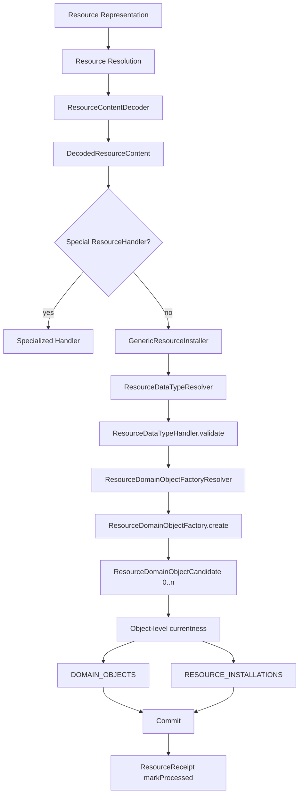

# Resource Installation

## Status

**Status:** Current
**Scope:** decoded Resource content through accepted local persistence
**Primary implementation:** generic datatype validation + Domain Object factories + generic installation transaction

---

# Purpose

This document describes the current Resource installation implementation used by the KJVOnly.bible client.

The codebase has completed the migration away from per-Domain inbound stacks such as:

```text
ResourceHandler
    ↓
Domain Interpreter
    ↓
Domain Validator
    ↓
Domain Installer
    ↓
Domain-specific installation transaction
```

for normal Resource-backed Domain Objects.

The default implementation is now:

```text
DecodedResourceContent
    ↓
ResourceDataTypeResolver
    ↓
ResourceDataTypeHandler.validate(...)
    ↓
ResourceDomainObjectFactoryResolver
    ↓
ResourceDomainObjectFactory.create(...)
    ↓
ResourceDomainObjectCandidate[]
    ↓
GenericResourceInstaller
    ↓
IndexedDBGenericResourceInstallationTransaction
    ↓
DOMAIN_OBJECTS
+
RESOURCE_INSTALLATIONS
```

The remaining specialized inbound `ResourceHandler` is Filesystem because Filesystem entries are persisted in their own physical store and have different addressing requirements.

This is an important implementation boundary:

```text
same generic Resource acquisition/resolution
        ↓
normal Domain Objects
    → GenericResourceInstaller

specialized persistence target
    → specialized ResourceHandler/installer
```

---

# Related Architecture

The implementation realizes these Resource Boundary decisions:

```text
docs/02_resource-boundary/01-domain-resource-model.md
docs/02_resource-boundary/03-nostr-event-model.md
docs/02_resource-boundary/04-nostr-resource-identity.md
docs/02_resource-boundary/08-resource-installation-lifecycle.md
docs/02_resource-boundary/11-resource-archives.md
```

Current source is authoritative for concrete class names and file layout.

---

# High-Level Runtime Flow

The normal content path is:



The key composition point is:

```text
src/lib/resource/worker/resource-worker-composition.ts
```

`createResourceProcessingDependencies()` constructs:

```text
ResourceContentDecoder
ResourceReceiptService
ResourceDataTypeResolver
ResourceDomainObjectFactoryResolver
IndexedDBGenericResourceInstallationTransaction
GenericResourceInstaller
special ResourceHandler[]
```

At the current state of the codebase:

```text
special ResourceHandler[]
    = Filesystem only
```

Bible, Notes, Reading Plans, Strong's, and Normalized Content use the generic path.

---

# DecodedResourceContent

Current model:

```ts
interface DecodedResourceContent {
    readonly publisher: string;
    readonly resourceId: string;
    readonly resourceType: string;
    readonly modifiedAt: number;
    readonly mediaType: string;
    readonly dataType: string;
    readonly dataVersion: number;
    readonly metadata?: Readonly<Record<string, string>>;
    readonly value: unknown;
}
```

Important distinctions:

```text
resourceId
    = Resource identity supplied by the publisher

resourceType
    = Resource Type / family

dataType + dataVersion
    = semantic payload contract

metadata
    = additional Resource-envelope metadata

value
    = decoded but not yet semantically accepted payload
```

Do not treat `resourceType`, `dataType`, and `resourceId` as interchangeable.

---

# ResourceMetadata

Current model:

```ts
export type ResourceMetadata =
    Readonly<Record<string, string>>;
```

It is intentionally protocol-agnostic and scalar.

Metadata is preserved through:

```text
ResourceRepresentation
    ↓
VerifiedResourceContent
    ↓
DecodedResourceContent
    ↓
ResourceDomainObjectFactoryContext
```

The generic Resource layer transports metadata without assigning meaning to individual keys.

Owning Domains interpret keys they define.

Current Bible Chapter example:

```text
metadata.version
    = semantic Bible version label
```

This value is deliberately separate from the Chapter Resource identity namespace (`bibleId`).

---

# ResourceDataTypeHandler

Source:

```text
src/lib/resource/data-types/resource-data-type-handler.ts
```

Contract:

```ts
interface ResourceDataTypeHandler<TValue = unknown> {
    readonly dataType: string;
    readonly dataVersion: number;

    validate(value: unknown): TValue;
}
```

A handler understands exactly one semantic contract:

```text
(dataType, dataVersion)
```

Its responsibility is to validate the decoded value's semantic structure.

It does not own:

```text
Resource identity
Resource Type dispatch
Domain Object identity
currentness
persistence
ResourceInstallation
publication
Module behavior
```

---

# ResourceDataTypeResolver

Source:

```text
src/lib/resource/data-types/resource-data-type-resolver.ts
```

The resolver is composed from registered handlers and indexes them by an exact key:

```text
<dataType>@<dataVersion>
```

For example:

```text
kjvonly.bible.chapter@1
kjvonly.bible.version@1
kjvonly.strongs.definition@1
```

Duplicate registrations throw during composition.

An unsupported datatype/version also throws before Domain Object construction or persistence.

---

# Published Datatype vs Canonical Object Datatype

The published Resource datatype is not required to equal the datatype persisted on each resulting Domain Object.

This matters for bundles and archive reconstruction.

Conceptually:

```text
Published Resource
    dataType = collection/bundle contract
        ↓
factory expands collection
        ↓
Stored Domain Object
    dataType = canonical object contract
```

Several Resource families therefore register two handlers:

```text
Published Resource handler
Canonical object/archive handler
```

Examples include:

```text
Strong's definitions
Bible Chapters
Bible Booknames
Bible Paragraphs
Bible Pericopes
Bible Text Markup
Bible Search Index
Reading Plan definitions/subscriptions/progress
```

The second handler exists because Archive import reconstructs individual canonical Domain Objects and feeds them back through the same generic installer.

---

# ResourceDomainObjectFactory

Source:

```text
src/lib/resource/domain-objects/resource-domain-object-factory.ts
```

Factory context:

```ts
Omit<DecodedResourceContent, 'value'>
```

The factory therefore receives Resource context such as:

```text
publisher
resourceId
resourceType
modifiedAt
mediaType
dataType
dataVersion
metadata
```

but receives the semantic value separately only after datatype validation succeeds.

Contract:

```ts
interface ResourceDomainObjectFactory {
    readonly resourceType: string;

    create(
        resource: ResourceDomainObjectFactoryContext,
        value: unknown
    ): readonly ResourceDomainObjectCandidate[];
}
```

The factory owns:

```text
Domain Object identity
Domain-specific interpretation of Resource identity
Domain-specific interpretation of Resource metadata
cross-field / context-dependent Domain invariants
canonical persisted datatype/version
bundle expansion
```

One factory may produce:

```text
0 Domain Objects
1 Domain Object
many Domain Objects
```

---

# ResourceDomainObjectCandidate

Current candidate shape:

```ts
interface ResourceDomainObjectCandidate {
    readonly objectType: string;
    readonly objectId: string;
    readonly dataType: string;
    readonly dataVersion: number;
    readonly value: unknown;
}
```

There is intentionally no Domain-specific installation policy flag on the candidate.

All normal candidates follow the same generic persistence/currentness rules.

A previous attempt to add a special `derived-if-absent` installation mode was rejected because it made one Domain's historical persistence behavior part of the generic Resource contract.

The current rule is simpler:

> If a factory emits a normal Resource-backed candidate, it follows normal Resource currentness and provenance behavior.

---

# ResourceDomainObjectFactoryResolver

Source:

```text
src/lib/resource/domain-objects/resource-domain-object-factory-resolver.ts
```

Factories are registered by Resource Type.

Conceptually:

```text
resource.resourceType
    ↓
ResourceDomainObjectFactoryResolver
    ↓
factory.resourceType
```

Duplicate Resource Type registrations throw during composition.

An unregistered Resource Type reaches the generic installer and fails installation.

---

# GenericResourceInstaller

Source:

```text
src/lib/resource/installation/generic-resource-installer.ts
```

The implementation sequence is:

```text
resolve datatype handler
    ↓
validate resource.value
    ↓
resolve Domain Object factory by resourceType
    ↓
remove raw value from Resource context
    ↓
factory.create(context, validatedValue)
    ↓
transaction.run(...)
    ↓
for each candidate:
    load ResourceInstallation
    compare modifiedAt
    construct StoredDomainObject
    construct ResourceInstallation
    persist both
```

The installer does not know Bible, Notes, Plans, Strong's, or Normalized Content identity rules.

It operates only on the generic candidate contract.

---

# Object-Level Currentness

For every candidate:

```ts
const currentInstallation =
    await stores.resourceInstallations.get(
        candidate.objectType,
        candidate.objectId
    );
```

Then:

```text
no current installation
    → install

incoming resource.modifiedAt > current.modifiedAt
    → replace

incoming resource.modifiedAt <= current.modifiedAt
    → skip this candidate
```

Currentness is object-level.

This means a bundle can legitimately produce mixed results:

```text
candidate A newer locally → skip
candidate B older locally → replace
candidate C missing       → install
```

The transaction still succeeds atomically for the writes that should occur.

---

# StoredDomainObject

The generic installer persists accepted values into `DOMAIN_OBJECTS` using:

```ts
interface StoredDomainObject {
    id: string;
    objectType: string;
    objectId: string;
    dataType: string;
    dataVersion: number;
    value: unknown;
}
```

`id` is created from:

```text
objectType + objectId
```

The candidate, not the incoming Resource envelope, defines the persisted Domain Object's:

```text
objectType
dataType
dataVersion
```

That distinction is required when the published Resource contract differs from the canonical stored Domain Object contract.

---

# ResourceInstallation

Source:

```text
src/lib/resource/installation/resource-installation.ts
```

Current model:

```ts
interface ResourceInstallation {
    readonly id: string;
    readonly objectType: string;
    readonly objectId: string;
    readonly publisher: string;
    readonly resourceId?: string;
    readonly metadata?: ResourceMetadata;
    readonly modifiedAt: number;
}
```

Its identity is:

```text
<objectType>:<objectId>
```

`ResourceInstallation` is not the Domain Object.

It stores Resource-backed state associated with the accepted object:

```text
publisher
known Resource identity
Resource revision timestamp
optional Resource-envelope metadata
```

---

# Why ResourceInstallation Keeps Resource Metadata

The generic installer copies Resource metadata into `ResourceInstallation` when metadata is present.

This does not affect currentness. Currentness still compares only:

```text
resource.modifiedAt
vs
installation.modifiedAt
```

Metadata is preserved because some Domain semantics belong to the Resource envelope rather than the canonical Domain object.

Bible Chapter is the current important example:

```text
Chapter Domain Object
    = Chapter content + Domain identity
    does not care about semantic Bible version label

Resource metadata.version
    = semantic version label required to reconstruct the Resource envelope
```

Archive reconstruction processes individual archived Domain Objects. Preserving the incoming Resource metadata on the installation allows reconstruction to retain information that intentionally was not duplicated into the Chapter value.

This is provenance/reconstruction state, not Domain payload state.

---

# Generic Installation Transaction

Sources:

```text
src/lib/resource/installation/generic-resource-installation-stores.ts
src/lib/resource/installation/indexeddb-generic-resource-installation-transaction.ts
```

The IndexedDB implementation opens one read/write transaction over:

```text
DOMAIN_OBJECTS
RESOURCE_INSTALLATIONS
```

For every accepted candidate, the Domain Object and ResourceInstallation are written within that transaction.

If the operation throws, the transaction is aborted and the original error is preserved.

The transaction exposes narrow store contracts rather than the complete application database.

---

# Atomicity

Semantic validation and factory construction happen before persistence begins.

Then candidate persistence is performed inside one generic transaction.

Therefore:

```text
invalid Resource payload
    → no write

factory invariant failure
    → no write

persistence failure
    → transaction abort

current candidate
    → intentional no-op
```

A skipped current candidate is not considered a failed atomic installation.

---

# ResourceReceipt vs ResourceInstallation

These remain distinct.

## ResourceReceipt

Resource-level processing state.

Conceptually:

```text
publisher + resourceId
    → this Resource revision has been processed/current
```

Receipts participate in resolution/currentness optimization.

## ResourceInstallation

Object-level Resource state.

Conceptually:

```text
objectType + objectId
    → this accepted Domain Object corresponds to this Resource revision
```

One Resource can produce many objects:

```text
1 ResourceReceipt
many ResourceInstallations
```

A Resource receipt is marked processed only after the Resource's handler/generic installation path completes successfully.

Receipt write failure is logged after successful Domain handling rather than rolling back Domain persistence.

---

# ResourceResolutionProcessor Dispatch

Source:

```text
src/lib/resource/services/resource-resolution-processor.ts
```

After decoding, the processor checks for a specialized ResourceHandler by `resourceType`:

```text
special handler registered
    → handler.handle(decoded)

no special handler
    → genericInstaller.install(decoded)
```

This allows exceptional Resource families to keep specialized persistence without forcing every Domain through custom infrastructure.

Standalone Normalized Content demonstrates the normal generic contract clearly:

```text
resourceType = normalized-content/document
objectType   = normalized-content/document
dataType     = kjvonly.normalized-document
dataVersion  = 1
resourceId   = opaque to generic Resource infrastructure
```

The semantic datatype is reusable independently from Resource Type. A future Resource Type such as `sermon` may reuse `kjvonly.normalized-document@1` while a module that understands the `sermon` type adds richer application behavior.

At present the intended special-case list is:

```text
Filesystem
```

---

# Filesystem Exception

Filesystem remains on its specialized installation path, but it uses the same Resource vocabulary as the generic path:

```text
resourceType = filesystem/entry
objectType   = filesystem/entry
dataType     = kjvonly.filesystem.entries
dataVersion  = 1
```

The plural semantic datatype is intentional: one Filesystem Resource payload contains a path-keyed collection of entries, while each installed filesystem object is one `filesystem/entry`.

Current flow:

```text
Decoded Filesystem Resource
    ↓
FilesystemResourceHandler
    ↓
FilesystemEntriesDataTypeHandler
    ↓
FilesystemInterpreter
    ↓
FilesystemValidator
    ↓
FilesystemInstaller
    ↓
FilesystemInstallationTransaction
```

The specialized handler validates the declared semantic payload contract before interpretation. The reason for keeping a separate lifecycle is persistence, not different Resource semantics.

Filesystem entries are stored in their own physical store with addressing based on:

```text
publisher
rootPath / mount
entry path
```

Its transaction writes:

```text
FILESYSTEM store
+
RESOURCE_INSTALLATIONS
```

rather than:

```text
DOMAIN_OBJECTS
+
RESOURCE_INSTALLATIONS
```

Filesystem also preserves deferred `ResourceDescriptor` values and mount/path behavior that belong to the Filesystem Domain.

For now, this is a legitimate specialized installer and should not be generalized away merely to eliminate the final `ResourceHandler`.

---

# Domain-Specific Local Write Transactions

Files such as:

```text
bible-text-markup-write-transaction.ts
```

are not leftover inbound Resource installers.

They own local application mutations.

A typical local Resource-backed write must atomically maintain:

```text
DOMAIN_OBJECTS
+
RESOURCE_INSTALLATIONS
+
OUTBOX
```

Conceptually:

```text
user/application modifies Domain state
    ↓
Domain local-write service
    ↓
allocate monotonic modifiedAt
    ↓
write accepted Domain Object
write ResourceInstallation revision state
queue publication intent
    ↓
commit
```

This is different from inbound `GenericResourceInstaller`:

```text
GenericResourceInstaller
    = accept an external/decoded Resource

Domain write transaction
    = create/update locally authoritative state and queue publication
```

Do not remove local-write transactions just because inbound installation became generic.

---

# Bible Chapter Example

Bible Chapters demonstrate several important boundaries.

Published Chapter Resource:

```text
resourceType = bible/chapter
dataType     = kjvonly.bible.chapter
dataVersion  = 1
metadata.version = semantic Bible version label
```

The Bible Domain owns the path-like Resource ID grammar:

```text
kjvonly/bible/chapter/<bibleId>/<chapterRef>
```

or bundle:

```text
kjvonly/bible/chapter/<bibleId>
```

The factory treats:

```text
bibleId
    = identity namespace derived from Resource identity

metadata.version
    = semantic version label
```

They are intentionally independent.

For a non-empty Chapter Resource, the factory emits:

```text
bible/version
+
one or more bible/chapter candidates
```

Both are normal candidates and use the same generic currentness/provenance rules.

No special `derived-if-absent` mode exists.

---

# Notes Example

Notes use:

```text
NoteDataTypeHandler
NoteDomainObjectFactory
GenericResourceInstaller
```

The old Notes-specific interpreter/validator/installer/resource-handler installation stack has been removed.

Application-side Notes writes/publication remain Domain-specific because they are local mutation/outbound behavior, not inbound installation.

---

# Reading Plans Example

Plan Definition, Subscription, and Progress each register:

```text
published datatype handler
canonical object/archive datatype handler where required
Domain Object factory
```

They share the same GenericResourceInstaller.

Local subscription/progress write transactions remain because local writes must update Domain state, Resource revision state, and Outbox intent atomically.

---

# Strong's Example

Strong's established the important distinction between:

```text
published Resource datatype
and
canonical stored Domain Object datatype
```

A definitions bundle may validate as a published collection contract while the factory emits individual objects with:

```text
objectType = strongs/definition
dataType   = kjvonly.strongs.definition@1
```

The generic installer persists candidate metadata supplied by the factory rather than blindly copying the incoming Resource datatype onto every object.

---

# Bible Resource Migration State

The following Bible Resource families now use generic datatype/factory installation:

```text
Chapters
Booknames
Paragraphs
Pericopes
Text Markup
Search Index
```

Their old inbound:

```text
Interpreter
Installer
ResourceHandler
Domain-specific installation transaction
```

stacks have been removed where no longer required.

Reusable Domain validators remain when the new datatype/factory code still uses them.

Filesystem remains the intentional specialized inbound path.

---

# Archive Reconstruction

Archive import does not write archived Domain Objects directly.

It reconstructs a `ResourcePublication`, then builds `DecodedResourceContent` and calls:

```text
ResourceResolutionProcessor.processDecoded(...)
```

The reconstructed envelope uses:

```text
publisher          ← publication
resourceId         ← publication
resourceType       ← publication
modifiedAt         ← archived ResourceInstallation
dataType            ← publication
dataVersion         ← publication
metadata            ← installation.metadata ?? publication.metadata
value               ← publication.value
```

The reconstructed Resource then follows the same specialized/generic installation dispatch as normal inbound Resources.

The reconstructed Resource therefore validates against the publication payload contract, while the archived Domain Object keeps its own persisted semantic datatype. ResourceInstallation metadata may still be required for faithful Resource reconstruction.

---

# Empty Candidate Sets

A valid factory may return:

```text
[]
```

The generic installer still runs the transaction callback, but no Domain Object or ResourceInstallation writes occur.

The enclosing Resource processing may still mark the Resource itself processed successfully.

A Domain factory should return an empty candidate list only when an empty semantic value is valid for that Resource contract.

---

# Failure Semantics

The generic path can fail because of:

```text
unsupported dataType/dataVersion
semantic validation error
unsupported Resource Type
factory invariant error
transaction/persistence error
```

`ResourceResolutionProcessor` converts these errors into a failed `ResourceInstallOutcome` for that Resource.

The generic installer does not swallow semantic or persistence failures.

---

# Source Organization

Generic Resource installation infrastructure:

```text
src/lib/resource/
├── data-types/
│   ├── resource-data-type-handler.ts
│   └── resource-data-type-resolver.ts
├── domain-objects/
│   ├── resource-domain-object-factory.ts
│   └── resource-domain-object-factory-resolver.ts
├── installation/
│   ├── generic-resource-installer.ts
│   ├── generic-resource-installation-stores.ts
│   ├── indexeddb-generic-resource-installation-transaction.ts
│   └── resource-installation.ts
└── worker/
    └── resource-worker-composition.ts
```

A typical migrated Domain Resource folder now contains:

```text
<resource>-resource.ts
<resource>-data-type-handler.ts
<resource>-domain-object-factory.ts
<resource>-resource-publication.ts
```

plus Domain validators/services as actually required.

---

# Testing Strategy

The generic installation architecture should be tested at several levels.

## DataType handler tests

Verify:

```text
valid values accepted
invalid semantic shape rejected
canonical object/archive contract behavior
```

## Factory tests

Verify:

```text
Resource context interpretation
Domain Object IDs
bundle expansion
Domain invariants
metadata interpretation
candidate semantic metadata
```

## Generic installer tests

Verify:

```text
datatype dispatch
factory dispatch
0..n candidates
modifiedAt currentness
StoredDomainObject construction
ResourceInstallation construction
metadata preservation
atomic transaction behavior
```

## Browser installation tests

Use real IndexedDB/Worker execution to prove representative Resources install through production composition.

## Relay integration tests

For important Resource families such as Bible Chapters, publish a real Nostr Resource event and exercise discovery → resolution → decoding → generic installation.

Test fixtures must include all Resource-envelope metadata required by the Domain contract.

---

# Extension Procedure for a Normal Resource Family

To add a Resource family that persists normal Domain Objects:

1. Define the Resource contract constants.
2. Define `dataType` and `dataVersion` explicitly.
3. Add a `ResourceDataTypeHandler` for the published semantic payload.
4. Add a `ResourceDomainObjectFactory` registered by Resource Type.
5. Put Domain identity and context-dependent invariants in the factory.
6. Return canonical `ResourceDomainObjectCandidate` values.
7. Provide a Domain-owned `ResourcePublication` builder for archive/outbound reconstruction where required.
8. Register handlers/factory in Resource worker composition.
9. Add focused datatype/factory/generic installation tests.
10. Add or update Archive `ResourcePublication` reconstruction.
11. Do not add a custom ResourceHandler/Installer unless persistence requirements genuinely differ from the generic path.

---

# When a Specialized Installer Is Justified

Before adding a specialized inbound installer, ask:

```text
Can the accepted state be represented as normal StoredDomainObject candidates
and persisted to DOMAIN_OBJECTS + RESOURCE_INSTALLATIONS?
```

If yes:

```text
use GenericResourceInstaller
```

A specialized installer is justified only when there is a real lifecycle/persistence difference, such as:

```text
separate physical store
special addressing model
required atomic stores not represented by generic transaction
non-Domain-object installation semantics
```

Filesystem currently satisfies this exception.

A Domain being "special" semantically is not enough.

---

# Important Invariants

```text
1. dataType + dataVersion own semantic payload validation.

2. Resource Type owns Domain Object factory selection.

3. Resource ID does not generically define Domain semantics.

4. Resource metadata is transported generically and interpreted by owning Domains.

5. Factories receive validated values, never raw unvalidated payloads.

6. Factories own Domain Object identity and canonical persisted semantic metadata.

7. One Resource may produce zero, one, or many Domain Objects.

8. GenericResourceInstaller owns normal currentness and persistence only.

9. Currentness is per Domain Object using ResourceInstallation.modifiedAt.

10. Stored Domain Object + ResourceInstallation writes are atomic.

11. ResourceInstallation metadata is provenance/reconstruction state, not Domain payload.

12. ResourceReceipt and ResourceInstallation are separate layers.

13. Domain-specific local-write transactions are not obsolete inbound installers.

14. Specialized inbound installers require materially different persistence requirements.

15. Filesystem remains specialized because it writes its own store.
```

---

# Common Anti-Patterns

Avoid reintroducing:

```text
one Interpreter + Validator + Installer + ResourceHandler stack per Domain
```

when the only difference is semantic validation and Domain identity.

Avoid:

```text
parsing Resource ID generically to infer Domain meaning
```

Avoid:

```text
using dataType as Resource Type
```

Avoid:

```text
copying the published datatype blindly onto every stored Domain Object
```

Avoid:

```text
special candidate persistence flags for one Domain
```

Avoid:

```text
removing local-write transactions because inbound installation became generic
```

Avoid:

```text
forcing Filesystem into DOMAIN_OBJECTS solely for architectural uniformity
```

---

# Summary

The current Resource installation implementation is intentionally small at its center:

```text
Decoded Resource
    ↓
validate dataType + dataVersion
    ↓
factory constructs canonical Domain Objects
    ↓
GenericResourceInstaller applies modifiedAt currentness
    ↓
DOMAIN_OBJECTS + RESOURCE_INSTALLATIONS
```

This shared path now installs the normal Resource-backed Domain state across Bible, Notes, Reading Plans, Strong's, and Normalized Content.

Domain code supplies meaning and identity rather than reimplementing the lifecycle.

Filesystem remains a specialized inbound installer because it persists accepted entries in a different store with different addressing semantics.

Local-write transactions remain Domain-specific because they own a different responsibility: atomically updating locally authoritative Domain state, Resource revision state, and publication intent.
