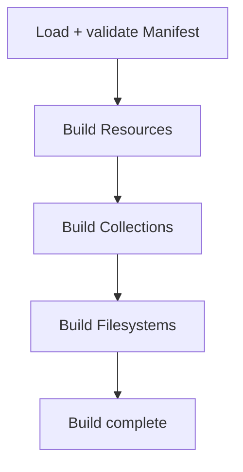
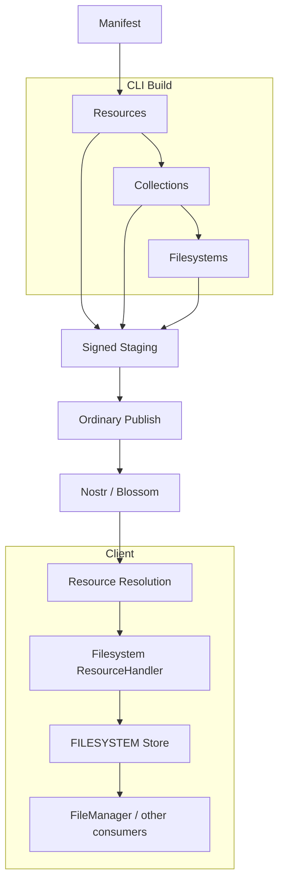

# CLI Filesystem Overlay Manifest and Builder Implementation

**Date:** 2026-10-06  
**Status:** Current — V1 implemented and end-to-end smoke validated
**Scope:** `client/cli` Filesystem manifest/build support plus the client-side Filesystem path contract
**Current validation manifest:** `zarf/manifest/filesystem-smoke.yaml`
**Planned application integration:** `zarf/manifest/app-data.yaml`

---

# 1. Purpose

This implementation document records the CLI Filesystem overlay category used to publish Filesystem Resources from Resources and Collections that the CLI has already built.

The Normalized Document directory importer builds this same overlay from discovered files.
See [CLI Filesystem recursive import](../../../client/cli/docs/filesystem-recursive-import-discovery.md)
for its current import command, generated Manifest, and staging-generation behavior.

The manifest has three named publication categories:

```text
resources
collections
filesystems
```

The Filesystem category does not introduce a new Resource lifecycle or publication protocol.

A Filesystem is still an ordinary Resource. Its application purpose is Resource discovery and organization.

Conceptually:

```text
Filesystem Resource
    ↓ resolved as an ordinary Resource
Filesystem semantic content
    ↓
full filesystem path → ResourceDescriptor
    ↓
Filesystem specialized installation
    ↓
first-class FilesystemEntry state
```

The CLI addition is therefore an authoring/build adapter that constructs the semantic payload of a Filesystem Resource from already-built signed Resource events.

---

# 2. Established Filesystem Contract

The following Filesystem contract is authoritative.

```text
d / resourceId
    = identity of the Filesystem Resource itself

f
    = Filesystem root/mount contributed by that Resource

payload key
    = complete filesystem path, including the root

payload value
    = deferred ResourceDescriptor

FilesystemEntry.path
    = complete filesystem path, unchanged from the payload key
```

Example:

```text
d = <publisher-controlled Filesystem Resource ID>
f = library

t = filesystem/entry
dataType = kjvonly.filesystem.entries
dataVersion = 1
representation = content
```

Semantic payload:

```json
{
  "library/books/theology/knowing-god": {
    "descriptor": {}
  },
  "library/sermons/spurgeon/grace": {
    "descriptor": {}
  }
}
```

The Filesystem root and Filesystem Resource identity are intentionally independent.

The root MUST NOT be derived from `d`.

The target Resource identity is also independent from its filesystem location.

Therefore the same target Resource may legitimately back multiple first-class Filesystem entries.

---

# 3. Client Full-Path Contract

The client Filesystem validator enforces the same full-path contract emitted by the CLI overlay builder.

The authoritative invariant is:

```text
rootPath
    = canonical filesystem root

path
    = canonical complete filesystem path

path
    = strict descendant of rootPath
```

For:

```text
rootPath = library
```

valid:

```text
library/books/foo
library/books/foo/bar
```

invalid:

```text
library
books/foo
other/foo
library2/foo
library/../notes/foo
library/books/
library//books/foo
```

A path MUST NOT equal its root.

Containment must be segment-safe. After canonical validation, the effective relationship is:

```text
path starts with rootPath + "/"
```

The interpreter must preserve the payload key verbatim as the candidate path. The installer must preserve it verbatim as `FilesystemEntry.path`.

No root stripping, relative-path conversion, or root/path joining belongs in the client Filesystem lifecycle.

The interpreter and installer preserve the payload key unchanged. Store contracts, tests, FileManager projection, and implementation documentation use the same full-path vocabulary.

---

# 4. Non-Delete Overlay Semantics

Filesystem Resources are additive/update overlays.

Installation semantics remain:

```text
mapping present
    → install or update according to currentness

mapping omitted
    → do nothing
```

Absence MUST NOT mean deletion.

This is intentional. A relay outage, incomplete relay response, temporary network failure, or incomplete discovery result must not cause accepted filesystem state to be deleted.

An explicit delete/tombstone contract may be designed later if removal is required.

One consequence is accepted for V1:

```text
latest overlay omits an old path
    ↓
existing clients may retain that accepted entry
new clients may never install it
```

This is the deliberate safety tradeoff until explicit deletion semantics exist.

---

# 5. Current CLI Architecture

The current CLI build flow is:

```text
Manifest
    ↓
Resources
    ↓
Collections
    ↓
Filesystems
```

Resources may expand from one source file or a directory of source files.

Each concrete Resource source has a stable `key` derived by `SourceExpander`.

The ordinary signed-event staging repository retains that key in `StagedEventMetadata` and guarantees at most one staged event per key for a named Resource definition.

Collections are built after Resources and may reference named Resources or child Collections. Filesystems are built after Collections and may reference already-staged named Resources and Collections.

Publication uses:

```text
staged Blossom artifacts
    ↓
Nostr staged events
```

`FilesystemBuilder` consumes the signed staged events from the first two phases.

It does not rebuild target Resources and does not inspect their Domain payloads.

---

# 6. Implemented V1 Behavior

The V1 Filesystem manifest/build feature:

1. keeps the CLI Resource-agnostic outside the Filesystem-specific adapter;
2. treats Filesystem output as an ordinary Resource with `representation = content`;
3. allows explicit placement of named Resources and Collections into a Filesystem root;
4. allows one named Resource definition to expand to every concrete staged Resource it produced;
5. allows selective placement of one concrete Resource by staged `key`;
6. preserves full filesystem paths in generated payload keys;
7. builds target descriptors from already-signed staged Resource/Collection events;
8. works regardless of whether the target Resource event uses `content` or `descriptors` representation;
9. reuses manifest `nostr.relays` when constructing Nostr-backed target descriptors;
10. rejects ambiguous or colliding filesystem paths before signing the Filesystem Resource;
11. publishes dependency categories before the Filesystem Resource category that references them;
12. preserves the existing Filesystem non-delete runtime semantics; and
13. provides a clean target model for a future recursive-directory/GUI workflow.

---

# 7. Non-Goals

V1 does not add:

```text
recursive OS-directory Resource authoring
GUI publication
filesystem mutation commands
filesystem deletion/tombstones
automatic Resource Type inference
automatic datatype inference
semantic inspection of target Resource payloads
Filesystem-driven Resource resolution during build
flattening Collection members into Filesystem entries
cross-manifest Resource lookup
remote relay discovery during build
```

The builder works from the current manifest and its local staging state.

---

# 8. Filesystem Manifest Category

The top-level manifest contains the additive category:

```yaml
filesystems: {}
```

Its plural naming matches the existing named publication categories:

```yaml
resources: {}
collections: {}
filesystems: {}
```

Existing manifests remain valid because the category defaults to an empty map. The additive V1 feature did not require a manifest version bump.

---

# 9. Filesystem Definition

A Filesystem definition owns:

```text
root
Filesystem Resource event definition
directory placement rules
```

Conceptual shape:

```yaml
filesystems:

  application-library:
    root: library

    event:
      encoding:
        - hex

      tags:
        - ["d", "<filesystem-resource-id>"]
        - ["m", "application/json+hex"]
        - ["t", "filesystem/entry"]
        - ["dataType", "kjvonly.filesystem.entries"]
        - ["dataVersion", "1"]
        - ["representation", "content"]

    directories:
      - path: bible

        resources:
          kjvs-chapters:
            resource: bible-chapters-kjvs

          genesis-1:
            resource: bible-chapters-kjvs
            key: 1_1

        collections:
          application-defaults:
            collection: application-defaults
```

The example `d` value is intentionally unspecified. Filesystem Resource identity remains publisher policy and is independent from `root`.

---

# 10. The `f` Tag Is Derived From `root`

`root` is the manifest source of truth for the Filesystem mount.

The Filesystem builder adds:

```text
["f", root]
```

to the signed Filesystem Resource event.

The manifest author does not provide an `f` tag manually.

A Filesystem definition containing an explicit `f` tag fails validation so the manifest cannot contain two competing root values.

Therefore:

```yaml
root: library
```

produces:

```text
f = library
```

while:

```text
d
```

remains completely independent.

---

# 11. Directory Placement Semantics

Each `directories[]` entry describes one root-relative placement directory.

For example:

```yaml
root: library

directories:
  - path: bible/chapters
```

has the placement base:

```text
library/bible/chapters
```

`directories[].path` is a manifest placement path, not a persisted relative `FilesystemEntry.path`.

The final generated payload key is always a complete path including `root`.

A directory path may be omitted or empty to place entries directly below the root, but the generated file path must still be a strict descendant of the root.

Directory paths must be canonical slash-separated paths:

```text
no leading /
no trailing /
no empty segments
no . segments
no .. segments
```

Filesystem logical path construction must not use platform-dependent `node:path.join`, because Filesystem paths always use `/` regardless of host operating system.

---

# 12. Resource Placement Rules

A directory's `resources` map is keyed by a **placement name**.

Each value references one named manifest Resource definition and may optionally select one concrete staged key.

Shape:

```yaml
resources:
  <placement-name>:
    resource: <manifest-resource-name>
    key: <optional-concrete-key>
```

The presence or absence of `key` deliberately changes the placement mode.

---

# 13. Selective Resource Placement

When `key` is present, the rule selects exactly one concrete staged Resource.

Example:

```yaml
resources:
  genesis-1:
    resource: bible-chapters-kjvs
    key: 1_1
```

For:

```text
root = library
directory.path = bible/chapters
```

this generates exactly one Filesystem entry:

```text
library/bible/chapters/genesis-1
```

Its descriptor points to the staged signed event for:

```text
resource definition = bible-chapters-kjvs
key                 = 1_1
```

The placement name may therefore rename the selected Resource within the Filesystem without changing the target Resource identity.

If the requested key does not exist, the build fails.

---

# 14. Bulk Resource Placement

When `key` is omitted, the rule expands every currently staged concrete Resource produced by the referenced Resource definition.

Example:

```yaml
resources:
  kjvs-chapters:
    resource: bible-chapters-kjvs
```

If `bible-chapters-kjvs` has staged keys:

```text
1_1
1_2
1_3
...
```

then the Filesystem builder generates:

```text
library/bible/chapters/kjvs-chapters/1_1
library/bible/chapters/kjvs-chapters/1_2
library/bible/chapters/kjvs-chapters/1_3
...
```

For the full KJVS chapter set this produces 1,189 first-class Filesystem entries.

The placement name becomes a synthetic directory prefix and each concrete Resource `key` becomes the file basename.

No directory Domain objects are persisted. The directory exists only because the generated full paths share the same prefix.

---

# 15. Bulk Placement Shape Is Cardinality-Independent

Bulk placement MUST NOT change shape depending on whether the referenced Resource currently produces one or many concrete keys.

Therefore a bulk rule with one current key still generates:

```text
<root>/<directory>/<placement-name>/<key>
```

and does not collapse to:

```text
<root>/<directory>/<placement-name>
```

This is required because source cardinality can change over time.

Without this rule:

```text
revision 1: one key
    → library/foo

revision 2: two keys
    → library/foo/a
    → library/foo/b
```

would move the original entry and, because omission is non-destructive, could leave stale accepted state at the old path.

Stable bulk placement is therefore:

```text
key supplied
    → <directory>/<placement-name>

key omitted
    → <directory>/<placement-name>/<concrete-key>
```

for every cardinality.

---

# 16. Zero-Match Bulk Rules

A bulk Resource rule that resolves to zero staged events fails the Filesystem build.

Failing is safer than silently publishing an unexpectedly incomplete Filesystem overlay.

This protects against cases such as:

```text
wrong Resource name
missing/empty source directory
failed prior Resource build
unexpected staging cleanup
```

A selective rule already fails when its requested key is absent.

---

# 17. Collection Placement Rules

A Collection reference represents the Collection Resource itself.

It does not flatten or expand the Collection's member descriptors into Filesystem entries.

Shape:

```yaml
collections:
  <placement-name>:
    collection: <manifest-collection-name>
```

Example:

```yaml
collections:
  application-defaults:
    collection: application-defaults
```

For:

```text
root = library
directory.path = bootstrap
```

this generates:

```text
library/bootstrap/application-defaults
```

whose descriptor points to the staged signed Collection event.

If a Collection's individual members should appear as individual Filesystem entries, those Resources must be referenced through `resources` placement rules instead.

---

# 18. Same Resource, Multiple Filesystem Entries

Filesystem entries are first-class application state, while their descriptors reference Resources.

The same concrete Resource may therefore be placed more than once.

Example:

```yaml
resources:
  genesis-1:
    resource: bible-chapters-kjvs
    key: 1_1

  kjvs-chapters:
    resource: bible-chapters-kjvs
```

may produce both:

```text
library/bible/chapters/genesis-1
library/bible/chapters/kjvs-chapters/1_1
```

Both entries contain equivalent descriptors pointing at the same target Resource.

Their Filesystem identities remain different because their full paths differ.

---

# 19. Staged Resource Resolution

The Filesystem builder resolves Resource references from ordinary signed Resource staging.

For a referenced Resource name:

```text
SignedEventStagingRepository.list(stagingRoot, resourceName)
```

returns the current staged events sorted by concrete `key`.

BuildManifest already removes stale Resource staging entries before the Filesystem phase runs.

Therefore Filesystem expansion sees the current local build set.

Selective algorithm:

```text
list staged entries
    ↓
find metadata.key == requested key
    ↓
read and verify signed event
    ↓
convert event to ResourceDescriptor
```

Bulk algorithm:

```text
list staged entries
    ↓
require at least one
    ↓
for each staged key in deterministic order
    ↓
read and verify signed event
    ↓
convert event to ResourceDescriptor
```

The builder never parses target Resource IDs to recover source keys.

The staging `key` is authoritative for bulk/seletive source expansion.

---

# 20. Staged Collection Resolution

Collection references resolve through `CollectionEventStagingRepository`.

Algorithm:

```text
find staged Collection by manifest collection name
    ↓
read and verify signed event
    ↓
convert event to ResourceDescriptor
```

CollectionBuilder runs before FilesystemBuilder, so referenced Collections are already staged.

If a referenced Collection has no staged event, the Filesystem build fails.

---

# 21. Generic Signed-Event → ResourceDescriptor Builder

`NostrEventResourceDescriptorBuilder` is the generic build collaborator that converts a signed Resource event into a Nostr-backed `ResourceDescriptor`.

Contract:

```ts
build(
    event: SignedNostrEvent,
    relays: readonly string[]
): ResourceDescriptor
```

It reads the ordinary Resource envelope:

```text
d
m
t
dataType
dataVersion
representation
```

and preserves non-envelope scalar tags as `resourceMetadata`.

It constructs:

```ts
strategy: {
    type: 'nostr',
    data: {
        kind: event.kind,
        relays: [...relays]
    }
}
```

`manifest.nostr.relays` supplies the relay list.

The generic descriptor builder MUST NOT require a particular Resource representation.

Therefore both are valid targets:

```text
representation = content
representation = descriptors
```

CollectionBuilder may continue to enforce `representation = descriptors` specifically when it treats an event as a nested Collection.

FilesystemBuilder imposes no such restriction on the target Resource.

---

# 22. Why Filesystem Uses Staged Events Instead of `descriptorsByResource`

The existing `descriptorsByResource` map only contains descriptors produced by the object-upload Resource path.

It does not represent every ordinary inline Resource event.

Filesystem discovery must be able to expose any Resource built by the CLI.

The signed staged event is the common denominator:

```text
inline Resource
    → signed staged Resource event

object-upload Resource
    → signed staged descriptor-backed Resource event

Collection
    → signed staged Collection event
```

Filesystem therefore references the signed event and constructs a Nostr-backed descriptor for that Resource.

This keeps Filesystem assembly independent from the target Resource's underlying representation or storage provider.

---

# 23. Filesystem Payload Construction

The Filesystem builder first resolves every placement rule into an in-memory list:

```ts
interface FilesystemOverlayEntry {
    readonly path: string;
    readonly descriptor: ResourceDescriptor;
}
```

After all rules have expanded and validation has succeeded, entries are sorted by full path.

The payload is then projected as:

```ts
Record<
    string,
    {
        readonly descriptor: ResourceDescriptor;
    }
>
```

Conceptually:

```json
{
  "library/bible/chapters/genesis-1": {
    "descriptor": {}
  },
  "library/bible/chapters/kjvs-chapters/1_1": {
    "descriptor": {}
  },
  "library/bible/chapters/kjvs-chapters/1_2": {
    "descriptor": {}
  }
}
```

The sorted insertion order makes serialized JSON deterministic for identical inputs.

---

# 24. Filesystem Event Construction

`FilesystemEventBuilder` mirrors the existing Collection event-builder pattern while producing Filesystem semantic content.

Inputs:

```text
kind
event definition
root
sorted Filesystem payload
previous created_at when rebuilding
```

The builder:

1. serializes the Filesystem payload as JSON;
2. applies the manifest event encodings;
3. appends the derived `f` tag;
4. preserves the declared Resource envelope tags;
5. signs an ordinary Nostr Resource event.

The Filesystem event must use:

```text
t = filesystem/entry
dataType = kjvonly.filesystem.entries
dataVersion = 1
representation = content
```

The exact `d` remains manifest/publisher controlled.

---

# 25. Filesystem Manifest Validation

Manifest validation has two layers.

## 25.1 Static manifest validation

The Zod manifest schema validates what can be known before building:

```text
filesystem name is non-empty
root is canonical
Filesystem event has the generic Resource envelope
event representation is content
Resource Type is filesystem/entry
dataType is kjvonly.filesystem.entries
dataVersion is 1
manifest event does not explicitly contain f
directory paths are canonical placement paths
placement names are valid single filesystem segments
referenced Resource definitions exist
referenced Collections exist
```

`key` existence is not statically validated because concrete staged keys are produced by Resource expansion/build.

## 25.2 Build-time validation

FilesystemBuilder validates:

```text
selective Resource key exists
bulk Resource has at least one staged event
referenced Collection is staged
all target signed events are valid
all generated target descriptors are valid Resource envelopes
all generated full paths are strict descendants of root
no exact path collisions
no file/directory collisions
```

---

# 26. Filesystem Path Helpers

CLI Filesystem path logic is centralized in small pure Domain helpers under `client/cli/src/domain/filesystem/filesystem-path.ts`:

```text
isCanonicalFilesystemPath(value)
isCanonicalFilesystemDirectoryPath(value)
isFilesystemPathSegment(value)
joinFilesystemPath(...components)
isStrictFilesystemDescendant(root, path)
```

These helpers operate on `/`-separated logical Filesystem paths and do not depend on host filesystem normalization.

The client and CLI implement the same Filesystem path contract at their respective owner boundaries and cover that contract with focused tests rather than introducing a shared package solely for this feature.

---

# 27. Collision Rules

All entries produced by one Filesystem Resource must be validated together before the event is signed.

## 27.1 Exact path collision

Reject:

```text
library/books/foo
library/books/foo
```

No last-write-wins behavior exists inside one generated payload.

## 27.2 File/directory collision

Reject:

```text
library/books/foo
library/books/foo/bar
```

because one logical path cannot simultaneously be a file and a directory prefix in a producer-authored filesystem tree.

FileManager may retain defensive collision behavior for externally authored state, but the CLI should not knowingly publish an ambiguous tree.

## 27.3 Root collision

Reject:

```text
root = library
path = library
```

A file must be a strict descendant of its root.

## 27.4 Cross-Filesystem overlays

Separate Filesystem Resources may intentionally target the same root and even the same path.

Those are genuine overlays and remain governed by the existing client currentness identity:

```text
filesystem publisher
+
rootPath
+
full entry path
```

with newer accepted Resource revisions replacing older mappings.

The CLI does not globally prohibit collisions across separate Filesystem Resource definitions.

---

# 28. Incremental Filesystem Builds

An unchanged Filesystem definition reuses its existing signed staged event.

This is more important for Filesystem than blindly re-signing every build because Filesystem Resource `created_at` becomes `modifiedAt` for the installed entry mappings.

Re-signing an unchanged overlay would make every mapping appear newer and create unnecessary local currentness churn.

The Filesystem staging metadata therefore retains an input revision derived from the complete semantic build input.

The input revision hashes:

```text
manifest kind
publisher
root
Filesystem event definition
manifest Nostr relays
sorted generated paths
referenced target event IDs
```

Using target event IDs ensures any changed signed Resource revision invalidates the Filesystem input revision.

Behavior:

```text
same input revision + same publisher
    → reuse prior signed Filesystem event byte-for-byte

changed input revision
    → sign new event
    → created_at = max(now, previous.created_at + 1)
```

---

# 29. Filesystem Event Staging

V1 uses an explicit Filesystem generated-event staging boundary rather than ordinary source-event staging metadata such as source mtime/size.

Conceptually:

```text
FilesystemEventStagingRepository
```

with one staged event per named Filesystem definition.

Current staging location:

```text
<stagingRoot>/events/__filesystems__/
```

Current staged metadata:

```text
filesystemName
inputRevision
createdAt
eventId
```

The repository verifies staged event ID, `created_at`, and signature on read, following the existing Resource/Collection staging patterns.

A later cleanup may generalize Collection and Filesystem generated-event staging if the duplication becomes material. That refactor is not required to implement V1 correctly.

---

# 30. Build Order

`BuildManifestUseCase` runs:



The Filesystem phase must run after Collection cleanup/build so references never resolve to stale Collection events.

Current composition:

```text
BuildManifestUseCase
    ├── Resource build path
    ├── CollectionBuilder
    └── FilesystemBuilder
```

FileManager and the client runtime do not participate in this producer-side build.

---

# 31. Publication Order

Publication dependencies are explicit rather than relying on staging-path lexical order.

For each publish operation and relay:

```text
1. Blossom artifacts
2. ordinary Resource Nostr events
3. Collection Nostr events
4. Filesystem Nostr events
```

This ensures a Filesystem Resource is advertised only after the Resource/Collection events referenced by its descriptors have been attempted for publication to the same configured relay.

`NostrStagedEventPublisher` owns the Nostr publication category sequence `Resource → Collection → Filesystem` and requests each category from `NostrEventStagingRepository`. The staging repository owns category-specific listing and exact staged-event reads; it does not choose which categories participate or their publication order.

This is category ordering, not a complete topological sort of dependencies among events within one category. Publication remains ordinary Nostr publication, and `PublishManifestUseCase` does not require Filesystem-specific protocol behavior.

---

# 32. Staging Cleanup vs Filesystem Deletion

Removing a Filesystem definition from the manifest may remove its obsolete local staged event.

Changing a Filesystem definition may replace its locally staged event.

These are CLI staging operations only.

They MUST NOT be confused with accepted Filesystem deletion semantics in the client.

Likewise, if a bulk Resource definition loses one concrete key, the rebuilt Filesystem payload simply omits the corresponding path. Existing clients do not interpret that omission as deletion.

---

# 33. Manifest Type Shapes

Representative inferred TypeScript shapes:

```ts
interface FilesystemResourcePlacementDefinition {
    readonly resource: string;
    readonly key?: string;
}

interface FilesystemCollectionPlacementDefinition {
    readonly collection: string;
}

interface FilesystemDirectoryDefinition {
    readonly path?: string;

    readonly resources: Readonly<
        Record<
            string,
            FilesystemResourcePlacementDefinition
        >
    >;

    readonly collections: Readonly<
        Record<
            string,
            FilesystemCollectionPlacementDefinition
        >
    >;
}

interface FilesystemDefinition {
    readonly root: string;
    readonly event: EventDefinition;
    readonly directories: readonly FilesystemDirectoryDefinition[];
}
```

The current source uses Zod inference for these manifest model types.

---

# 34. Current Schema Behavior

The current Zod manifest model includes:

```text
filesystemResourcePlacementSchema
filesystemCollectionPlacementSchema
filesystemDirectoryDefinitionSchema
filesystemDefinitionSchema

manifestSchema.filesystems
    = record(nonEmptyString, filesystemDefinitionSchema)
      .default({})
```

`manifestSchema.superRefine(...)` owns semantic checks that require the whole manifest, including Resource/Collection cross-references and the shared staging-safe logical-name contract for top-level Resource, Collection, and Filesystem names.

Filesystem-specific event-envelope assertions are handled by `validateFilesystemEventTags(...)` rather than expanding generic Resource tag validation with Filesystem semantics.

---

# 35. Current CLI Source Organization

Filesystem semantic contracts and deterministic revision logic are Domain-owned:

```text
client/cli/src/domain/filesystem/
    filesystem-path.ts
    filesystem-path.spec.ts
    filesystem-resource-contract.ts
    filesystem-input-revision.ts
    filesystem-input-revision.spec.ts
```

Filesystem application builders consume those contracts:

```text
client/cli/src/application/build/filesystem/
    filesystem-builder.ts
    filesystem-builder.spec.ts
    filesystem-content-builder.ts
    filesystem-content-builder.spec.ts
    filesystem-event-builder.ts
    filesystem-event-builder.spec.ts

client/cli/src/application/build/descriptor/
    nostr-event-resource-descriptor-builder.ts
    nostr-event-resource-descriptor-builder.spec.ts
```

Filesystem staging uses the shared staging-layout contract plus its specialized event repository:

```text
client/cli/src/domain/staging/
    staging-layout.ts

client/cli/src/ports/staging/
    filesystem-event-staging-repository.ts

client/cli/src/adapters/staging/
    node-filesystem-event-staging-repository.ts
```

Integration points:

```text
client/cli/src/domain/manifest/manifest.ts
client/cli/src/application/build/build-manifest.ts
client/cli/src/adapters/staging/node-nostr-event-staging-repository.ts
client/cli/src/application/publish/publish-manifest.ts
client/cli/src/composition/create-cli-composition.ts
```

Client-side path validation remains under the existing Filesystem owner, not CLI code.

---

# 36. Planned `app-data.yaml` Integration

V1 was first validated with `zarf/manifest/filesystem-smoke.yaml`, including relay publication, PWA installation, IndexedDB persistence, and FileManager projection. `app-data.yaml` has intentionally not been changed yet. When the application manifest adopts published Filesystem content, it can use the same structure, for example:

```yaml
resources:
  bible-chapters-kjvs:
    # existing definition

  bible-bundle-kjvs:
    # existing definition

  strongs-kjvs:
    # existing definition

collections:
  application-defaults:
    # existing definition

filesystems:
  application-library:
    root: library

    event:
      encoding:
        - hex

      tags:
        - ["d", "<filesystem-resource-id>"]
        - ["m", "application/json+hex"]
        - ["t", "filesystem/entry"]
        - ["dataType", "kjvonly.filesystem.entries"]
        - ["dataVersion", "1"]
        - ["representation", "content"]

    directories:
      - path: bible/chapters

        resources:
          kjvs:
            resource: bible-chapters-kjvs

          genesis-1:
            resource: bible-chapters-kjvs
            key: 1_1

      - path: content

        resources:
          kjvs-bundle:
            resource: bible-bundle-kjvs
            key: kjvs

          strongs:
            resource: strongs-kjvs
            key: strongs

      - path: bootstrap

        collections:
          defaults:
            collection: application-defaults
```

Exact concrete source keys for single-file Resource definitions must come from their current `SourceExpander` derivation and should be verified when the real manifest is updated.

---

# 37. Testing Strategy

## 37.1 Manifest schema tests

Verify:

```text
filesystems defaults to {}
valid Filesystem definitions parse
unknown Resource reference fails
unknown Collection reference fails
manual f tag fails
wrong Filesystem resourceType fails
wrong dataType fails
wrong dataVersion fails
non-content Filesystem representation fails
invalid root fails
invalid directory path fails
invalid placement segment fails
```

## 37.2 Descriptor builder tests

Verify signed events with:

```text
representation = content
representation = descriptors
extra scalar metadata
```

produce correct Nostr-backed descriptors and preserve configured relays.

## 37.3 Resource expansion tests

Verify:

```text
key selector produces one entry
missing selected key fails
bulk rule produces N entries
bulk rule with one concrete key still uses <placement>/<key>
bulk rule with zero concrete keys fails
multiple placements may reference the same target event
```

## 37.4 Collection placement tests

Verify:

```text
Collection produces one Filesystem entry
Collection members are not flattened
missing staged Collection fails
```

## 37.5 Path/collision tests

Verify:

```text
full paths include root
path cannot equal root
path cannot escape root
exact duplicate path fails
file/directory prefix collision fails
canonical path ordering is deterministic
```

## 37.6 Incremental staging tests

Verify:

```text
unchanged Filesystem input reuses signed event
changed placement rebuilds
changed target event ID rebuilds
changed relays rebuild
changed root rebuilds
changed event definition rebuilds
old staged Filesystem definition is cleaned up
```

## 37.7 Publication-order tests

Verify:

```text
ordinary Resource event publishes before Filesystem event
Collection event publishes before Filesystem event
Blossom artifacts publish before Nostr events
```

## 37.8 End-to-end integration

Build a small fixture with:

```text
one multi-file Resource
one selected key from that Resource
one object-upload Resource
one Collection
one Filesystem overlay
```

Assert the generated Filesystem Resource decodes to the exact expected full-path payload and that each descriptor resolves to the intended signed target Resource.

---

# 38. Implementation Status

Implemented V1 work:

```text
✓ client Filesystem full-path validator contract
✓ Filesystem manifest schemas and static validation
✓ generic SignedNostrEvent → ResourceDescriptor builder
✓ Filesystem logical path helpers and collision validation
✓ Resource/Collection placement resolution
✓ FilesystemEventBuilder
✓ dedicated Filesystem event staging and unchanged-input reuse
✓ Domain-owned Filesystem semantic content and input-revision contracts
✓ staging-safe logical-name validation and centralized reserved staging names
✓ FilesystemBuilder after CollectionBuilder
✓ application-owned Nostr publication category ordering
✓ Collection semantic input revision and exact signed-event reuse
✓ focused boundary tests
✓ small-scale filesystem-smoke manifest
✓ build and relay publication smoke validation
✓ PWA Resource Worker → Filesystem handler → IndexedDB installation validation
✓ FileManager projection of the installed Filesystem entries
✓ generic application Filesystem bootstrap feature boundary
```

Still intentionally deferred:

```text
real `zarf/manifest/app-data.yaml` Filesystem definitions
explicit Filesystem deletion/tombstone semantics
V2 recursive-directory / GUI authoring
```

FileManager remains a downstream consumer of the accepted Filesystem contract.

---

# 39. Smoke Validation

The first V1 integration uses:

```text
zarf/manifest/filesystem-smoke.yaml
```

It builds one descriptor-backed Resource, one Collection containing that Resource, and one Filesystem Resource exposing both. The published Filesystem payload contains:

```text
filesystem-smoke/content/chapter/1_1
filesystem-smoke/content/collection
```

The live relay result confirmed that both values are Nostr-backed `ResourceDescriptor`s pointing at the target Resource/Collection events rather than bypassing the Resource layer and pointing directly at Blossom. The target event representation remains authoritative, so the chapter descriptor points to a `representation = descriptors` Resource event which then resolves its Blossom descriptor normally.

The original smoke test also captured the then-current Collection behavior: Collection events were re-signed on each build, so their new event IDs correctly invalidated dependent Filesystem revisions. Current CLI source now reuses the exact signed Collection event when its semantic inputs are unchanged. A genuinely changed Collection still receives a new event ID and therefore still invalidates dependent Filesystem overlays as intended.

The same published Filesystem Resource was also installed through the PWA's ordinary `ResourceWorkerClient` path and produced two accepted Filesystem entries in IndexedDB. FileManager displayed those entries through its normal Filesystem service boundary. This proves the full publication-to-client vertical slice without introducing a Filesystem-specific Resource acquisition path.

The PWA bootstrap mechanism is now intentionally generic. The current application bootstrap reference points at `kjvonly/filesystem/app-filesystem`; `filesystem-smoke` remains an independent test fixture. The application architecture does not model this as a `published-smoke` runtime. Instead:

```text
VITE_FILESYSTEM_DEV_MODE
    = indexeddb | mock
    = development-only runtime backing selection

VITE_FILESYSTEM_BOOTSTRAP_MODE
    = enabled | disabled
    = release-capable published Filesystem bootstrap policy
```

Filesystem bootstrap continues to default to `disabled` until explicitly enabled in a deployment. When enabled with the real IndexedDB runtime, authenticated startup installs the published application Filesystem Resource through the ordinary Resource Worker. The mock runtime remains a deterministic FileManager development aid and does not participate in published Filesystem bootstrap.

---

# 40. V2: Recursive Directory → Resources + Filesystem Overlay

The V1 manifest model is intentionally designed to become the target representation for a later recursive-directory authoring workflow.

Desired V2 user experience:

```text
select local directory
    ↓
configure publication profile
    ↓
walk recursively
    ↓
build Resources for files
    ↓
publish/stage Resources
    ↓
mirror relative directory layout
    ↓
generate Filesystem placement definitions
    ↓
build/publish Filesystem Resource
```

Potential UI/CLI settings include:

```text
filesystem root
Nostr relays
signing identity
Blossom strategy/URLs
Resource Type profile
dataType/dataVersion profile
media/encoding defaults
path/glob rules
```

The V2 producer should compile down to the same V1 concepts rather than bypassing them.

Conceptually:


The GUI can therefore become another authoring surface over the same build model rather than a second publication architecture.

---

# 41. Rejected Alternatives

## Derive Filesystem root from `d`

Rejected.

`d/resourceId` identifies the Filesystem Resource. `f` identifies its root/mount. They are independent concepts.

## Root-relative Filesystem payload keys

Rejected.

Payload keys and `FilesystemEntry.path` are complete paths including the root.

## Treat Filesystem as a generic descriptor Collection

Rejected.

A Collection is an ordered/set-like Resource descriptor aggregation. Filesystem semantic content preserves an independent first-class location key for each descriptor.

## Derive filesystem location from target Resource ID

Rejected.

Filesystem location and target Resource identity are independent. One Resource may back multiple Filesystem entries.

## Filesystem-specific Resource publication protocol

Rejected.

Filesystem Resources use ordinary Resource/Nostr build and publication semantics. Only semantic payload assembly and specialized client persistence differ.

## Use `descriptorsByResource` as the Filesystem source

Rejected as the sole source.

It does not cover every inline Resource. Signed staged Resource events are the common denominator.

## Cardinality-dependent bulk path shape

Rejected.

A Resource moving from one concrete key to multiple keys must not move already-published filesystem paths merely because cardinality changed.

## Omission means deletion

Rejected for V1.

Filesystem omission remains non-destructive.

---

# 42. Final V1 Mental Model



The essential rule is:

> **The CLI does not invent another Resource architecture for Filesystem. It composes already-built Resources into first-class Filesystem locations, publishes that mapping as ordinary Resource content, and leaves accepted Filesystem state to the client's specialized Filesystem persistence boundary.**
